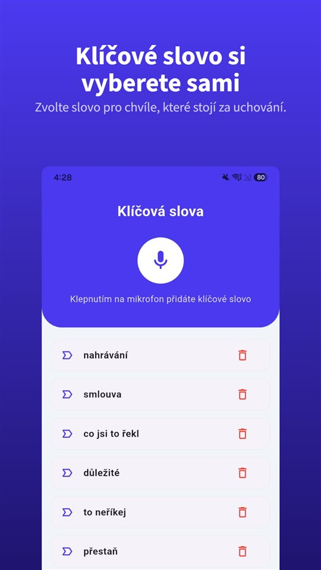

Zkušební jízda dopadne dobře.

„Nebourané, rozvody vyměněné, servisní knížka kompletní.“

Za tři týdny najde servis opravený předek. Ve smlouvě stojí: **kupující se seznámil s technickým stavem vozidla.**

Co řekne prodávající, rozhoduje o koupi. Co je na papíře, rozhoduje spor.

## Kdo prodává, na tom záleží

| Situace | Doba pro uplatnění vady | Domněnka „vada byla už při převzetí“ | Základ |
|---|---|---|---|
| Spotřebitel kupuje od autobazaru | 2 roky od převzetí; u ojetého auta lze ujednat zkrácení až na 1 rok | Ano, projeví-li se vada do 1 roku | § 2161 odst. 5, § 2165, § 2168 OZ |
| Kupující od soukromé osoby | Oznámit bez zbytečného odkladu; skrytou vadu nejpozději do 2 let po odevzdání | Ne | § 2112 OZ |
| Slovensko | Neověřeno | Neověřeno | — |

## Autobazar: dva roky, u ojetiny možná jeden

Kupuje-li spotřebitel od autobazaru, může vytknout vadu, která se projeví **v době dvou let od převzetí** (§ 2165). U použité věci mohou strany tuto dobu **zkrátit až na jeden rok** (§ 2168) — proto se vyplatí podívat, co v tomhle bodě stojí ve smlouvě.

Pomáhá i **domněnka**: projeví-li se vada **v průběhu jednoho roku** od převzetí, má se za to, že auto bylo vadné už při převzetí, ledaže to povaha věci nebo vady vylučuje (§ 2161 odst. 5). Prokazovat tedy musí spíš prodávající.

Má to ale hranici: **vadou není opotřebení**, které odpovídá míře předchozího používání použité věci (§ 2167 odst. 2). Opotřebená spojka u auta s 250 000 km sama o sobě vadou být nemusí.

## Soukromý prodejce: oznámit hned

Při koupi od soukromé osoby se domněnka neuplatní. Kupující musí vadu **oznámit bez zbytečného odkladu** poté, co ji mohl při včasné prohlídce a dostatečné péči zjistit. U **skryté vady** platí totéž, **nejpozději však do dvou let** po odevzdání auta (§ 2112 odst. 1). Jinak mu soud právo z vadného plnění nepřizná, pokud prodávající namítne, že vada nebyla oznámena včas.

Tuto námitku ale prodávající **nemá**, je-li vada důsledkem něčeho, **o čem v době odevzdání věděl nebo musel vědět** (§ 2112 odst. 2). Tady začíná být důležité, co prodávající **říkal**.

## Co zaznělo, není ve smlouvě

Všude stejný problém: **co není na papíře, je třeba prokázat.** „Nebourané“, „rozvody vyměněné“, „nová spojka“ zazní při zkušební jízdě, ne u podpisu.

**Nechte sliby zapsat do smlouvy.** Nejjednodušší: „nebourané podle prohlášení prodávajícího“ a stav tachometru.

**Uložte si inzerát.** Po prodeji zmizí. Snímek obrazovky s popisem je to, na co můžete později ukázat.

**Pošlete shrnutí ještě týž den.** „Jak jste říkal: nebourané, rozvody vyměněné při 120 000 km.“ Odpověď ve zprávě je důkaz.

**Nahrávat se souhlasem.** V Česku rozhoduje účel záznamu, na Slovensku je třeba svolení ([Je legální nahrávat rozhovor bez souhlasu? V Česku rozhoduje účel, na Slovensku svolení](/blog/cs/nahravani-rozhovoru/)). Otevřená otázka je v pořádku a souhlas, který je slyšet přímo na nahrávce, je jeho nejlepším důkazem.

K tomu se hodí [TalkSafe](https://hcompany-kr.github.io/talksafe/cs/). Je to aplikace pro nahrávání na Android a iPhone, která se spustí, když uslyší **předem zvolené slovo**, funguje při **zamčené obrazovce** a ukládá i **30 sekund před začátkem**. Když nastavíte slovo ze své otázky, například **„nahrát“**, nahrávání začne otázkou „Můžu si to nahrát, ať na nic nezapomenu?“ a odpověď je v souboru. Telefon může zůstat v kapse.

<figure class="shot"><figcaption>Nastavení klíčových slov. Můžete uložit několik slov; stačí, aby bylo rozpoznáno jedno z nich.</figcaption></figure>

Jak obstojí ústní domluva proti písemnému dokumentu, popisuje [Ústní smlouva platí. Jak ale dokázat, co se domluvilo, když v rozpočtu stojí něco jiného?](/blog/cs/ustni-smlouva/).

## Stručně

- Od autobazaru: dva roky na vytknutí vady, u ojetého auta lze ujednat zkrácení na rok; vada, která se projeví do roka, se považuje za existující při převzetí.
- Opotřebení odpovídající předchozímu používání vadou není.
- Od soukromé osoby: skrytou vadu oznámit bez zbytečného odkladu, nejpozději do dvou let; pokud prodávající o vadě věděl, námitku opožděného oznámení nemá.
- Co bylo jen řečeno, je třeba prokázat: zápis ve smlouvě, snímek inzerátu, shrnutí ve zprávě a nahrávka se souhlasem.

## Zdroje

- [Zákon č. 89/2012 Sb., občanský zákoník (Zákony pro lidi)](https://www.zakonyprolidi.cz/cs/2012-89)

Obecné informace, nikoli právní rada. V konkrétní věci se obraťte na advokáta nebo spotřebitelskou organizaci.

