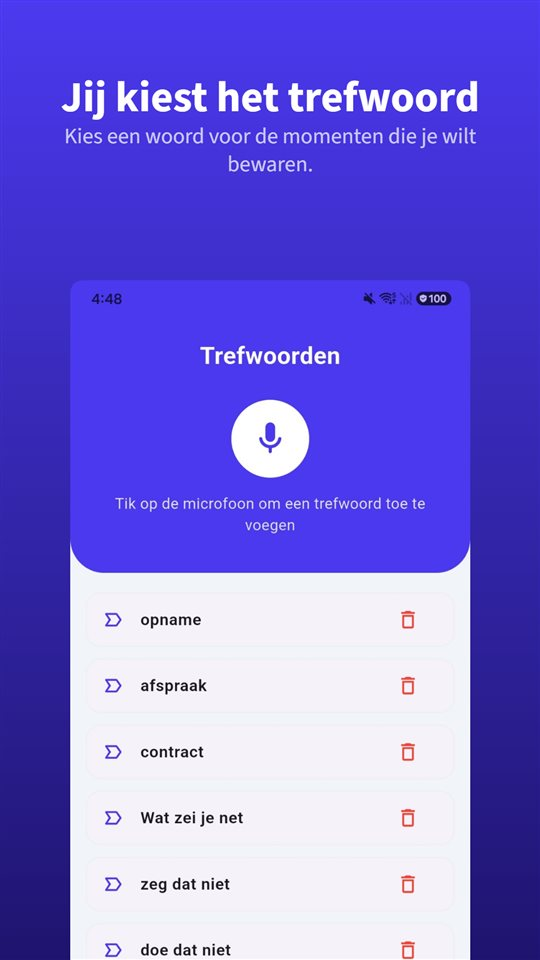

De proefrit gaat prima.

„Schadevrij, distributieriem net vervangen, dealeronderhouden.”

Drie weken later vindt de garage herstelde schade aan de voorkant. In het koopcontract staat: **verkocht zoals gezien.**

Wat de verkoper zegt, beslist over de koop. Wat er op papier staat, beslist over het geschil.

## Wie verkoopt, maakt verschil

| Land | Autobedrijf (consument koopt) | Particulier |
|---|---|---|
| Nederland | Non-conformiteit (art. 7:17 BW); gebrek binnen een jaar wordt vermoed er al te zijn (art. 7:18a lid 2 BW) | Geen bewijsvermoeden; onderzoeksplicht van de koper weegt zwaarder |
| België | Wettelijke garantie van twee jaar, voor occasions in te korten tot één jaar (art. 1649quater BW) | Vrijwaring voor verborgen gebreken |

Suriname, Aruba, Curaçao en Sint Maarten hebben we voor dit artikel niet onderzocht.

## Nederland: bij een autobedrijf ligt de bewijslast eerst bij de verkoper

Koop je als consument bij een autobedrijf, dan moet de auto **aan de overeenkomst beantwoorden** (art. 7:17 BW). Blijkt binnen **een jaar** na aflevering een gebrek, dan wordt vermoed dat de auto al bij aflevering niet in orde was (art. 7:18a lid 2 BW). De verkoper moet dan het tegendeel bewijzen, tenzij dat vermoeden niet past bij de aard van de auto of het gebrek.

Dat betekent niet dat elk mankement aan een oude auto voor rekening van de verkoper komt. Rechters houden rekening met **leeftijd en kilometerstand**: bij een oudere auto met veel kilometers neemt de kans op gebreken toe, en normale slijtage is moeilijker als non-conformiteit aan te merken.

## Nederland: bij een particulier ligt meer bij jou

Bij een particuliere verkoop geldt **geen bewijsvermoeden**. Je moet zelf aantonen dat het gebrek er bij de koop al was. Bovendien weegt je **onderzoeksplicht** zwaarder: een gebrek dat je bij een proefrit makkelijk had kunnen ontdekken, telt niet als verborgen.

Juist daarom is het belangrijk wat de verkoper **zei**. Wie op „schadevrij” vertrouwde, moet kunnen laten zien dat het gezegd is.

## België

Koop je als consument bij een professionele verkoper, dan geldt een wettelijke garantie van **twee jaar**, die voor een tweedehands goed contractueel tot **één jaar** kan worden ingekort (artikel 1649quater Burgerlijk Wetboek). Bij een particuliere verkoop blijft de vrijwaring voor verborgen gebreken.

## Wat gezegd is, staat niet in het contract

Overal hetzelfde: **wat niet op papier staat, moet je bewijzen.** „Schadevrij”, „distributieriem vervangen”, „koppeling nieuw” worden bij de proefrit gezegd, niet aan tafel.

**Laat toezeggingen opschrijven.** Het eenvoudigst: „schadevrij volgens verkoper” met de kilometerstand in het koopcontract.

**Bewaar de advertentie.** Die verdwijnt na de verkoop. Een schermafbeelding van de omschrijving is wat je later kunt laten zien.

**Stuur dezelfde dag een samenvatting.** „Zoals je zei: schadevrij, distributieriem vervangen bij 120.000 km.” Een antwoord per bericht is bewijs.

**Een opname is ook bewijs.** In Nederland en België mag je een gesprek waaraan je zelf deelneemt opnemen ([Mag je een gesprek stiekem opnemen? In Nederland en België wel, als je zelf meepraat](/blog/nl/gesprek-opnemen/)). Verspreiden is een andere zaak.

Daarvoor is [TalkSafe](https://hcompany-kr.github.io/talksafe/nl/) gemaakt. Het is een opname-app voor Android en iPhone die start zodra hij een **vooraf gekozen woord** hoort, werkt met een **vergrendeld scherm** en ook de **30 seconden vóór de start** bewaart. Trefwoorden worden herkend wie ze ook uitspreekt, dus je kunt woorden instellen die een verkoper vaak gebruikt — **„schadevrij”**, **„garantie”**, **„onderhouden”**. Je telefoon kan de hele proefrit in je zak blijven.

<figure class="shot"><figcaption>Trefwoordinstellingen. Je kunt meerdere woorden instellen; het is genoeg dat er één herkend wordt.</figcaption></figure>

Hoe een mondelinge afspraak staat tegenover een schriftelijk stuk, lees je in [Is een mondelinge afspraak geldig? Ja, maar wat als de offerte iets anders zegt?](/blog/nl/mondelinge-afspraak/).

## Kort gezegd

- Bij een autobedrijf geldt voor de consument een bewijsvermoeden van een jaar (Nederland) of een garantie van twee jaar, voor occasions in te korten tot een jaar (België).
- Bij een particulier is er geen bewijsvermoeden en weegt je onderzoeksplicht zwaarder.
- Leeftijd, kilometerstand en normale slijtage tellen mee.
- Wat alleen gezegd is, moet je bewijzen: laat het opschrijven, bewaar de advertentie, vat het dezelfde dag samen en neem het gesprek op waaraan je deelneemt.

## Bronnen

- [Wettelijke garantie bij het kopen van een auto (ANWB)](https://www.anwb.nl/auto/kopen/garantie/wettelijke-garantie)

Algemene informatie, geen juridisch advies. Raadpleeg voor een concreet geval een advocaat of het Juridisch Loket.

