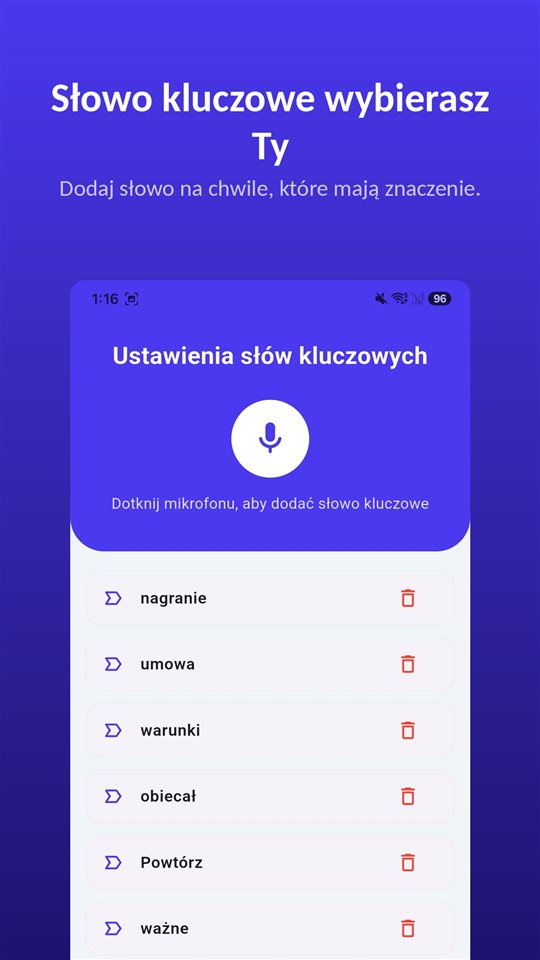

Jazda próbna wypada dobrze.

„Bezwypadkowy, rozrząd wymieniony, serwisowany w ASO.”

Trzy tygodnie później mechanik znajduje naprawiony przód. W umowie jedno zdanie: **kupujący zapoznał się ze stanem technicznym pojazdu.**

To, co mówi sprzedający, decyduje o zakupie. To, co jest na piśmie, decyduje o sporze.

## Kto sprzedaje, ma znaczenie

| Sytuacja | Odpowiedzialność | Wyłączenie | Termin |
|---|---|---|---|
| Polska, od osoby prywatnej | Rękojmia (art. 556 i nast. k.c.) | Możliwe (art. 558 § 1), ale bezskuteczne przy podstępnym zatajeniu wady (§ 2) | 2 lata; przy rzeczy używanej można skrócić do roku (art. 568 § 1) |
| Polska, konsument od przedsiębiorcy (komis, handlarz) | Odpowiedzialność sprzedawcy wobec konsumenta | Bezskuteczne | — |
| Niemcy, konsument od dealera | Rękojmia (§ 434 i nast. BGB) | Bezskuteczne (§ 476 BGB) | 2 lata; przy używanych do roku tylko po osobnym uprzedzeniu i odrębnej umowie; domniemanie, że wada istniała, przez rok (§ 477) |
| Holandia, konsument od dealera | Zgodność z umową (art. 7:17 BW) | — | Domniemanie, że wada istniała, jeśli ujawni się w ciągu roku (art. 7:18a BW) |

Wielka Brytania, Irlandia i pozostałe kraje nie są tu omówione.

## Od osoby prywatnej: rękojmia jest, ale można ją wyłączyć

Osoba prywatna sprzedająca auto odpowiada za wady na podstawie **rękojmi** z Kodeksu cywilnego (art. 556 i nast.). Strony mogą rękojmię **ograniczyć lub wyłączyć** (art. 558 § 1) — i w ogłoszeniach z drugiej ręki to częste.

Takie wyłączenie ma jednak granicę: jest **bezskuteczne, jeśli sprzedawca podstępnie zataił wadę** (art. 558 § 2). Trudność polega na tym, że kupujący musi wykazać, że wada istniała i że **sprzedawca o niej wiedział**.

Termin to co do zasady **dwa lata**; przy rzeczy używanej strony mogą go skrócić **do roku**, o czym sprzedawca musi wyraźnie poinformować (art. 568 § 1).

## Od komisu lub handlarza

Gdy konsument kupuje od przedsiębiorcy, odpowiedzialności sprzedawcy **nie da się skutecznie wyłączyć**. Klauzula „kupujący zapoznał się ze stanem technicznym” nie zdejmie z handlarza odpowiedzialności za to, czego przy oględzinach nie dało się zobaczyć.

## Co padło ustnie, nie ma w umowie

Wszędzie ten sam problem: **czego nie ma na piśmie, trzeba udowodnić.** „Bezwypadkowy”, „rozrząd wymieniony”, „sprzęgło nowe” padają przy jeździe próbnej, nie przy podpisie.

**Poproś o wpisanie zapewnień do umowy.** Najprościej: „bezwypadkowy według oświadczenia sprzedającego” w umowie, z przebiegiem.

**Zachowaj ogłoszenie.** Znika po sprzedaży. Zrzut ekranu opisu to coś, co można potem pokazać.

**Wyślij podsumowanie tego samego dnia.** „Tak jak Pan mówił: bezwypadkowy, rozrząd wymieniony przy 120 tys. km.” Odpowiedź w wiadomości to dowód.

**Nagranie też jest dowodem.** W Polsce uczestnik może co do zasady nagrać rozmowę, w której bierze udział ([Czy można nagrywać rozmowę bez zgody? W Polsce uczestnik może, rozpowszechnianie to inna sprawa](/blog/pl/nagrywanie-rozmowy/)). Jeśli kupujesz auto w Niemczech, nagranie bez zgody jest tam przestępstwem — wtedy zapytaj najpierw i nagraj odpowiedź.

[TalkSafe](https://hcompany-kr.github.io/talksafe/pl/) powstał do takich rozmów. To aplikacja do nagrywania na Androida i iPhone'a, która startuje, gdy usłyszy **wybrane wcześniej słowo**, działa przy **zablokowanym ekranie** i zapisuje też **30 sekund sprzed startu**. Słowa kluczowe są wykrywane niezależnie od tego, kto je wypowie, więc można ustawić słowa, których sprzedający zwykle używa — **„bezwypadkowy”**, **„gwarancja”**, **„serwisowany”**. Telefon może zostać w kieszeni przez całą jazdę próbną.

<figure class="shot"><figcaption>Ustawienia słów kluczowych. Można zapisać kilka słów; wystarczy, że zostanie wykryte jedno z nich.</figcaption></figure>

Jak ustne ustalenia mają się do dokumentu na piśmie, opisuje [Umowa ustna jest ważna. Ale jak udowodnić, co ustalono, gdy w kosztorysie stoi co innego?](/blog/pl/umowa-ustna/).

## W skrócie

- Od osoby prywatnej obowiązuje rękojmia, którą można wyłączyć — ale nie, gdy sprzedawca podstępnie zataił wadę.
- Konsument kupujący od przedsiębiorcy nie traci ochrony przez klauzulę w umowie.
- Termin to dwa lata, przy rzeczy używanej można go skrócić do roku.
- Co było tylko powiedziane, trzeba udowodnić: wpis w umowie, zrzut ogłoszenia, podsumowanie w wiadomości, nagranie rozmowy, w której uczestniczysz.

## Źródła

- [Rękojmia na samochód używany – czym jest i jak działa? (Otomoto)](https://www.otomoto.pl/news/rekojmia)

Informacje ogólne, nie porada prawna. W konkretnej sprawie skonsultuj się z prawnikiem lub rzecznikiem konsumentów.

