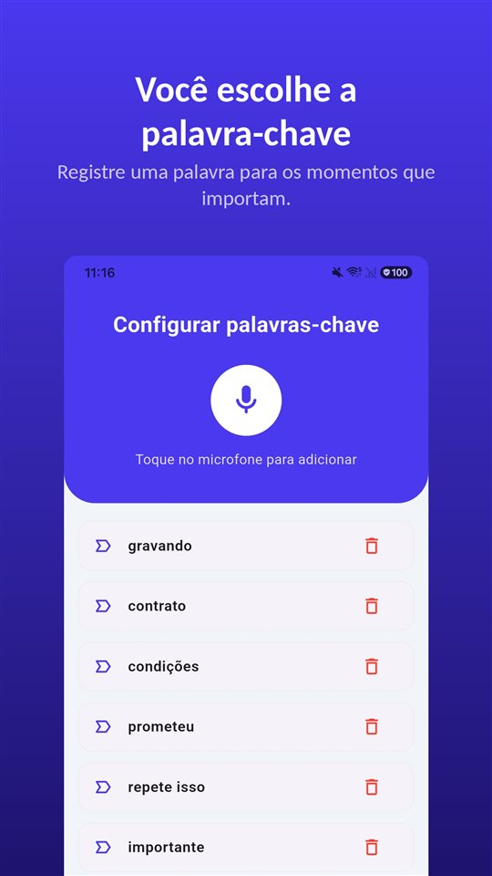

Não teve contrato. Escopo e preço foram combinados na primeira reunião, depois só mensagens sobre prazo. No fim, chega uma frase:

"Isso estava incluso no valor que a gente fechou."

E o pagamento não vem.

Sem contrato assinado, você ainda pode cobrar. O que decide é o que dá para mostrar por escrito sobre o que foi combinado.

## O que vale no Brasil e em Portugal

| País | Sem contrato escrito | Cobrança | Atraso entre empresas |
|---|---|---|---|
| Brasil | O serviço existe mesmo assim; o problema é a prova | Ação monitória com prova escrita: e-mail (STJ, REsp 1.381.603-MS) e WhatsApp aceitos; prova só oral não basta | Não pesquisado aqui |
| Portugal | — | Procedimento de injunção (não verificado aqui) | DL 62/2013: 40 € mínimos por custos de cobrança, sem interpelação; juros desde o dia seguinte ao vencimento |

Os outros países de língua portuguesa não foram pesquisados aqui.

## Brasil: sem contrato, mas com prova escrita

O contrato de prestação de serviço não precisa estar no papel para existir. O que falta, quando o cliente não paga, é a **prova** do que foi combinado.

A via mais usada é a **ação monitória**, que exige **prova escrita** sem força de título executivo. O **STJ** entende que o **e-mail** pode fundamentar a monitória, com a idoneidade avaliada no caso concreto (REsp 1.381.603-MS). Tribunais estaduais também têm aceitado **conversas de WhatsApp**, inclusive registradas em **ata notarial**, como prova escrita.

Mas há um limite claro: **não se admite prova exclusivamente oral ou testemunhal** para propor a monitória. O que só foi dito na reunião, sem nada escrito depois, não abre esse caminho.

## Portugal: 40 euros por cobrança

Entre empresas, **incluindo profissionais liberais**, o Decreto-Lei 62/2013 dá ao credor uma **indemnização mínima de 40 euros** pelos custos de cobrança, **sem necessidade de interpelação**, e pode-se provar custos maiores, como honorários de advogado. Os **juros de mora** contam a partir do dia seguinte ao vencimento. O regime não se aplica a consumidores.

## O que nenhuma regra resolve

Juros e indemnização ajudam quando se sabe **o que** é devido. A briga mais comum é outra: o que foi combinado, afinal?

- "Duas rodadas de ajuste estão incluídas."
- "Os textos a gente manda."
- "Se passar disso, cobramos por hora."

Essas frases são ditas na primeira reunião. Depois, só existem em duas memórias que raramente batem.

## Os cinco minutos que evitam tudo isso

**Mande um resumo no mesmo dia.** "Conforme combinado: site de cinco páginas, duas rodadas de ajuste, textos enviados por vocês, valor fechado de R$ 8.000, acima disso R$ 150 por hora." Uma resposta confirmando pode servir como a prova escrita que a monitória pede.

**Confirme cada pedido extra por escrito.** "Claro, isso está fora do escopo, cerca de três horas."

**A gravação também registra.** No Brasil, quem participa da conversa pode gravá-la ([Gravar conversa sem a outra pessoa saber é crime? No Brasil e em Portugal, a resposta é oposta](/blog/pt-br/gravar-conversa/)). Em Portugal, não sem consentimento; lá, pergunte antes e deixe a resposta gravada.

O [TalkSafe](https://hcompany-kr.github.io/talksafe/pt-br/) foi feito para esse tipo de conversa. É um app de gravação de voz para Android e iPhone que começa quando ouve uma **palavra escolhida por você**, funciona com a **tela bloqueada** e salva também os **30 segundos anteriores ao início**. As palavras-chave são detectadas seja quem for que as diga, então dá para escolher palavras que aparecem quando se fala de preço e escopo — **"valor"**, **"incluído"**, **"prazo"**. Depois, a gravação ajuda a escrever o resumo certo.

<figure class="shot"><figcaption>Configuração de palavras-chave. Dá para cadastrar várias; basta uma delas ser detectada para a gravação começar.</figcaption></figure>

Como um acordo verbal se sustenta diante de um documento escrito está em [Contrato verbal tem validade? Tem, mas e quando o orçamento diz outra coisa?](/blog/pt-br/contrato-verbal/).

## Resumindo

- No Brasil, sem contrato você ainda pode cobrar; a ação monitória aceita e-mail e WhatsApp como prova escrita, mas não prova só oral.
- Em Portugal, entre empresas e profissionais liberais, há 40 euros mínimos por custos de cobrança e juros desde o dia seguinte ao vencimento.
- Contra a briga sobre o escopo, só vale o que ficou registrado: resumo escrito no mesmo dia, extras confirmados, e a gravação da conversa da qual você participa onde for lícito.

## Fontes

- [Uso de prova escrita retirada do WhatsApp e e-mail na ação monitória (Conjur)](https://www.conjur.com.br/2023-fev-14/washington-reis-uso-prova-escrita-retirada-whatsappe-mail//?print=1)
- [Prazos legais para o pagamento de faturas (Caixa Geral de Depósitos)](https://www.cgd.pt/Site/Saldo-Positivo/negocios/Pages/conheca-prazos-legais-pagamento-faturas.aspx)

Informação geral, não é aconselhamento jurídico. Para um caso concreto, consulte um advogado.

