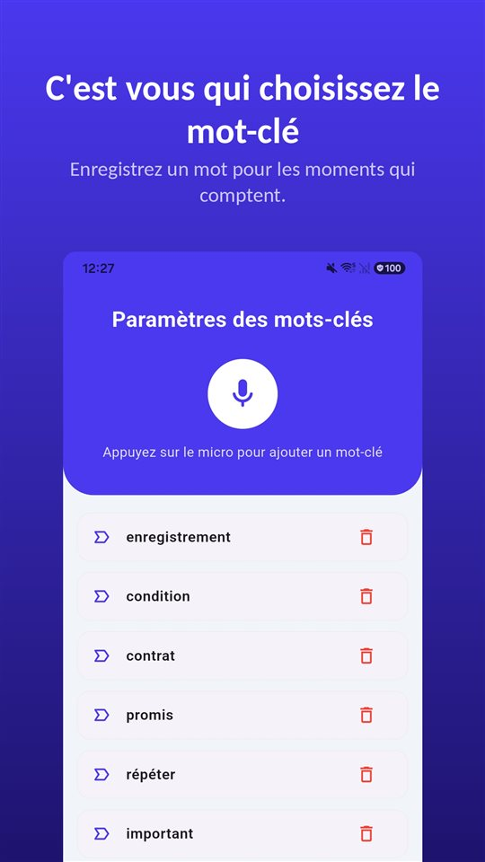

Il n'y avait pas de contrat. Le périmètre et le prix ont été discutés au premier rendez-vous, puis il n'y a plus eu que des messages sur les délais. À la fin, une phrase :

« C'était inclus dans le forfait. »

Et la facture attend.

La loi vous donne des pénalités et 40 € par facture sans que vous ayez à les demander. Ce qu'elle ne vous donne pas : la preuve de ce qui a été convenu au premier rendez-vous.

## Ce qui s'applique dans les pays francophones

| | France | Belgique | Suisse | Québec |
|---|---|---|---|---|
| Délai à défaut d'accord | 30 jours (L441-10 C. com.) | 30 jours | — | — |
| Délai maximal convenu | 60 jours après la facture (ou 45 jours fin de mois) | 60 jours (depuis 2021) | — | — |
| Intérêts / pénalités | De plein droit ; à défaut, taux BCE + 10 points | Intérêts de retard légaux | 5 % par an après mise en demeure (art. 102, 104 CO) | Pas de règle équivalente trouvée |
| Indemnité forfaitaire | 40 € par facture | 40 € minimum (directive 2011/7) | Aucune | — |

Luxembourg, Monaco et les pays francophones d'Afrique ne sont pas couverts ici. Nous avons laissé vides les cases que nous n'avons pas vérifiées.

## France : ce que la loi vous donne sans le demander

**Le délai.** À défaut de stipulation, le client a **trente jours** après la réception de la prestation pour payer. S'il y a un accord, il ne peut pas dépasser **soixante jours** après l'émission de la facture, ou **quarante-cinq jours fin de mois** si le contrat le prévoit (article L441-10 du Code de commerce).

**Les pénalités.** Elles sont exigibles **de plein droit** dès le lendemain de l'échéance. À défaut d'autre taux, c'est le taux de la **BCE majoré de 10 points**.

**Les 40 €.** S'y ajoute une **indemnité forfaitaire de 40 € pour frais de recouvrement**, **par facture impayée** et non par créance globale. Dix factures en retard, ce sont 400 € en plus des pénalités et du principal. Presque personne ne les réclame.

Si les relances restent sans effet, l'**injonction de payer** est la voie judiciaire simple pour une créance certaine.

## Belgique, Suisse, Québec

**Belgique.** La loi du 2 août 2002 sur les retards de paiement dans les transactions commerciales prévoit un délai de **30 jours** à défaut d'accord, et depuis 2021 le délai contractuel est **plafonné à 60 jours**. La directive européenne 2011/7, qu'elle transpose, impose une indemnité forfaitaire minimale de **40 €** pour frais de recouvrement.

**Suisse.** L'intérêt moratoire est de **5 % par an** (art. 104 CO). Mais le débiteur n'est en demeure qu'après une **interpellation** (une relance) ou à l'échéance d'un **jour fixé** (art. 102 CO) : une facture seule ne suffit pas. Il n'y a pas d'indemnité forfaitaire légale ; des frais de rappel seulement s'ils ont été convenus.

**Québec.** Nous n'avons pas trouvé de règle équivalente sur les délais de paiement entre entreprises. Les créances de faible montant relèvent de la Division des petites créances de la Cour du Québec.

## Ce qu'aucune règle ne règle

Pénalités et indemnité aident quand on sait **ce qui** est dû. Le litige le plus fréquent est ailleurs : qu'est-ce qui était convenu ?

- « Deux allers-retours de corrections, c'est compris. »
- « Les textes, on vous les fournit. »
- « Si ça dépasse, on passe au taux horaire. »

Ces phrases se disent au premier rendez-vous. Ensuite, elles n'existent plus que dans deux mémoires qui concordent rarement.

## Les cinq minutes qui évitent tout cela

**Résumer par écrit le jour même.** « Comme convenu : site de cinq pages, deux tours de corrections, textes fournis par le client, forfait 4 000 € HT, au-delà 90 €/h. » Une réponse qui confirme est une preuve solide.

**Confirmer chaque ajout.** Chaque demande en plus reçoit un message court : « Avec plaisir, c'est hors périmètre, environ trois heures. »

**N'enregistrer qu'avec accord.** En France, enregistrer à l'insu de l'autre est punissable ([Enregistrer une conversation à l'insu de quelqu'un : interdit en France, permis en Belgique et au Québec](/blog/fr/enregistrer-conversation/)). Demander franchement est permis, et un accord qui s'entend sur l'enregistrement lui-même en est la meilleure preuve.

C'est là que [TalkSafe](https://hcompany-kr.github.io/talksafe/fr/) est pratique. TalkSafe est une application d'enregistrement pour Android et iPhone qui démarre sur un **mot choisi à l'avance**, fonctionne **écran verrouillé** et conserve les **30 secondes précédant le démarrage**. En choisissant un mot de votre question, par exemple **« enregistrer »**, l'enregistrement commence avec « Je peux enregistrer pour ne rien noter de travers ? », et la réponse du client y figure.

<figure class="shot"><figcaption>Réglages des mots-clés. Vous pouvez en enregistrer plusieurs ; il suffit que l'un d'eux soit détecté pour que l'enregistrement démarre.</figcaption></figure>

Comment une promesse orale tient face à un document écrit : [Contrat verbal : il est valable, mais comment le prouver quand le devis dit autre chose ?](/blog/fr/contrat-verbal/).

## En bref

- En France, 30 jours à défaut d'accord, 60 jours au maximum ; pénalités de plein droit et 40 € par facture impayée.
- Belgique : 30 jours, 60 au maximum, 40 € minimum. Suisse : 5 % après mise en demeure, pas d'indemnité forfaitaire.
- Contre le litige sur le périmètre, seul compte ce qui a été fixé : résumé écrit le jour même, ajouts confirmés, et enregistrement seulement avec accord.

## Sources

- [Pénalités de retard sur facture (Abby)](https://abby.fr/guide/facturation/penalites-retard-facture)
- [Le législateur impose des délais de paiement plus stricts dans les relations B2B (Jubel)](https://www.jubel.be/fr/le-legislateur-impose-des-delais-de-paiement-plus-strictes-dans-les-relations-b2b/)

Information générale, pas un conseil juridique. Pour un cas précis, consultez un avocat ou votre organisation professionnelle.

