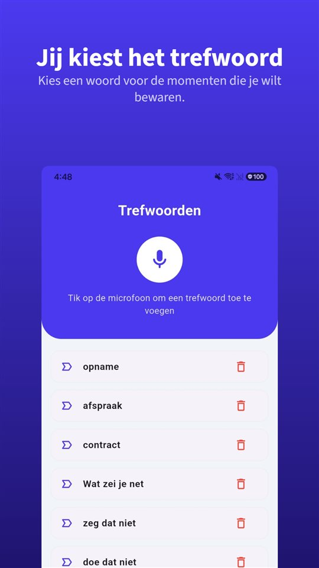

Een contract was er niet. Omvang en prijs zijn in het eerste gesprek besproken, daarna gingen er alleen nog berichten over planning heen en weer. Aan het eind komt één zin:

„Dat zat toch in de vaste prijs.”

En de factuur blijft liggen.

De wet geeft je rente en minstens € 40 zonder dat je erom hoeft te vragen. Wat de wet je niet geeft: bewijs van wat er in het eerste gesprek is afgesproken.

## Wat geldt in Nederland en België

| | Nederland | België |
|---|---|---|
| Termijn zonder afspraak | 30 dagen | 30 dagen |
| Maximale afgesproken termijn | 60 dagen (langer alleen zonder nadelen voor beide) | 60 dagen (sinds 2021) |
| Grootbedrijf betaalt mkb/zzp'er | Binnen 30 dagen | — |
| Rente | Wettelijke handelsrente (art. 6:119a BW), halfjaarlijks gewijzigd | Wettelijke intrest bij laattijdige betaling |
| Vaste vergoeding | € 40 standaardvergoeding; incassokosten minimaal € 40, maximaal € 6.775 | Minimaal € 40 (Europese richtlijn 2011/7) |

Suriname, Aruba, Curaçao en Sint Maarten hebben we voor dit artikel niet onderzocht.

## Wat je krijgt zonder te vragen

**De termijn.** Zonder afspraak moet een zakelijke klant **binnen 30 dagen** betalen. Afgesproken termijnen zijn in principe **maximaal 60 dagen**. En **grootbedrijven moeten het mkb en zelfstandige ondernemers binnen 30 dagen betalen** — voor een zzp'er met een grote opdrachtgever is dat de belangrijkste regel.

**De rente.** Tussen bedrijven geldt de **wettelijke handelsrente** (artikel 6:119a BW). Die gaat lopen zodra de betalingstermijn verstreken is; een aparte ingebrekestelling is daarvoor niet nodig. Het percentage wijzigt elk half jaar.

**De vergoeding.** Volgens de overheid heb je, als je hebt geleverd en je klant niet of te laat betaalt, recht op een **standaardvergoeding van € 40**, een vergoeding voor gemaakte kosten zoals incassokosten, en rente. De **incassokosten** zijn een percentage van het bedrag, met een **minimum van € 40** en een **maximum van € 6.775**; met een zakelijke klant kun je in een contract iets anders afspreken.

## België

De wet van 2 augustus 2002 over betalingsachterstand bij handelstransacties voorziet in een termijn van **30 dagen** zonder afspraak, en sinds 2021 is de contractuele termijn **beperkt tot 60 dagen**. De Europese richtlijn 2011/7, die ze omzet, schrijft een forfaitaire vergoeding van minstens **€ 40** voor invorderingskosten voor.

## Wat geen regel oplost

Rente en vergoeding helpen als vaststaat **wat** er verschuldigd is. Het vaker voorkomende geschil gaat over iets anders: wat was er eigenlijk afgesproken?

- „Twee correctierondes zitten erbij.”
- „De teksten leveren wij aan.”
- „Als het meer wordt, rekenen we per uur.”

Die zinnen vallen in het eerste gesprek. Daarna bestaan ze alleen nog in twee herinneringen, die zelden overeenkomen.

## De vijf minuten die dit voorkomen

**Stuur dezelfde dag een samenvatting.** „Zoals besproken: website van vijf pagina's, twee correctierondes, teksten van jullie, vaste prijs € 4.000 excl. btw, daarboven € 90 per uur.” Een bevestigend antwoord is sterk bewijs.

**Bevestig elk extra verzoek.** „Graag, dat valt buiten de opdracht, ongeveer drie uur.”

**Een opname legt het vast.** In Nederland en België mag je een gesprek waaraan je zelf deelneemt opnemen ([Mag je een gesprek stiekem opnemen? In Nederland en België wel, als je zelf meepraat](/blog/nl/gesprek-opnemen/)). Verspreiden is een andere zaak.

Daarvoor is [TalkSafe](https://hcompany-kr.github.io/talksafe/nl/) gemaakt. Het is een opname-app voor Android en iPhone die start zodra hij een **vooraf gekozen woord** hoort, werkt met een **vergrendeld scherm** en ook de **30 seconden vóór de start** bewaart. Trefwoorden worden herkend wie ze ook uitspreekt, dus je kunt woorden instellen die vallen als het over prijs en omvang gaat — **„offerte”**, **„inbegrepen”**, **„deadline”**. Met de opname schrijf je daarna ook de juiste samenvatting.

<figure class="shot"><figcaption>Trefwoordinstellingen. Je kunt meerdere woorden instellen; het is genoeg dat er één herkend wordt.</figcaption></figure>

Hoe een mondelinge afspraak staat tegenover een schriftelijk stuk, lees je in [Is een mondelinge afspraak geldig? Ja, maar wat als de offerte iets anders zegt?](/blog/nl/mondelinge-afspraak/).

## Kort gezegd

- Zonder afspraak 30 dagen, afgesproken maximaal 60; grootbedrijven betalen zzp'ers binnen 30 dagen.
- Na de termijn loopt de wettelijke handelsrente, en heb je recht op minimaal € 40.
- België: 30 dagen, maximaal 60, minimaal € 40.
- Tegen het geschil over de omvang helpt alleen wat is vastgelegd: samenvatting dezelfde dag, extra's bevestigd, en de opname van een gesprek waaraan je deelneemt.

## Bronnen

- [Betalingstermijn, incassokosten en wettelijke rente (Ondernemersplein, overheid)](https://ondernemersplein.overheid.nl/wetten-en-regels/betalingstermijn-incassokosten-en-wettelijke-rente/)

Algemene informatie, geen juridisch advies. Raadpleeg voor een concreet geval een advocaat of het Juridisch Loket.

