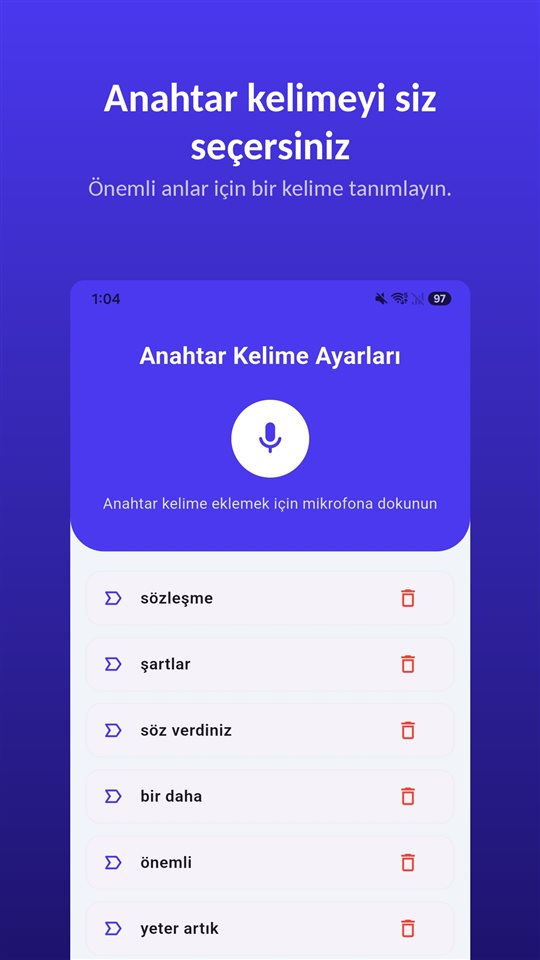

Sözleşme yoktu. Kapsam ve fiyat ilk görüşmede konuşuldu, sonra sadece tarihlerle ilgili mesajlaşıldı. İş bitince tek bir cümle geliyor:

"O, anlaştığımız fiyata dahildi."

Ve fatura bekliyor.

Kanun size, istemenize gerek kalmadan faiz ve bir tahsil giderimi verir. Vermediği şey: ilk görüşmede neyin kararlaştırıldığının kanıtı.

## Türkiye'de ne geçerli

| Konu | Kural | Dayanak |
|---|---|---|
| Sözleşmede süre yoksa | Fatura alındıktan 30 gün sonra temerrüt | TTK md. 1530 |
| Sözleşmede süre varsa | Sürenin sonunda ihtarsız temerrüt ve faiz | TTK md. 1530 |
| Azami ödeme süresi | Kural olarak 60 gün | TTK md. 1530 |
| 2026 temerrüt faizi | Yıllık %43 (sözleşmede faiz yoksa) | TCMB, TTK 1530/7 |
| 2026 asgari giderim | 2.020 TL | TCMB, TTK 1530/7 |
| Görüşmeyi rıza olmadan kaydetmek | Suç | TCK md. 133/2 |

Avrupa'da çalışan Türkçe konuşanlar için geçerli olan, bulundukları ülkenin kanunudur; bu yazıda yalnızca Türkiye ele alındı.

## Kanunun size kendiliğinden verdiği şeyler

**Temerrüt.** Mal ve hizmet tedarikinde sözleşmede ödeme süresi yoksa müşteri, faturayı aldıktan **30 gün sonra** temerrüde düşer. Sözleşmede süre varsa, **ihtara gerek kalmadan** o sürenin sonunda temerrüde düşer ve sözleşmede yazmasa bile faiz işler (TTK md. 1530).

**Süre sınırı.** Sözleşmede ödeme süresi kararlaştırılabilir, ama kural olarak **60 günü aşamaz**.

**Faiz ve giderim.** Sözleşmede temerrüt faizi yoksa TCMB'nin her yıl belirlediği oran uygulanır: **2026 için yıllık %43**. Ayrıca alacağın tahsili masrafları için **asgari 2.020 TL giderim** istenebilir.

**Kime uygulanır?** Bu kurallar ticari işlerde mal ve hizmet tedarikine ilişkindir. Ticari işletme olarak çalışıyorsanız uygulanır; serbest meslek kazancı elde eden birinin bu kapsama girip girmediği somut duruma göre değişebilir ve bunu bu yazı için kesinleştiremedik.

Hatırlatmalar sonuçsuz kalırsa, alacak için icra takibi başlatılabilir.

## Hiçbir kuralın çözmediği şey

Faiz ve giderim, **neyin** borçlu olunduğu belli olduğunda işe yarar. Daha sık yaşanan anlaşmazlık başka: aslında ne kararlaştırılmıştı?

- "İki revizyon fiyata dahil."
- "Metinleri biz göndereceğiz."
- "İş büyürse saat ücretine geçeriz."

Bu cümleler ilk görüşmede söylenir. Sonra sadece iki ayrı hafızada kalır ve bu hafızalar nadiren aynıdır.

## Bunu önleyen beş dakika

**Aynı gün yazılı özet gönderin.** "Konuştuğumuz gibi: beş sayfalık site, iki revizyon, metinler sizden, sabit fiyat 120.000 TL + KDV, fazlası saatlik 3.000 TL." Onaylayan bir cevap güçlü bir kanıttır.

**Her ek talebi yazılı teyit edin.** "Memnuniyetle, bu kapsam dışında, yaklaşık üç saat."

**Kaydedecekseniz: önce sorun.** Türkiye'de katıldığınız bir konuşmayı rıza olmadan kaydetmek suçtur ([Gizli ses kaydı almak suç mu? Türkiye'de kendi konuşmanızı kaydetmek de suç](/blog/tr/ses-kaydi-suc-mu/)). Açıkça sormak serbesttir ve kaydın içinde duyulan bir onay, onayın en iyi kanıtıdır.

Bunun için [TalkSafe](https://hcompany-kr.github.io/talksafe/tr/) işe yarar. TalkSafe, **önceden belirlediğiniz bir kelimeyi** duyduğunda başlayan, **ekran kilitliyken** çalışan ve **başlangıçtan önceki 30 saniyeyi** de saklayan, Android ve iPhone için bir ses kayıt uygulamasıdır. Sorunuzdaki bir kelimeyi, örneğin **"kayıt"** kelimesini anahtar kelime yaparsanız, "Yanlış not almamak için bu görüşmeyi kayıt altına alabilir miyim?" diye sorduğunuzda kayıt başlar ve müşterinin cevabı da dosyada olur.

<figure class="shot"><figcaption>Anahtar kelime ayarları. Birden fazla kelime kaydedebilirsiniz; herhangi birinin algılanması kaydı başlatır.</figcaption></figure>

Sözlü bir anlaşmanın yazılı bir belgeyle çeliştiği durumlar [Sözlü sözleşme geçerli mi? Geçerli, ama yazılı teklifle çelişince ne olur?](/blog/tr/sozlu-sozlesme/) yazısında.

## Özet

- Mal ve hizmet tedarikinde sözleşmede süre yoksa müşteri faturadan 30 gün sonra temerrüde düşer; süre varsa ihtarsız.
- Ödeme süresi kural olarak 60 günü aşamaz; 2026 için faiz %43, asgari giderim 2.020 TL.
- Kapsam anlaşmazlığına karşı tek çare kayıt altına alınmış olandır: aynı gün yazılı özet, ek taleplerin yazılı teyidi, ve kayıt yalnızca rızayla.

## Kaynaklar

- [Ticari sözleşmede ödeme gecikirse hangi faiz talep edilebilir? 2026 güncel rehber (FFK Partner Hukuk)](https://www.ffkpartnerhukuk.com.tr/ticari-sozlesmede-odeme-gecikirse-hangi-faiz-talep-edilebilir-2026-guncel-rehber/)
- [6102 sayılı Türk Ticaret Kanunu (Mevzuat Bilgi Sistemi)](https://www.mevzuat.gov.tr/mevzuat?MevzuatNo=6102&MevzuatTur=1&MevzuatTertip=5)

Genel bilgidir, hukuki danışmanlık değildir. Somut bir durum için bir avukata veya meslek odanıza danışın.

