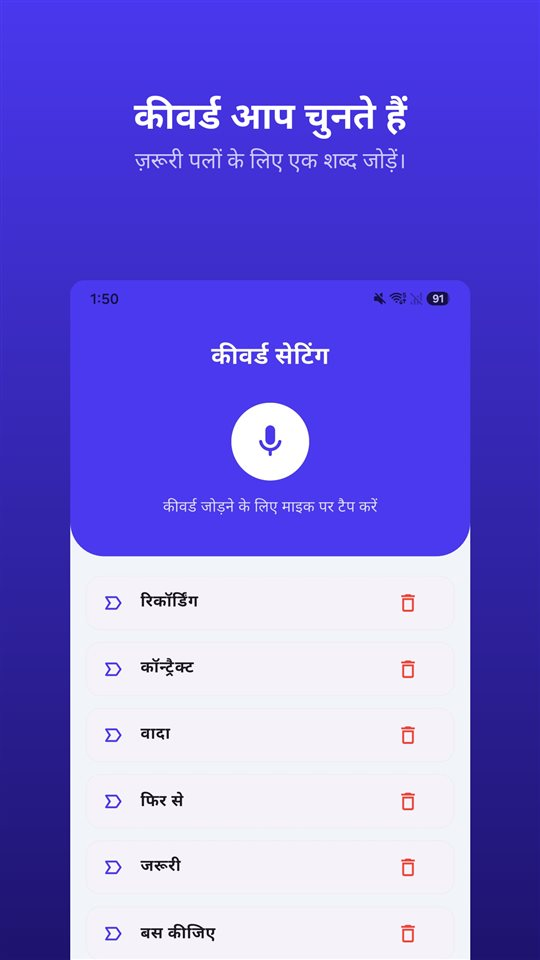

कोई लिखित अनुबंध नहीं था। काम का दायरा और रेट पहली मीटिंग में तय हुआ, फिर बस डेडलाइन पर मैसेज चलते रहे। आख़िर में एक वाक्य आता है:

„वो तो तय रेट में ही शामिल था।”

और पेमेंट रुका रहता है।

क़ानून आपको, माँगे बिना, 45 दिन की सीमा और भारी ब्याज देता है। जो नहीं देता: पहली मीटिंग में क्या तय हुआ, इसका सबूत।

## भारत में क्या स्थिति है

| सवाल | नियम | आधार |
|---|---|---|
| भुगतान की समय-सीमा | लिखित रूप में तय तारीख़; हर हाल में स्वीकृति से 45 दिन के भीतर | MSMED एक्ट 2006, धारा 15 |
| देरी पर ब्याज | RBI बैंक दर का तीन गुना, मासिक चक्रवृद्धि | धारा 16 |
| विवाद कहाँ जाए | सूक्ष्म और लघु उद्यम फ़ैसिलिटेशन काउंसिल, MSME समाधान पोर्टल से | धारा 18 |
| किसे मिलता है | सूक्ष्म और लघु उद्यम सप्लायर (आम तौर पर Udyam पंजीकरण) | — |
| जिस बातचीत में आप शामिल हैं, उसकी रिकॉर्डिंग | इंटरसेप्शन नहीं | सुप्रीम कोर्ट, आर. एम. मलकानी (1973) |

भारत के अलावा जिन देशों में हिंदी बोली जाती है, वे यहाँ शामिल नहीं हैं।

## माँगे बिना क़ानून क्या देता है

**45 दिन की सीमा।** आप सूक्ष्म या लघु उद्यम के रूप में सप्लायर हैं, तो ख़रीदार को लिखित में तय तारीख़ पर भुगतान करना है — और वह अवधि किसी भी हाल में काम की **स्वीकृति (या मानी गई स्वीकृति) से 45 दिन** से ज़्यादा नहीं हो सकती (धारा 15)।

**ब्याज।** देरी होने पर ख़रीदार को **RBI बैंक दर के तीन गुना** पर, **मासिक चक्रवृद्धि** ब्याज देना होता है (धारा 16)। अनुबंध में कुछ भी लिखा हो, यह ब्याज ख़त्म नहीं किया जा सकता।

**शिकायत।** बकाया रक़म का विवाद **सूक्ष्म और लघु उद्यम फ़ैसिलिटेशन काउंसिल** के पास भेजा जा सकता है (धारा 18)। आवेदन **MSME समाधान** पोर्टल पर ऑनलाइन होता है।

**किसे मिलता है।** यह सुरक्षा सूक्ष्म और लघु उद्यम सप्लायर के लिए है, इसलिए आम तौर पर **Udyam पंजीकरण** ज़रूरी माना जाता है। फ़्रीलांस काम शुरू करते समय पंजीकरण करा लेना और इनवॉइस पर Udyam नंबर लिखना काम आता है।

## कौन-सी बात कोई क़ानून हल नहीं करता

ब्याज और काउंसिल तब काम आते हैं जब साफ़ हो कि **क्या** बकाया है। ज़्यादा आम झगड़ा कुछ और होता है: असल में तय क्या हुआ था?

- „दो बार बदलाव रेट में शामिल हैं।”
- „कंटेंट हम भेज देंगे।”
- „काम बढ़ा तो घंटे के हिसाब से लेंगे।”

ये वाक्य पहली मीटिंग में बोले जाते हैं। फिर बस दो यादों में रह जाते हैं, जो शायद ही कभी मेल खाती हैं।

## पाँच मिनट जो यह सब रोकते हैं

**उसी दिन ईमेल में सार भेजें।** „जैसा तय हुआ: पाँच पेज की वेबसाइट, दो बार बदलाव, कंटेंट आपकी तरफ़ से, फ़िक्स रेट ₹80,000 + GST, उसके बाद ₹1,500 प्रति घंटा।” पुष्टि वाला जवाब मज़बूत सबूत है।

**हर अतिरिक्त माँग लिखित में मानें।** „ज़रूर, यह दायरे से बाहर है, लगभग तीन घंटे।”

**रिकॉर्डिंग भी रिकॉर्ड है।** भारत में जिस बातचीत में आप शामिल हैं, उसकी रिकॉर्डिंग को सुप्रीम कोर्ट ने इंटरसेप्शन नहीं माना है ([भारत में बातचीत रिकॉर्ड करना: रिकॉर्डिंग आसान हिस्सा है, प्रमाणपत्र नहीं](/blog/hi/recording-law-india/))। सबूत के रूप में इस्तेमाल करना हो, तो मूल फ़ाइल बिना बदले रखें; धारा 63 का प्रमाणपत्र उसी पर टिकता है।

इसी के लिए [TalkSafe](https://hcompany-kr.github.io/talksafe/hi/) बना है। यह Android और iPhone के लिए एक वॉइस रिकॉर्डर ऐप है, जो **पहले से चुना हुआ शब्द** सुनते ही शुरू होता है, **स्क्रीन लॉक** रहने पर भी काम करता है, और **शुरुआत से पहले के 30 सेकंड** भी सेव करता है। कीवर्ड कोई भी बोले, पहचाना जाता है, इसलिए क़ीमत और दायरे की बात में आने वाले शब्द — **„रेट”**, **„शामिल”**, **„डेडलाइन”** — सेट किए जा सकते हैं। रिकॉर्डिंग से बाद में सही सार लिखना भी आसान होता है।

<figure class="shot"><figcaption>कीवर्ड सेटिंग। आप कई कीवर्ड सेव कर सकते हैं; उनमें से कोई एक पहचाना जाते ही रिकॉर्डिंग शुरू हो जाती है।</figcaption></figure>

मौखिक समझौता लिखित दस्तावेज़ के सामने कैसे टिकता है, यह [मौखिक समझौता मान्य है? हाँ, लेकिन जब लिखित कोटेशन में कुछ और लिखा हो तब?](/blog/hi/verbal-contract/) में है।

## संक्षेप में

- सूक्ष्म या लघु उद्यम सप्लायर को स्वीकृति से 45 दिन के भीतर भुगतान का अधिकार है (MSMED एक्ट, धारा 15)।
- देरी पर बैंक दर के तीन गुना पर मासिक चक्रवृद्धि ब्याज (धारा 16), और विवाद MSME समाधान के ज़रिए फ़ैसिलिटेशन काउंसिल में (धारा 18)।
- आम तौर पर Udyam पंजीकरण ज़रूरी माना जाता है।
- दायरे के झगड़े के ख़िलाफ़ वही काम आता है जो दर्ज है: उसी दिन ईमेल, अतिरिक्त काम की लिखित पुष्टि, और उस बातचीत की रिकॉर्डिंग जिसमें आप शामिल हैं।

## स्रोत

- [MSME Samadhaan: delayed payment recovery (iPleaders)](https://blog.ipleaders.in/msme-samadhaan-delayed-payment-recovery/)
- [Legal framework for MSMEs (Office of the DC-MSME)](https://www.dcmsme.gov.in/publications/LegalFramework.pdf)

यह सामान्य जानकारी है, क़ानूनी सलाह नहीं। अपने मामले के लिए किसी वकील या चार्टर्ड अकाउंटेंट से सलाह लें।

