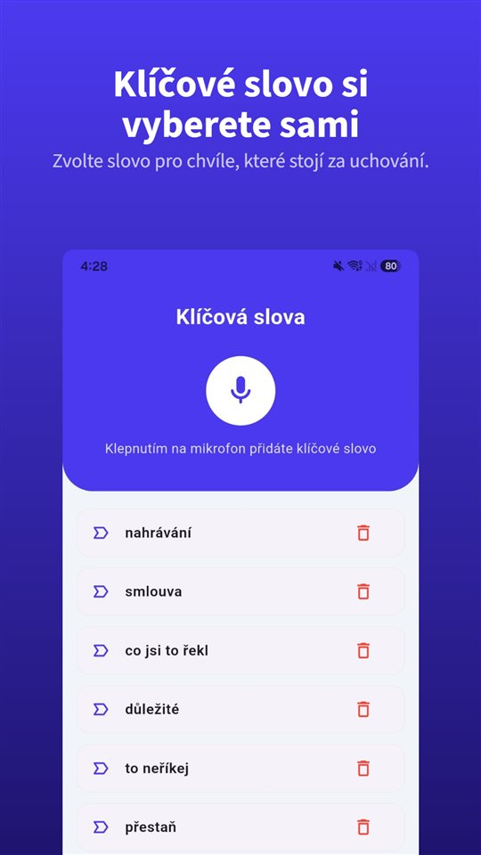

Smlouva nebyla. Rozsah a cena se probraly na první schůzce, potom už jen zprávy o termínech. Na konci přijde jedna věta:

„To přece bylo v ceně.“

A faktura čeká.

Zákon vám dá úrok a 1 200 Kč, aniž byste o ně museli žádat. Nedá vám ale důkaz o tom, co se domluvilo na první schůzce.

## Co platí v Česku

| Otázka | Pravidlo | Základ |
|---|---|---|
| Splatnost mezi podnikateli | Do 30 dnů od doručení faktury | § 1963 odst. 1 OZ |
| Splatnost delší než 60 dnů | Jen za podmínek zákona | § 1963 odst. 2 OZ |
| Úrok z prodlení | Repo sazba ČNB + 8 procentních bodů | NV č. 351/2013 Sb. |
| Paušální náhrada nákladů | Minimálně 1 200 Kč, vedle úroku | NV č. 351/2013 Sb. |
| Promlčení | Tři roky | § 629 OZ |

Pravidla na Slovensku jsme pro tento článek neověřili.

## Co dostanete, aniž byste žádali

**Splatnost.** Dodává-li podnikatel podnikateli službu nebo zboží za úplatu, je cena splatná **do třiceti dnů** od doručení faktury (§ 1963 odst. 1). Delší splatnost než **šedesát dnů** lze ujednat jen za podmínek, které zákon stanoví.

**Úrok.** Po splatnosti běží **úrok z prodlení**: repo sazba ČNB platná pro první den pololetí, v němž prodlení vzniklo, **zvýšená o 8 procentních bodů** (nařízení vlády č. 351/2013 Sb.).

**Paušál.** K tomu máte nárok na **minimální náhradu nákladů spojených s uplatněním pohledávky 1 200 Kč**, a to už z důvodu prodlení, vedle úroku. Málokdo ji uplatňuje.

**Promlčení.** Obecná promlčecí lhůta je **tři roky** (§ 629 OZ).

Když upomínky nepomáhají, přichází na řadu předžalobní výzva a potom žaloba, případně návrh na vydání platebního rozkazu.

## Co žádné pravidlo neřeší

Úrok a paušál pomáhají, když je jasné, **co** je dlužné. Častější spor je jiný: co se vlastně domluvilo?

- „Dvě kola úprav jsou v ceně.“
- „Texty dodáme my.“
- „Kdyby toho bylo víc, budeme účtovat hodinově.“

Tyhle věty zazní na první schůzce. Pak existují už jen ve dvou vzpomínkách, které se málokdy shodují.

## Pět minut, které tomu předejdou

**Pošlete shrnutí ještě týž den.** „Jak jsme se domluvili: web o pěti stránkách, dvě kola úprav, texty od vás, pevná cena 100 000 Kč bez DPH, nad rámec 2 000 Kč/hod.“ Potvrzující odpověď je silný důkaz.

**Každý požadavek navíc potvrďte.** „Rád, to je mimo rozsah, zhruba tři hodiny.“

**Nahrávat se souhlasem.** V Česku rozhoduje účel záznamu, na Slovensku je třeba svolení ([Je legální nahrávat rozhovor bez souhlasu? V Česku rozhoduje účel, na Slovensku svolení](/blog/cs/nahravani-rozhovoru/)). Otevřená otázka je v pořádku a souhlas, který je slyšet přímo na nahrávce, je jeho nejlepším důkazem.

K tomu se hodí [TalkSafe](https://hcompany-kr.github.io/talksafe/cs/). Je to aplikace pro nahrávání na Android a iPhone, která se spustí, když uslyší **předem zvolené slovo**, funguje při **zamčené obrazovce** a ukládá i **30 sekund před začátkem**. Když nastavíte slovo ze své otázky, například **„nahrát“**, nahrávání začne otázkou „Můžu si to nahrát, ať si nic nezapíšu špatně?“ a odpověď klienta je v souboru.

<figure class="shot"><figcaption>Nastavení klíčových slov. Můžete uložit několik slov; stačí, aby bylo rozpoznáno jedno z nich.</figcaption></figure>

Jak obstojí ústní domluva proti písemnému dokumentu, popisuje [Ústní smlouva platí. Jak ale dokázat, co se domluvilo, když v rozpočtu stojí něco jiného?](/blog/cs/ustni-smlouva/).

## Stručně

- Mezi podnikateli je cena splatná do 30 dnů od doručení faktury; delší splatnost než 60 dnů jen za podmínek zákona.
- Po splatnosti běží úrok z prodlení (repo + 8 p. b.) a náleží paušální náhrada nejméně 1 200 Kč.
- Promlčecí lhůta je tři roky.
- Proti sporu o rozsah pomůže jen to, co je zaznamenané: shrnutí týž den, potvrzené požadavky navíc a nahrávka se souhlasem.

## Zdroje

- [Zákon č. 89/2012 Sb., občanský zákoník (Zákony pro lidi)](https://www.zakonyprolidi.cz/cs/2012-89)
- [Nařízení vlády č. 351/2013 Sb. (Zákony pro lidi)](https://www.zakonyprolidi.cz/cs/2013-351)

Obecné informace, nikoli právní rada. V konkrétní věci se obraťte na advokáta.

