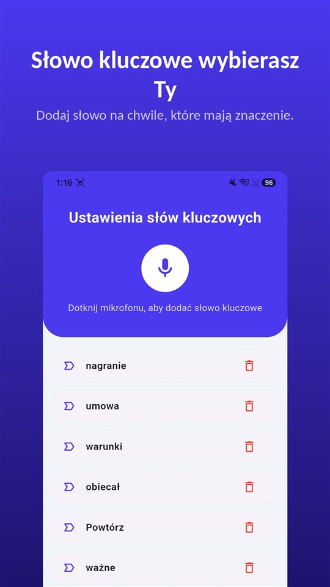

Umowy nie było. Zakres i cenę ustalono na pierwszym spotkaniu, potem były już tylko wiadomości o terminach. Na koniec pada jedno zdanie:

„To było w cenie.”

A faktura czeka.

Ustawa daje Ci odsetki i rekompensatę bez żadnego wezwania. Nie daje Ci jednak dowodu na to, co ustalono na pierwszym spotkaniu.

## Co obowiązuje w Polsce

| Wartość świadczenia | Rekompensata (art. 10 ustawy) |
|---|---|
| Do 5000 zł | 40 euro |
| Powyżej 5000 zł i poniżej 50 000 zł | 70 euro |
| Od 50 000 zł | 100 euro |

Rekompensata przysługuje **bez wezwania**, od dnia nabycia uprawnienia do **odsetek ustawowych za opóźnienie w transakcjach handlowych**. Roszczenia o nią nie można zbyć. Przed 1 stycznia 2020 r. wynosiła 40 euro bez względu na kwotę.

## Co dostajesz bez proszenia

**Transakcja handlowa.** Przepisy dotyczą umów między przedsiębiorcami (i z podmiotami publicznymi), których przedmiotem jest odpłatne świadczenie usług lub dostarczanie towaru. Freelancer na działalności, który wystawia fakturę firmie, jest dokładnie w tym schemacie.

**Odsetki.** Gdy klient nie płaci w terminie, należą się **odsetki ustawowe za opóźnienie w transakcjach handlowych**.

**Rekompensata.** Do tego **40, 70 albo 100 euro** jako rekompensata za koszty odzyskiwania należności, w zależności od kwoty. Nie trzeba jej wcześniej zapowiadać ani wzywać do zapłaty. Mało kto jej żąda.

Jeśli przypomnienia nic nie dają, drogą sądową jest pozew o zapłatę z wnioskiem o nakaz zapłaty.

## Czego żaden przepis nie rozstrzyga

Odsetki i rekompensata pomagają, gdy wiadomo, **co** jest należne. Częstszy spór jest inny: co właściwie ustalono?

- „Dwie rundy poprawek są w cenie.”
- „Teksty dostarczymy my.”
- „Jak będzie więcej, rozliczymy godzinowo.”

Te zdania padają na pierwszym spotkaniu. Potem istnieją tylko w dwóch pamięciach, które rzadko się zgadzają.

## Pięć minut, które temu zapobiegają

**Wyślij podsumowanie tego samego dnia.** „Zgodnie z ustaleniami: strona na pięć podstron, dwie rundy poprawek, teksty po Waszej stronie, cena ryczałtowa 16 000 zł netto, powyżej 150 zł/h.” Odpowiedź potwierdzająca to mocny dowód.

**Potwierdzaj każdą dodatkową prośbę.** „Jasne, to poza zakresem, około trzech godzin.”

**Nagranie też jest zapisem.** W Polsce uczestnik może co do zasady nagrać rozmowę, w której bierze udział ([Czy można nagrywać rozmowę bez zgody? W Polsce uczestnik może, rozpowszechnianie to inna sprawa](/blog/pl/nagrywanie-rozmowy/)). Jeśli klient jest w Niemczech, nagranie bez zgody jest tam przestępstwem — wtedy zapytaj najpierw i nagraj odpowiedź.

[TalkSafe](https://hcompany-kr.github.io/talksafe/pl/) powstał do takich rozmów. To aplikacja do nagrywania na Androida i iPhone'a, która startuje, gdy usłyszy **wybrane wcześniej słowo**, działa przy **zablokowanym ekranie** i zapisuje też **30 sekund sprzed startu**. Słowa kluczowe są wykrywane niezależnie od tego, kto je wypowie, więc można ustawić słowa, które padają, gdy mowa o cenie i zakresie — **„wycena”**, **„w cenie”**, **„termin”**. Z nagrania łatwiej potem napisać dokładne podsumowanie.

<figure class="shot"><figcaption>Ustawienia słów kluczowych. Można zapisać kilka słów; wystarczy, że zostanie wykryte jedno z nich.</figcaption></figure>

Jak ustne ustalenia mają się do dokumentu na piśmie, opisuje [Umowa ustna jest ważna. Ale jak udowodnić, co ustalono, gdy w kosztorysie stoi co innego?](/blog/pl/umowa-ustna/).

## W skrócie

- W transakcji handlowej opóźnienie w zapłacie daje odsetki i rekompensatę 40, 70 lub 100 euro, bez wezwania.
- Kwota rekompensaty zależy od wartości świadczenia: do 5000 zł, do 50 000 zł i od 50 000 zł.
- Przeciw sporowi o zakres pomaga tylko to, co zapisane: podsumowanie tego samego dnia, potwierdzone dodatki i nagranie rozmowy, w której uczestniczysz.

## Źródła

- [Rekompensata dla wierzyciela za koszty odzyskania należności (Poradnik Przedsiębiorcy)](https://poradnikprzedsiebiorcy.pl/-rekompensata-dla-wierzyciela-za-koszty-odzyskania-naleznosci)
- [Interpelacja nr 8242 (Sejm RP)](https://api.sejm.gov.pl/sejm/term10/interpellations/8242/body)

Informacje ogólne, nie porada prawna. W konkretnej sprawie skonsultuj się z prawnikiem.

