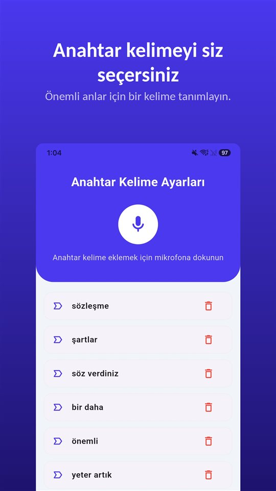

Mutfak masasında her şey kolay görünür.

"Araba sende kalsın, krediyi ben öderim." "Evin taksitlerini sen ödersen nafaka istemem." İkisi de başını sallar.

Birkaç hafta sonra protokol taslağı geldiğinde herkes biraz farklı bir cümle hatırlar.

Anlaşmalı boşanmada kimsenin kusur ispatlaması gerekmez. Ama nafaka, ev ve çocuklar hakkında konuşulanlar, ancak protokole yazılmışsa geçerlidir.

## Türkiye'de anlaşmalı boşanma kısaca

| Konu | Kural | Dayanak |
|---|---|---|
| Evlilik süresi | En az bir yıl | TMK 166/3 |
| Başvuru | Eşler birlikte başvurur ya da biri diğerinin davasını kabul eder | TMK 166/3 |
| Duruşma | Hâkim eşleri bizzat dinler | TMK 166/3 |
| Protokol | Mali sonuçlar ve çocukların durumu; hâkim uygun bulmalı | TMK 166/3 |
| Değişiklik | Hâkim gerekli gördüğü değişiklikleri yapabilir; taraflar kabul ederse boşanma | TMK 166/3 |

Kuzey Kıbrıs Türk Cumhuriyeti'nin kurallarını bu yazı için incelemedik.

## Şartlar: bir yıl, birlikte başvuru, bizzat dinlenme

Türk Medeni Kanunu'nun 166. maddesinin 3. fıkrasına göre evlilik **en az bir yıl** sürmüşse ve eşler **birlikte başvurursa** ya da bir eş diğerinin davasını **kabul ederse**, evlilik birliği temelinden sarsılmış sayılır. Kimsenin kusur ispatlaması gerekmez.

İki şart daha var. Hâkim **tarafları bizzat dinler** ve iradelerini serbestçe açıkladıklarına kanaat getirir; avukatın beyanı bunun yerine geçmez. Ve hâkim, boşanmanın mali sonuçları ile çocukların durumu hakkındaki düzenlemeyi **uygun bulmalıdır**.

Evlilik bir yıldan kısa sürdüyse bu yol kullanılamaz; boşanma ancak genel hükümlere göre açılan bir davayla mümkündür.

## Protokol: ne yazılırsa o geçerli

Anlaşmalı boşanma protokolü genellikle şunları düzenler:

- **Nafaka**: eşlerden birine yoksulluk nafakası verilip verilmeyeceği,
- **Tazminat**: maddi ve manevi tazminat talep edilip edilmediği,
- **Mal paylaşımı**: ev, araba, birikimler ve borçlar,
- **Çocuklar**: velayet, kişisel ilişki (görüşme günleri, tatiller) ve iştirak nafakası.

Hâkim, tarafların ve çocukların menfaatini göz önünde tutarak düzenlemede **gerekli gördüğü değişiklikleri yapabilir**; taraflar bunları kabul ederse boşanmaya karar verilir. Eşlerden biri duruşmada anlaşmadan dönerse dava anlaşmalı boşanma olarak sonuçlanmaz.

Protokolde yazmayan bir söz, mahkeme kararının da parçası olmaz.

## Her yerde aynı olan: önceki cümleler

Protokol bir konuşmanın sonucudur ve o konuşmada şu tür cümleler kurulur:

- "Araba sende kalsın, krediyi ben öderim."
- "Evin taksitlerini sen ödersen nafaka istemem."
- "Çocuklar iki haftada bir hafta sonu bende, bayramları paylaşırız."
- "Annenlerin taktığı altınlar sende kalsın."
- "Eşyaları yarı yarıya bölelim."

Her biri protokole girerse geçerlidir, girmezse değildir. Avukatın masasında başka bir cümle hatırlayan taraf, pazarlığa baştan başlar.

## Aynı gün yazmak

**Her görüşmeden sonra kısa bir mesaj.** "Konuştuğumuz gibi: araba sende, araç kredisini ben ödüyorum; yoksulluk nafakası yok; ev…" Onaylayan bir cevap, avukatın protokol taslağı için en iyi kaynaktır.

**Yalnızca onayla kaydetmek.** Türkiye'de katıldığınız bir konuşmayı karşı tarafın rızası olmadan kaydetmek suçtur ([Gizli ses kaydı almak suç mu? Türkiye'de kendi konuşmanızı kaydetmek de suç](/blog/tr/ses-kaydi-suc-mu/)). Açıkça sormak serbesttir ve kaydın içinde duyulan onay, bunun en iyi kanıtıdır.

## Telefona uzanmadan konuşmayı saklamak

Bunun için [TalkSafe](https://hcompany-kr.github.io/talksafe/tr/) işe yarar. TalkSafe, **önceden belirlediğiniz bir kelimeyi** duyduğunda başlayan, **ekran kilitliyken** çalışan ve **başlangıçtan önceki 30 saniyeyi** de saklayan, Android ve iPhone için bir ses kayıt uygulamasıdır. Sorunuzdaki bir kelimeyi, örneğin **"kayıt"** kelimesini anahtar kelime yaparsanız, "Sonra ikimiz de aynı şeyi yazalım diye bu konuşmayı kayda alabilir miyim?" diye sorduğunuzda kayıt başlar ve cevap da dosyada olur. Konuşmanın ortasında kimsenin telefonunun kilidini açması gerekmez.

<figure class="shot"><figcaption>Anahtar kelime ayarları. Birden fazla kelime kaydedebilirsiniz; herhangi birinin algılanması kaydı başlatır.</figcaption></figure>

Kayıt kimseyi bağlamaz. Akşam atılan mesajın ve protokol taslağının gerçekten söylenenleri içermesini sağlar. Bir kayıtla sonra ne yapılır, ne yapılmaz: [Bir kayıtla ne yapmalı, ne yapmamalı](/blog/tr/after-recording/).

## Özetle

- Anlaşmalı boşanma için evlilik en az bir yıl sürmüş olmalı, eşler birlikte başvurmalı ya da biri diğerinin davasını kabul etmeli.
- Hâkim eşleri bizzat dinler ve mali sonuçlar ile çocuklara ilişkin protokolü uygun bulmalıdır; gerekli gördüğü değişiklikleri yapabilir.
- Konuşulanları aynı gün yazıya dökün; kaydı yalnızca karşı tarafın onayıyla ve onayı da kayda alarak yapın.

## Kaynaklar

- [Anlaşmalı boşanmada hâkimin tarafları bizzat dinlemesi (Hukukçular Evi)](https://hukukcularevi.com/anlasmali-bosanmada-hakimin-taraflari-bizzat-dinlemesi-zorunlu-mu/)
- [Anlaşmalı boşanma kurumu ve Yargıtay uygulaması (Hukuki Haber)](https://www.hukukihaber.net/anlasmali-bosanma-kurumu-ve-yargitay-uygulamasi)

Genel bilgidir, hukuki danışmanlık değildir. Somut bir durum için bir aile hukuku avukatına danışın.

