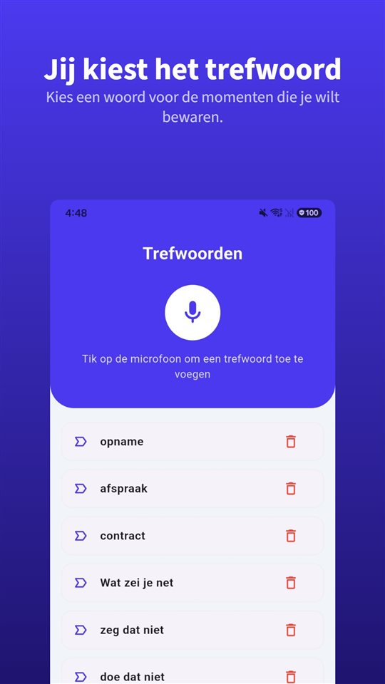

Aan de keukentafel lijkt het makkelijk.

„Jij houdt de auto, ik neem de lening over.” „Ik hoef geen alimentatie als jij de hypotheek blijft betalen.” Allebei knikken.

Een paar weken later ligt het concept-convenant op tafel, en ieder herinnert zich een net iets andere zin.

Scheiden op gemeenschappelijk verzoek gaat zonder ruzie over schuld. Maar wat er over alimentatie, het huis en de kinderen is gezegd, telt pas als het in het convenant of het ouderschapsplan staat.

## Nederland en België

| | Nederland | België |
|---|---|---|
| Procedure | Gemeenschappelijk verzoek bij de rechtbank | Echtscheiding door onderlinge toestemming bij de familierechtbank (art. 1287 e.v. Ger.W.) |
| Advocaat | Verplicht; één advocaat voor beiden kan | — |
| Afspraken | Echtscheidingsconvenant | Voorafgaande overeenkomsten over goederen en kinderen |
| Kinderen | Ouderschapsplan verplicht bij gezamenlijk gezag (art. 815 Rv) | Regeling voor verblijf, contact en kosten in de overeenkomsten |

Voor Suriname, Aruba, Curaçao, Sint Maarten en Caribisch Nederland hebben we de regels voor dit artikel niet kunnen nagaan. Lege cellen hebben we niet geverifieerd.

## Nederland: convenant en ouderschapsplan

Echtgenoten die het eens zijn, dienen een **gemeenschappelijk verzoek** tot echtscheiding in. Dat moet via een **advocaat**; bij een gezamenlijk verzoek kunnen ze er samen één nemen.

**Het convenant.** In het **echtscheidingsconvenant** leggen ze de gevolgen vast: partneralimentatie, de woning, de verdeling van bezittingen en schulden, het pensioen. De rechter kan het convenant in de **echtscheidingsbeschikking** laten opnemen.

**Het ouderschapsplan.** Hebben de echtgenoten samen het **gezag over minderjarige kinderen**, dan moet het verzoek een **ouderschapsplan** bevatten (artikel 815 lid 2 Rv): de verdeling van zorg en opvoeding, de kinderalimentatie en hoe de ouders elkaar informeren. Ontbreekt het, dan kan de rechter het verzoek **niet-ontvankelijk** verklaren, tenzij het redelijkerwijs niet kan worden overgelegd.

Wat niet in het convenant of het ouderschapsplan staat, is geen afspraak die de rechter vastlegt.

## België: voorafgaande overeenkomsten

Bij **echtscheiding door onderlinge toestemming** leggen de echtgenoten vooraf schriftelijk vast hoe hun **goederen** worden verdeeld en wat er met de **kinderen** gebeurt: verblijf, contact en bijdrage in de kosten (artikelen 1287 en volgende van het Gerechtelijk Wetboek). Die overeenkomsten gaan met het verzoekschrift naar de **familierechtbank**.

## Wat overal hetzelfde is: de zinnen vooraf

Convenant, ouderschapsplan of voorafgaande overeenkomst – alles begint met een gesprek, en daarin vallen zinnen als deze:

- „Jij houdt de auto, ik neem de lening over.”
- „Ik hoef geen alimentatie als jij de hypotheek blijft betalen.”
- „De kinderen zijn om het andere weekend bij mij, de vakanties delen we.”
- „Wat jouw ouders ons gegeven hebben, blijft van jou.”
- „Het pensioen laten we zoals het is.”

Elke zin telt als hij in het convenant staat, en telt niet als hij er niet in staat. Wie zich bij de advocaat een andere formulering herinnert, begint opnieuw te onderhandelen.

## Dezelfde dag opschrijven

**Een kort bericht na elk gesprek.** „Zoals besproken: de auto blijft bij jou, ik neem de autolening over; geen partneralimentatie; het huis…” Een bevestigend antwoord is de beste basis voor het concept-convenant.

**Opnemen mag als je zelf meepraat.** In Nederland en België mag een deelnemer een gesprek opnemen ([Mag je een gesprek stiekem opnemen? In Nederland en België wel, als je zelf meepraat](/blog/nl/gesprek-opnemen/)). Verspreiden is iets anders.

## Het gesprek bewaren zonder naar je telefoon te grijpen

Daarvoor is [TalkSafe](https://hcompany-kr.github.io/talksafe/nl/) gemaakt. Het is een opname-app voor Android en iPhone die start zodra hij een **vooraf gekozen woord** hoort, werkt met een **vergrendeld scherm** en ook de **30 seconden vóór de start** bewaart. Trefwoorden worden herkend wie ze ook uitspreekt, dus je kunt woorden instellen die in zulke gesprekken altijd vallen — **„alimentatie”**, **„huis”**, **„pensioen”**. Niemand hoeft midden in het gesprek zijn telefoon te ontgrendelen.

<figure class="shot"><figcaption>Trefwoordinstellingen. Je kunt meerdere woorden instellen; het is genoeg dat er één herkend wordt.</figcaption></figure>

De opname bindt niemand. Ze zorgt ervoor dat het bericht van die avond en het concept-convenant bevatten wat er echt is gezegd. Wat je daarna met een opname doet, en wat niet: [Wat je met een opname doet, en wat je er niet mee doet](/blog/nl/after-recording/).

## Kort gezegd

- Nederland: gemeenschappelijk verzoek via een advocaat, afspraken in een echtscheidingsconvenant, en bij gezamenlijk gezag over minderjarige kinderen een verplicht ouderschapsplan.
- België: echtscheiding door onderlinge toestemming met voorafgaande overeenkomsten over goederen en kinderen.
- Overal: wat aan de keukentafel is gezegd, dezelfde dag op schrift zetten.

## Bronnen

- [Echtscheiding met kinderen (Rechtspraak.nl)](https://www.rechtspraak.nl/Onderwerpen/Echtscheiding/Paginas/echtscheiding-met-kinderen.aspx)
- [Veelgestelde vragen echtscheiding (Rechtspraak.nl)](https://www.rechtspraak.nl/onderwerpen/echtscheiding/veelgestelde-vragen)

Algemene informatie, geen juridisch advies. Raadpleeg voor een concreet geval een advocaat of het Juridisch Loket.

