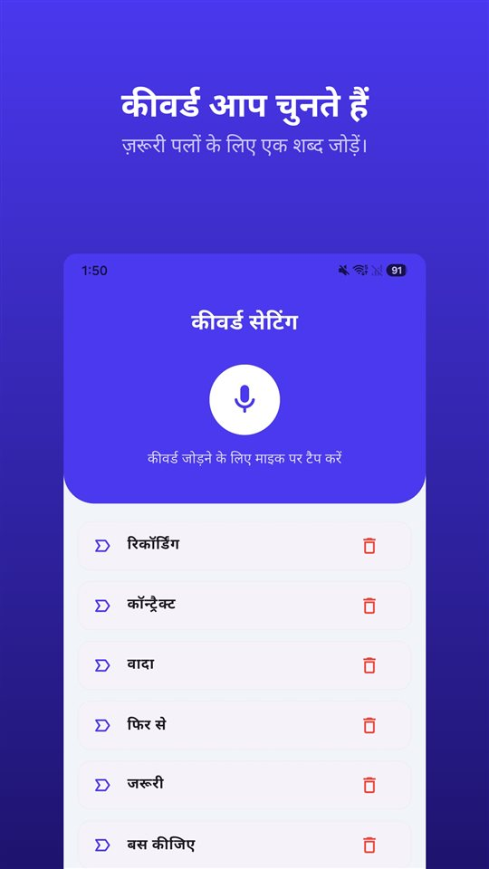

घर की बैठक में सब आसान लगता है।

„गाड़ी तुम रखो, लोन मैं भरूँगा।” „अगर फ़्लैट की EMI तुम भरते रहो तो मुझे मेंटेनेंस नहीं चाहिए।” दोनों हामी भरते हैं।

कुछ हफ़्ते बाद, वकील के बनाए ड्राफ़्ट पर, हर किसी को थोड़ा अलग वाक्य याद आता है।

आपसी सहमति से तलाक में किसी को दूसरे पर आरोप साबित नहीं करना पड़ता। लेकिन एलिमनी, घर और बच्चों के बारे में जो कहा गया, वह तभी गिना जाता है जब सेटलमेंट की शर्तों में लिखा हो।

## भारत में म्यूचुअल डिवोर्स एक नज़र में

| सवाल | नियम | आधार |
|---|---|---|
| कब अर्ज़ी दे सकते हैं | एक साल या उससे ज़्यादा अलग रहने के बाद, साथ मिलकर | HMA धारा 13B(1), SMA धारा 28(1) |
| दूसरी अर्ज़ी | पहली अर्ज़ी के 6 से 18 महीने के बीच | HMA धारा 13B(2), SMA धारा 28(2) |
| छह महीने की छूट | उचित मामले में अदालत माफ़ कर सकती है | अमरदीप सिंह (2017) |
| सुप्रीम कोर्ट | अनुच्छेद 142 के तहत भी | शिल्पा शैलेश (2023) |
| शर्तें | एलिमनी, स्त्रीधन, कस्टडी, मुकदमों की वापसी | अर्ज़ी या दर्ज समझौता |

मुस्लिम और ईसाई विवाह के तलाक के नियम अलग हैं; इस लेख में उन्हें शामिल नहीं किया गया। भारत के बाहर के हिंदी भाषी देशों के नियम भी हमने नहीं जाँचे।

## धारा 13B: दो अर्ज़ियाँ, बीच में छह महीने

**पहली अर्ज़ी।** हिंदू विवाह अधिनियम, 1955 की **धारा 13B** के तहत पति-पत्नी **साथ मिलकर** ज़िला अदालत (जहाँ है वहाँ फ़ैमिली कोर्ट) में अर्ज़ी देते हैं, अगर वे **एक साल या उससे ज़्यादा** समय से अलग रह रहे हैं, साथ नहीं रह पाए हैं और आपस में तय कर चुके हैं कि विवाह खत्म होना चाहिए। अंतरधार्मिक या कोर्ट मैरिज जैसे **विशेष विवाह अधिनियम, 1954** के विवाहों के लिए **धारा 28** में यही व्यवस्था है।

**दूसरी अर्ज़ी।** पहली अर्ज़ी के **कम से कम छह महीने बाद और अठारह महीने के भीतर** दोनों पक्ष दूसरी अर्ज़ी देते हैं। अगर इस बीच अर्ज़ी वापस नहीं ली गई, तो अदालत पक्षों को सुनकर **तलाक की डिक्री** देती है।

**छूट।** **अमरदीप सिंह बनाम हरवीन कौर (2017)** में सुप्रीम कोर्ट ने कहा कि छह महीने की अवधि **निर्देशात्मक** है और उचित मामले में माफ़ हो सकती है — जैसे जब मध्यस्थता विफल हो चुकी हो और **एलिमनी और कस्टडी समेत सभी मुद्दे सुलझ चुके हों**। **शिल्पा शैलेश बनाम वरुण श्रीनिवासन (2023)** में संविधान पीठ ने कहा कि सुप्रीम कोर्ट **अनुच्छेद 142** के तहत भी यह अवधि माफ़ कर सकता है।

यानी छूट का रास्ता भी इस पर टिका है कि शर्तें पूरी तरह तय हों।

## सेटलमेंट की शर्तें: जो लिखा है, वही लागू होता है

म्यूचुअल डिवोर्स के सेटलमेंट में आम तौर पर ये बातें होती हैं:

- **स्थायी एलिमनी**: रकम, एकमुश्त या किस्तों में, और कब तक,
- **स्त्रीधन** और दूसरे सामान की वापसी,
- **बच्चों की कस्टडी**, मिलने के दिन और छुट्टियों का बँटवारा,
- एक-दूसरे के ख़िलाफ़ चल रहे **मुकदमों की वापसी**।

ये शर्तें अर्ज़ी में या अदालत में दर्ज समझौते में लिखी जाती हैं। जो बात उनमें नहीं है, उस पर बाद में अमल कराना मुश्किल होता है।

## हर जगह एक जैसा: पहले के वाक्य

वकील का ड्राफ़्ट या अदालत का समझौता — सब किसी बातचीत से शुरू होता है, और उसमें ऐसे वाक्य बोले जाते हैं:

- „गाड़ी तुम रखो, लोन मैं भरूँगा।”
- „अगर फ़्लैट की EMI तुम भरते रहो तो मुझे मेंटेनेंस नहीं चाहिए।”
- „बच्चे हर दूसरे वीकेंड मेरे पास, छुट्टियाँ आधी-आधी।”
- „शादी में मायके से मिले गहने तुम्हारे पास रहेंगे।”
- „फ़र्नीचर आधा-आधा।”

हर वाक्य तभी गिना जाता है जब वह शर्तों में लिखा हो। वकील के पास अलग शब्द याद करने वाला पक्ष फिर से मोलभाव शुरू करता है।

## उसी दिन लिखना

**हर बातचीत के बाद एक छोटा मैसेज।** „जैसा तय हुआ: गाड़ी तुम्हारे पास, कार लोन मैं भरूँगा; आपस में मेंटेनेंस नहीं; फ़्लैट…” उसका पुष्टि वाला जवाब वकील के ड्राफ़्ट के लिए सबसे अच्छा आधार है।

**अपनी बातचीत रिकॉर्ड करना** इंटरसेप्शन नहीं माना गया है (मलकानी 1973), और विभोर गर्ग (2025) में सुप्रीम कोर्ट ने पति-पत्नी की गुप्त रिकॉर्डिंग को वैवाहिक मामलों में सबूत माना ([भारत में बातचीत रिकॉर्ड करना: रिकॉर्डिंग आसान हिस्सा है, प्रमाणपत्र नहीं](/blog/hi/recording-law-india/))। अदालत में पेश करने के लिए धारा 63 BSA का प्रमाणपत्र चाहिए।

## फ़ोन उठाए बिना बातचीत सँभालना

इसी के लिए [TalkSafe](https://hcompany-kr.github.io/talksafe/hi/) बना है। यह Android और iPhone के लिए एक वॉइस रिकॉर्डर ऐप है, जो **पहले से चुना हुआ शब्द** सुनते ही शुरू होता है, **स्क्रीन लॉक** रहने पर भी काम करता है, और **शुरुआत से पहले के 30 सेकंड** भी सेव करता है। कीवर्ड कोई भी बोले, पहचाना जाता है, इसलिए ऐसी बातचीत में आने वाले शब्द — **„एलिमनी”**, **„कस्टडी”**, **„स्त्रीधन”** — सेट किए जा सकते हैं। बातचीत के बीच किसी को फ़ोन अनलॉक नहीं करना पड़ता।

<figure class="shot"><figcaption>कीवर्ड सेटिंग। आप कई कीवर्ड सेव कर सकते हैं; उनमें से कोई एक पहचाना जाते ही रिकॉर्डिंग शुरू हो जाती है।</figcaption></figure>

रिकॉर्डिंग किसी को बाँधती नहीं। वह इसलिए है कि शाम का मैसेज और वकील का ड्राफ़्ट वही कहें जो सचमुच कहा गया। रिकॉर्डिंग के बाद क्या करें और क्या न करें: [रिकॉर्डिंग के बाद क्या करें, और क्या न करें](/blog/hi/after-recording/)।

## संक्षेप में

- धारा 13B (HMA) और धारा 28 (SMA): एक साल अलग रहने के बाद संयुक्त अर्ज़ी, फिर 6 से 18 महीने के बीच दूसरी अर्ज़ी।
- छह महीने की अवधि उचित मामले में माफ़ हो सकती है, ख़ासकर जब सभी शर्तें तय हों (अमरदीप सिंह 2017, शिल्पा शैलेश 2023)।
- एलिमनी, स्त्रीधन, कस्टडी और मुकदमों की वापसी शर्तों में लिखें; जो बातचीत में तय हुआ, उसे उसी दिन लिखकर भेजें।

## स्रोत

- [Mutual consent divorce under the Hindu Marriage Act (Casemine)](https://www.casemine.com/in/column/the-jurisprudence-of-mutual-consent-divorce:-an-analysis-of-section-13-b-of-the-hindu-marriage-act,-1955/view)
- [Shilpa Sailesh v. Varun Sreenivasan, 2023 (LiveLaw, PDF)](https://www.livelaw.in/pdf_upload/375-shilpa-sailesh-v-varun-sreenivasan-1-may-2023-471593.pdf)

यह सामान्य जानकारी है, क़ानूनी सलाह नहीं। अपने मामले के लिए किसी फ़ैमिली लॉ वकील से सलाह लें।

