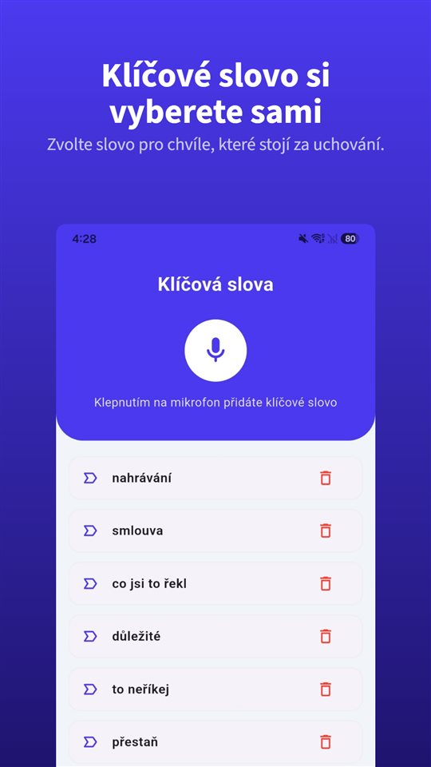

U kuchyňského stolu to vypadá jednoduše.

„Auto si nech, já budu splácet úvěr.“ „Výživné nechci, když budeš dál splácet byt.“ Oba přikývnou.

O pár týdnů později u notáře si každý pamatuje trochu jinou větu.

Smluvený rozvod je od roku 2026 ještě jednodušší. Co se ale řeklo o majetku, bydlení a dětech, platí až tehdy, když to stojí v dohodě s ověřenými podpisy a v dohodě schválené soudem.

## Smluvený rozvod v kostce

| Otázka | Pravidlo | Základ |
|---|---|---|
| Trvání manželství | Nejméně jeden rok | § 757 OZ |
| Rozvrat | Shodné tvrzení obou; nezjišťuje se | § 757 OZ |
| Děti | Dohoda o úpravě poměrů dítěte, kterou schválí soud | § 757 OZ |
| Majetek a bydlení | Písemná dohoda s ověřenými podpisy | § 757 OZ |
| Oddělené soužití 6 měsíců | Od 1. 1. 2026 zrušeno | zákon č. 268/2025 Sb. |
| Návrh | Nově i společný návrh obou manželů | zákon č. 268/2025 Sb. |

## Co se od roku 2026 změnilo

Zákon č. 268/2025 Sb., účinný od **1. ledna 2026**, pojmenoval dosavadní nesporný rozvod **smluveným rozvodem manželství** (§ 757 OZ). Hlavní věcná změna: **odpadla podmínka odděleného soužití delšího než šest měsíců**. Nově mohou manželé podat i **společný návrh**, místo aby jeden návrh podal a druhý se připojil.

Rozvrat se u smluveného rozvodu **nezjišťuje**: při splnění podmínek se vychází z nevyvratitelné domněnky. V praxi to usnadňuje i upuštění od výslechu manželů.

## Dvě dohody, bez kterých to nejde

**Děti.** Manželé uzavřou **dohodu o úpravě poměrů dítěte** – péče, styk, výživné – a soud ji **schválí**.

**Majetek a bydlení.** Druhá dohoda upravuje **majetkové poměry a bydlení po rozvodu** a musí být **písemná s ověřenými podpisy**. Podle Nejvyššího soudu (22 Cdo 2529/2019) je majetková dohoda uzavřená pro účely smluveného rozvodu vázána na to, že soud manželství podle § 757 skutečně rozvede.

Co v dohodách není, není součástí rozvodu.

## Slovensko

Na Slovensku manželství rozvádí **soud**, jestliže jsou vztahy mezi manželi tak vážně narušené, že manželství nemůže plnit svůj účel (§ 23 zákona o rodině). Spolu s rozvodem soud upraví výkon rodičovských práv k nezletilým dětem. Obdobu českého smluveného rozvodu jsme ve slovenském právu nenašli.

## Co je všude stejné: věty předtím

Notář, soud, dohoda – všechno začíná rozhovorem, a v něm padají takové věty:

- „Auto si nech, já budu splácet úvěr.“
- „Výživné nechci, když budeš dál splácet byt.“
- „Děti budou u mě každý druhý víkend, prázdniny si rozdělíme.“
- „Co nám dali tvoji rodiče, zůstane tobě.“
- „Nábytek napůl.“

Každá platí, když je v dohodě, a neplatí, když v ní není. Kdo si u notáře pamatuje jiné znění, začíná vyjednávat znovu.

## Zapsat ještě týž den

**Krátká zpráva po každém rozhovoru.** „Jak jsme se domluvili: auto zůstává tobě, já splácím úvěr na auto; výživné mezi námi žádné; byt…“ Potvrzující odpověď je nejlepší podklad pro text dohody.

**Nahrávat se souhlasem.** V Česku rozhoduje účel záznamu, na Slovensku je třeba svolení ([Je legální nahrávat rozhovor bez souhlasu? V Česku rozhoduje účel, na Slovensku svolení](/blog/cs/nahravani-rozhovoru/)). Otevřená otázka je v pořádku a souhlas, který je slyšet přímo na nahrávce, je jeho nejlepším důkazem.

## Uchovat rozhovor, aniž byste sahali po telefonu

K tomu se hodí [TalkSafe](https://hcompany-kr.github.io/talksafe/cs/). Je to aplikace pro nahrávání na Android a iPhone, která se spustí, když uslyší **předem zvolené slovo**, funguje při **zamčené obrazovce** a ukládá i **30 sekund před začátkem**. Když nastavíte slovo ze své otázky, například **„nahrát“**, nahrávání začne otázkou „Můžu to nahrát, ať pak oba napíšeme totéž?“ a odpověď je v souboru. Nikdo nemusí uprostřed rozhovoru odemykat telefon.

<figure class="shot"><figcaption>Nastavení klíčových slov. Můžete uložit několik slov; stačí, aby bylo rozpoznáno jedno z nich.</figcaption></figure>

Nahrávka nikoho nezavazuje. Pomáhá, aby večerní zpráva i text dohody obsahovaly to, co skutečně zaznělo. Co s nahrávkou dělat potom, a co ne: [Co s nahrávkou dělat, a co s ní nedělat](/blog/cs/after-recording/).

## Stručně

- Od 1. 1. 2026 je nesporný rozvod smluveným rozvodem; podmínka šesti měsíců odděleného soužití odpadla a lze podat společný návrh.
- Manželství musí trvat nejméně rok; potřebná je soudem schválená dohoda o dětech a písemná dohoda s ověřenými podpisy o majetku a bydlení.
- Na Slovensku rozvádí soud při vážném narušení vztahů; obdobu smluveného rozvodu jsme nenašli.
- Co zaznělo u stolu, zapište týž den; nahrávejte se souhlasem.

## Zdroje

- [Změny v úpravě rozvodu manželství od 1. 1. 2026 (Právní prostor)](https://www.pravniprostor.cz/clanky/obcanske-pravo/zmeny-v-uprave-rozvodu-manzelstvi-od-112026)
- [Zákon č. 89/2012 Sb., občanský zákoník (Zákony pro lidi)](https://www.zakonyprolidi.cz/cs/2012-89)

Obecné informace, nikoli právní rada. V konkrétní věci se obraťte na advokáta.

