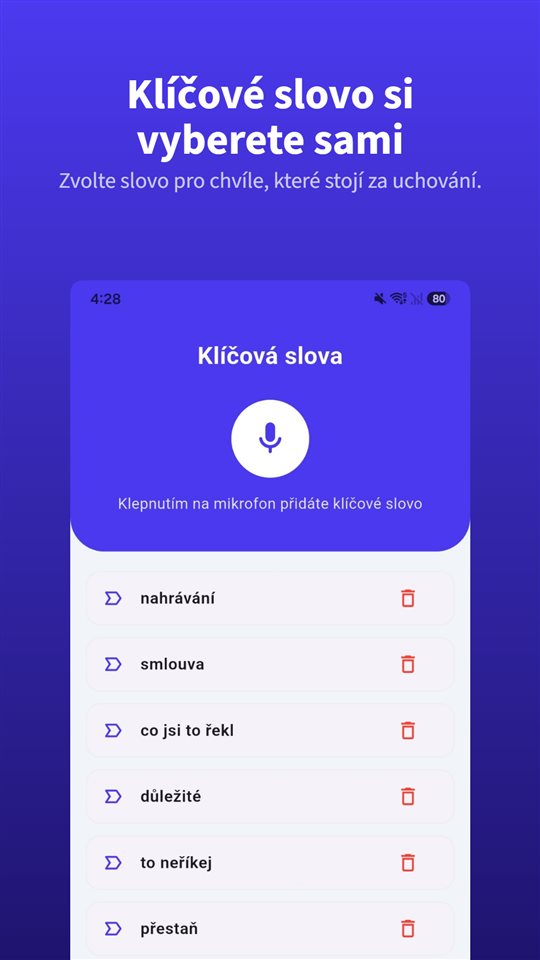

Týden po poradě přijde do týmového chatu zpráva: „Nedohodli jsme se na tom takhle?“

Každý si to pamatuje trochu jinak. Kdo to navrhl první, jestli byl termín v pátek, nebo až další týden. „Měl jsem to nahrát“ – přesně tahle myšlenka přichází v tu chvíli. Není to tím, že byste měli špatnou paměť. Na poradě posloucháte, přemýšlíte a odpovídáte, a nikdo nemá volnou ruku, aby si vedl záznam.

To podstatné na poradě zazní dřív, než někdo zmáčkne nahrávání.

## Pět chvil, které nahrávka porady často ztratí

| Chvíle | Co se ztratí | Funkce TalkSafe |
|---|---|---|
| Porada začíná | Co zaznělo před stisknutím nahrávání | Slova vedoucího porady jako klíčové slovo; uloží se 30 sekund, které už uběhly |
| Schůzka ve dvou v kavárně | Hlasy přehlušené hlukem | Odstranění šumu pomocí AI v telefonu; originál zůstane |
| Porada končí | Na čem se skutečně rozhodlo | Shrnutí od AI na klepnutí, v jazyce rozhovoru |
| Sdílení | Pár minut z hodiny, kdy padlo rozhodnutí | Vystřižení (originál zůstane) a nabídka sdílení v Androidu nebo iPhonu |
| Telefon se ztratí | Samotná nahrávka | Obnovení ze zálohy v cloudu |

## Telefon doprostřed, mikrofon volný

Chcete-li nahrát osobní poradu na telefon, položte ho doprostřed stolu, mezi lidi, kteří mluví. Mikrofon bývá na spodním okraji, takže ho nezakrývejte papíry ani bloky. Vedle klávesnice notebooku nakonec ťukání přehluší hlasy.

V dlouhé zasedačce může pomoct položit telefon trochu blíž k tomu, kdo rozhoduje. Obvykle je to hlas, který budete chtít slyšet znovu.

## Porada začíná dřív než „Tak, začneme“

„Jak to vlastně vypadá s tou věcí?“, zatímco si všichni sedají. „Jo, to udělám já“, zatímco vstávají. Tlačítko nahrávání obvykle mine obě chvíle. Než vás napadne ho zmáčknout, slova už zazněla.

[TalkSafe](/talksafe/cs/) je aplikace pro nahrávání na Android a iPhone, která začne nahrávat, když rozpozná předem zvolené slovo. Klíčová slova nejsou vázaná na osobu, takže můžete uložit **slova, která řekne ten, kdo poradu vede**, nejen ta svoje. Když se jedno rozpozná, nahrávání začne hned bez odemykání telefonu a uloží se i **30 sekund, které už uběhly**.

<figure class="shot"><figcaption>Nastavení klíčových slov. Můžete uložit několik slov; stačí, aby bylo rozpoznáno jedno z nich.</figcaption></figure>

Můžete uložit několik klíčových slov a stačí, aby bylo rozpoznáno jedno z nich. **Dvě slova, která se obvykle objevují ve stejné větě**, dělají rozpoznávání mnohem spolehlivějším. Vzpomeňte si na větu „Tak, začneme poradu“ a uložte „začneme“ a „poradu“. Pro porady nastavte délku nahrávání po rozpoznání na hodinu nebo na ruční zastavení, aby se nahrávka uprostřed nepřerušila.

Na příští týdenní poradě začne telefon nahrávat ve chvíli, kdy vedoucí řekne „Tak, začneme poradu“, tak jak leží na stole, a 30 sekund těsně předtím zůstane také. Jak funguje spuštění slovem, popisujeme v [Nejdřív něco řeknete: jak spustit nahrávání hlasem](/blog/cs/say-it-first/).

## V kavárně nejdřív odstraňte hluk

Pusťte si znovu schůzku ve dvou s klientem v kavárně a kávovar, hudba a smích od vedlejšího stolu můžou být hlasitější než rozhovor. Částka, kterou jste u stolu slyšeli jasně, je na nahrávce sotva rozumět.

**Odstranění šumu pomocí AI** v TalkSafe vezme z hotové nahrávky hluk v pozadí a nechá rozhovor. Zpracování probíhá **v telefonu** a vyčištěná verze se uloží jako nový soubor, **originál zůstane, jak byl**. Když spolu mluví dva lidé naproti sobě, zůstane rozhovor. Funkce funguje i na vystřižený úsek, takže můžete vyčistit jen ty minuty, kdy padla částka. Srovnání s jinými způsoby najdete v [Jak odstranit hluk v pozadí z hlasové nahrávky na Androidu](/blog/cs/remove-background-noise/).

## Po poradě si nejdřív přečtěte shrnutí

Nahrát poradu neznamená, že si někdo pustí hodinový soubor od začátku. Proto se i ti, kdo nahrávali, nakonec stejně spolehnou na paměť.

TalkSafe vytvoří na klepnutí **shrnutí nahrávky od AI** a zobrazí ho jako seznam bodů pod přehrávačem na obrazovce detailu. Porada v češtině se shrne česky. Najděte rozhodnutí ve shrnutí a poslechněte si to místo kvůli přesnému znění.

- **Je to shrnutí, ne přepis.** Text celé porady slovo od slova neexistuje.
- **Shrnutí vznikají na serveru.** Rozpoznávání klíčových slov běží v telefonu, ale kvůli shrnutí se nahrávka posílá na server.
- **I vystřižené úseky a soubory zbavené šumu** lze shrnout.

Vestavěné diktafony v telefonech Galaxy a Pixel nabízejí shrnutí na podporovaných modelech také. Rozdíly mezi aplikacemi popisujeme v [Jak shrnout hlasovou nahrávku pomocí AI na Androidu](/blog/cs/summarize-recording/).

## Pošlete jen ty minuty, kdy padlo rozhodnutí

Po poradě se obvykle nesdílí celá hodina, ale pár minut, kdy padlo rozhodnutí. **Vystřižení** v TalkSafe uloží vybraný úsek jako nový soubor a originál nechá na místě. Posílá se přes **nabídku sdílení v Androidu nebo iPhonu**, takže úsek může jít do jakékoli aplikace, která přijímá soubory: do e-mailu, do chatu, do sdílené složky. Jak vystřihovat, popisujeme v [Jak na Androidu zkrátit hlasovou nahrávku a nepřijít o originál](/blog/cs/trim-recording/).

## Telefon pryč, porada zůstane

Nahrávka porady je často potřeba až za několik měsíců. Mezitím můžete vyměnit telefon nebo soubor smazat, když uvolňujete místo.

Nahrávky **zálohované do cloudu** v TalkSafe lze obnovit, když je omylem smažete z telefonu, a když telefon ztratíte a vyměníte, lze je obnovit z cloudu v novém telefonu. Záloha neprobíhá automaticky, spouštíte ji sami. Co dalšího udělat po nahrání, popisujeme v [Co s nahrávkou dělat, a co s ní nedělat](/blog/cs/after-recording/).

## Co říká zákon v Česku a na Slovensku

**V Česku** podle § 86 občanského zákoníku nelze bez svolení pořizovat zvukový záznam soukromého života člověka. Podle § 88 odst. 1 ale svolení není třeba, pokud se záznam pořídí nebo použije k výkonu nebo ochraně jiných práv nebo právem chráněných zájmů, a podle § 90 nesmí být takový důvod využit nepřiměřeně. U pracovní porady je nejjednodušší říct na začátku, že nahráváte.

**Na Slovensku** je k nahrávání potřeba svolení.

Podrobnosti, i to, jak soudy s nahrávkami zacházejí, najdete v [Je legální nahrávat rozhovor bez souhlasu? V Česku rozhoduje účel, na Slovensku svolení](/blog/cs/nahravani-rozhovoru/).

## Aby si všichni pamatovali stejnou poradu

Až se příště někdo zeptá „Na čem jsme se vlastně v té věci dohodli?“, nemusíte porovnávat vzpomínky. Otevřete shrnutí a podívejte se na to místo.

Poradu nenahráváte proto, abyste vyhráli spor. Nahráváte ji proto, aby si ti, kdo byli v místnosti, pamatovali stejnou poradu.

Nahrávání přednášky funguje trochu jinak; popisujeme ho v [Jak nahrávat přednášky na telefon: celou hodinu, nebo jen to podstatné](/blog/cs/lecture-recording/).

Obecné informace, nikoli právní rada. V konkrétní věci se obraťte na advokáta. Funkce jiných aplikací jsou popsány podle jejich oficiálních informací v době psaní a mohou se změnit. Vyvíjíme aplikaci pro nahrávání TalkSafe.

