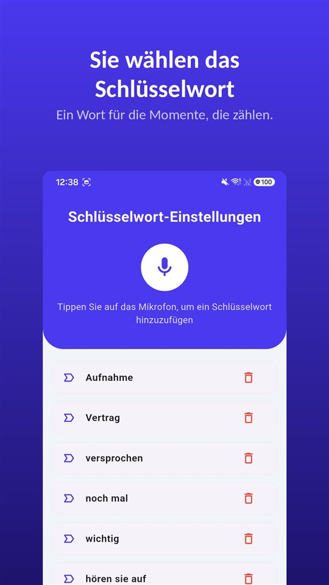

Eine Woche nach der Besprechung kommt eine Nachricht in den Team-Chat: „Hatten wir das nicht so abgemacht?“

Jeder erinnert sich ein bisschen anders. Wer es zuerst vorgeschlagen hat, ob die Frist Freitag war oder die Woche danach. „Hätte ich das mal aufgenommen“ – genau dieser Gedanke kommt in diesem Moment. Das liegt nicht am Gedächtnis. In einer Besprechung hört man zu, denkt nach und antwortet, und niemand hat eine Hand frei, um mitzuschreiben.

Was in einer Besprechung zählt, wird vor der Aufnahmetaste gesagt.

## Fünf Momente, die eine Besprechungsaufnahme oft verliert

| Moment | Was verloren geht | TalkSafe-Funktion |
|---|---|---|
| Die Besprechung beginnt | Was vor dem Drücken der Aufnahmetaste gesagt wurde | Worte der Gesprächsleitung als Schlüsselwort; die bereits vergangenen 30 Sekunden werden gespeichert |
| Zweiergespräch im Café | Stimmen, die im Lärm untergehen | KI-Rauschentfernung auf dem Handy; das Original bleibt |
| Die Besprechung endet | Was tatsächlich entschieden wurde | Eine KI-Zusammenfassung per Antippen, in der gesprochenen Sprache |
| Weitergeben | Die paar Minuten einer Stunde, in denen entschieden wurde | Kürzen (das Original bleibt) und das Teilen-Menü von Android oder iPhone |
| Das Handy geht verloren | Die Aufnahme selbst | Wiederherstellung aus dem Cloud-Backup |

## Das Handy in die Mitte, das Mikrofon frei

Um eine Besprechung vor Ort mit dem Handy aufzunehmen, legen Sie es in die Mitte des Tisches, zwischen die Sprechenden. Das Mikrofon sitzt meist am unteren Rand, also halten Sie diesen Rand frei von Papieren und Notizbüchern. Direkt neben einer Laptop-Tastatur ist das Tippen am Ende lauter als die Stimmen.

In einem langen Besprechungsraum kann es helfen, das Handy etwas näher zu der Person zu legen, die entscheidet. Meist ist das die Stimme, die Sie später noch einmal hören wollen.

## Eine Besprechung beginnt vor „Gut, dann starten wir“

„Wie steht es eigentlich mit der Sache?“, während alle Platz nehmen. „Ach, das übernehme ich“, während alle aufstehen. Die Aufnahmetaste verpasst meist beide Momente. Wenn man daran denkt, sie zu drücken, sind die Worte schon vorbei.

[TalkSafe](/talksafe/de/) ist eine Aufnahme-App für Android und iPhone, die mit der Aufnahme beginnt, wenn sie ein vorher festgelegtes Wort erkennt. Schlüsselwörter sind nicht an eine Person gebunden, deshalb können Sie **die Worte der Gesprächsleitung** hinterlegen, nicht nur Ihre eigenen. Wird eines erkannt, startet die Aufnahme sofort, ohne das Handy zu entsperren, und **die bereits vergangenen 30 Sekunden** werden mitgespeichert.

<figure class="shot"><figcaption>Schlüsselwort-Einstellungen. Sie können mehrere Wörter hinterlegen; es reicht, wenn eines davon erkannt wird.</figcaption></figure>

Sie können mehrere Schlüsselwörter hinterlegen, und es reicht, wenn eines erkannt wird. **Zwei Wörter, die meist im selben Satz vorkommen**, machen die Erkennung deutlich zuverlässiger. Denken Sie an den Satz „Gut, dann starten wir die Besprechung“ und hinterlegen Sie „starten“ und „Besprechung“. Für Besprechungen stellen Sie die Aufnahmedauer nach der Erkennung auf eine Stunde oder auf manuelles Beenden, damit die Aufnahme nicht mittendrin abbricht.

Im Team-Meeting nächste Woche sagt Ihre Chefin „Gut, dann starten wir die Besprechung“ – und in diesem Moment beginnt das Handy, so wie es auf dem Tisch liegt, mit der Aufnahme. Die 30 Sekunden direkt davor bleiben ebenfalls erhalten. Wie der Start über ein Wort funktioniert, steht in [Zuerst sagt man etwas: eine Aufnahme mit der Stimme starten](/blog/de/say-it-first/).

## Im Café zuerst den Lärm entfernen

Hören Sie sich ein Zweiergespräch mit einem Kunden im Café noch einmal an, sind Kaffeemaschine, Musik und das Lachen vom Nachbartisch manchmal lauter als das Gespräch. Die Zahl, die Sie am Tisch genau gehört haben, ist auf der Aufnahme kaum zu verstehen.

Die **KI-Rauschentfernung** von TalkSafe nimmt die Hintergrundgeräusche aus einer fertigen Aufnahme und lässt das Gespräch übrig. Die Verarbeitung läuft **auf dem Handy**, und die bereinigte Fassung wird als neue Datei gespeichert, **das Original bleibt unverändert**. Bei zwei Personen, die sich gegenübersitzen, bleibt das Gespräch übrig. Die Funktion lässt sich auch auf einen gekürzten Abschnitt anwenden, Sie können also nur die Minuten bereinigen, in denen die Zahl fiel. Der Vergleich mit anderen Wegen steht in [Hintergrundgeräusche aus einer Sprachaufnahme entfernen – so geht es auf Android](/blog/de/remove-background-noise/).

## Danach zuerst die Zusammenfassung lesen

Eine Besprechung aufzunehmen heißt nicht, dass jemand eine einstündige Datei von vorn anhört. Deshalb verlassen sich auch Leute, die aufgenommen haben, am Ende doch auf ihr Gedächtnis.

TalkSafe erstellt auf Antippen **eine KI-Zusammenfassung** einer Aufnahme und zeigt sie als Stichpunktliste unter dem Player in der Detailansicht. Eine deutsche Besprechung wird auf Deutsch zusammengefasst. Suchen Sie die Entscheidung in der Zusammenfassung und hören Sie sich die Stelle für den genauen Wortlaut an.

- **Es ist eine Zusammenfassung, kein Transkript.** Einen Wort-für-Wort-Text der ganzen Besprechung gibt es nicht.
- **Zusammenfassungen entstehen auf einem Server.** Die Schlüsselwort-Erkennung läuft auf dem Handy, für die Zusammenfassung wird die Aufnahme aber an einen Server geschickt.
- **Auch gekürzte und entrauschte Dateien** lassen sich zusammenfassen.

Auch die vorinstallierten Rekorder auf Galaxy- und Pixel-Handys bieten auf unterstützten Modellen Zusammenfassungen. Wie sich die Apps unterscheiden, steht in [Sprachaufnahme mit KI zusammenfassen – so geht es auf Android](/blog/de/summarize-recording/).

## Nur die Minuten weitergeben, in denen entschieden wurde

Was man nach einer Besprechung weitergibt, ist meist nicht die ganze Stunde, sondern die paar Minuten, in denen die Entscheidung fiel. Das **Kürzen** in TalkSafe speichert den gewählten Abschnitt als neue Datei und lässt das Original stehen. Zum Senden dient das **Teilen-Menü von Android oder iPhone**, der Ausschnitt kann also an jede App gehen, die Dateien annimmt: E-Mail, Messenger, ein geteilter Ordner. Wie man kürzt, steht in [Sprachaufnahme auf Android kürzen, ohne das Original zu verlieren](/blog/de/trim-recording/).

## Handy weg, Besprechung noch da

Eine Besprechungsaufnahme wird oft erst Monate später gebraucht. In der Zwischenzeit wechselt man vielleicht das Handy oder löscht die Datei beim Aufräumen.

Aufnahmen, die im **Cloud-Backup** von TalkSafe gesichert sind, lassen sich wiederherstellen, wenn sie versehentlich auf dem Handy gelöscht werden, und wenn das Handy verloren geht und ersetzt wird, lassen sie sich auf dem neuen Handy aus der Cloud wiederherstellen. Das Backup läuft nicht automatisch, Sie starten es selbst. Was nach der Aufnahme sonst noch wichtig ist, steht in [Was man mit einer Aufnahme tun sollte – und was nicht](/blog/de/after-recording/).

## Was in Deutschland, Österreich und der Schweiz gilt

**In Deutschland und der Schweiz** braucht die Aufnahme eines nichtöffentlichen Gesprächs die Einwilligung der anderen Teilnehmenden, auch wenn Sie selbst dabei sind (§ 201 StGB, Art. 179ter StGB). Bei einer Besprechung klären Sie das am einfachsten zu Beginn mit allen Anwesenden.

**In Österreich und Liechtenstein** dürfen Sie ein Gespräch aufnehmen, an dem Sie teilnehmen. Strafbar ist dort, die Aufnahme ohne Einverständnis der Sprechenden Dritten zugänglich zu machen oder zu veröffentlichen (§ 120 Abs. 2 StGB in Österreich).

Die Einzelheiten, auch dazu, wie Gerichte mit Aufnahmen umgehen, stehen in [Gespräch heimlich aufnehmen: In Deutschland strafbar, in Österreich nicht – und was das vor Gericht heißt](/blog/de/gespraech-aufnehmen/).

## Damit alle dieselbe Besprechung im Kopf haben

Wenn das nächste Mal jemand fragt „Was hatten wir da eigentlich beschlossen?“, müssen Sie keine Erinnerungen abgleichen. Öffnen Sie die Zusammenfassung und prüfen Sie die Stelle.

Man nimmt eine Besprechung nicht auf, um einen Streit zu gewinnen. Man nimmt sie auf, damit alle, die im Raum waren, dieselbe Besprechung im Kopf haben.

Wie man eine Vorlesung aufnimmt, steht gesondert in [Vorlesung mit dem Handy aufnehmen: die ganze Stunde oder nur das Wichtige](/blog/de/lecture-recording/).

Allgemeine Information, keine Rechtsberatung. Für einen konkreten Fall wenden Sie sich an eine Anwältin oder einen Anwalt. Die Funktionen anderer Apps sind nach deren offiziellen Angaben zum Zeitpunkt des Schreibens beschrieben und können sich ändern. Wir entwickeln die Aufnahme-App TalkSafe.

