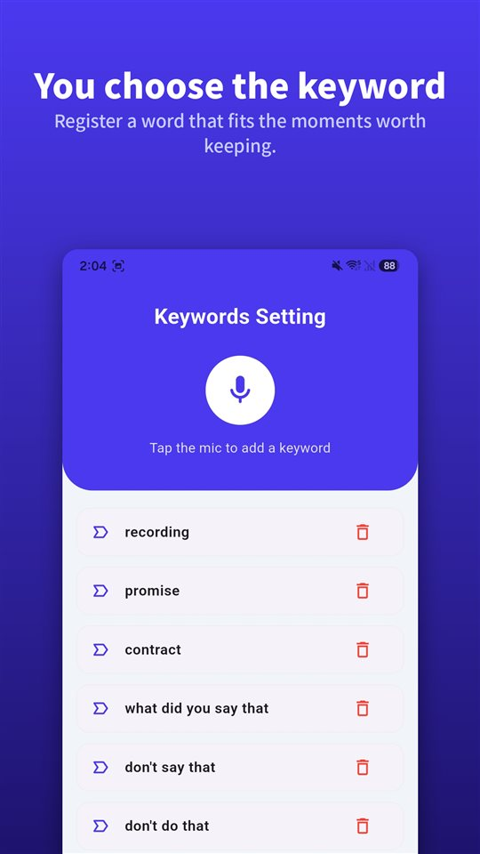

A week after the meeting, a message lands in the team chat: "Didn't we agree on that?"

Everyone remembers it slightly differently. Who raised it first, whether the deadline was Friday or the week after. "I should have recorded it" is always the thought that arrives at this point. It isn't a memory problem. During a meeting you are listening, thinking and answering, and nobody has a hand free to keep the record.

The words that matter in a meeting come before the record button.

## Five moments a meeting recording tends to lose

| Moment | What gets lost | TalkSafe feature |
|---|---|---|
| The meeting starts | What was said before you pressed record | The chair's words as a keyword; the 30 seconds that already passed are saved |
| A one-to-one in a café | Voices buried in background noise | AI noise removal processed on the phone; the original stays |
| The meeting ends | What was actually decided | An AI summary of every recording, in the language spoken |
| Sharing | The few minutes, out of an hour, where the decision was made | Trim (the original stays) and the Android or iPhone share sheet |
| The phone is lost | The recording itself | Restore from cloud backup |

## Put the phone in the middle, with the microphone uncovered

To record an in-person meeting on your phone, put the phone in the middle of the table, between the people talking. The microphone is usually on the bottom edge, so keep that edge clear of papers and notebooks. Right next to a laptop, the typing ends up louder than the voices.

In a long meeting room, it can help to put the phone a little closer to whoever makes the decisions. That is usually the voice you will want to hear again.

## A meeting starts before "Let's get started"

"So where are we on that?" as people sit down. "Oh, I'll take care of that one" as they stand up to leave. The record button usually misses both. By the time you think of pressing it, the words have already gone by.

[TalkSafe](/talksafe/en/) is a voice recorder for Android and iPhone that starts recording when it detects a word you set in advance. Keywords are not tied to one speaker, so you can set **the words the chair will say**, not just your own. When one is detected, recording starts right away without unlocking the phone, and **the 30 seconds that had already passed** are saved too.

<figure class="shot"><figcaption>Keyword settings. You can register several keywords; any one of them being detected starts a recording.</figcaption></figure>

You can register several keywords, and any one of them being detected starts a recording. **Two words likely to appear in the same sentence** make detection much more reliable. Think of the sentence "Right, let's start the meeting" and register both "start" and "meeting". For meetings, set the recording time after a keyword is detected to one hour or to manual stop, so it doesn't cut off halfway.

At next week's team meeting, the moment your manager says "Right, let's start the meeting", the phone starts recording where it lies on the table, and the 30 seconds just before are kept as well. More on starting a recording with a word is in [You say something first: starting a recording with your voice](/blog/en/say-it-first/).

## Clear the noise out of a café meeting first

Listen back to a one-to-one with a client in a café and the coffee machine, the music and the laughter at the next table can be louder than the conversation. The figure you clearly heard at the table is hard to make out on the recording.

TalkSafe's **AI noise removal** takes the background noise out of a finished recording and keeps the conversation. It is processed **on the phone**, and the cleaned version is saved as a new file **with the original left as it was**. For two people talking across a table, what remains is the conversation. It also works on a trimmed clip, so you can clean up only the few minutes where the figure came up. How it compares with other options is in [How to remove background noise from a voice recording on Android](/blog/en/remove-background-noise/).

## Read the summary first

Recording a meeting doesn't mean anyone will listen to an hour-long file from the start. That is why people who recorded still end up relying on memory.

TalkSafe creates **an AI summary of every recording** and shows it as a list of points under the player in the recording's detail screen. An English meeting is summarized in English. Find the decision in the summary, then listen to that part for the exact wording.

- **It is a summary, not a transcript.** There is no word-for-word text of the whole meeting.
- **Summaries are made on a server.** Keyword detection runs on the phone, but for the summary the recording is sent to a server.
- **Trimmed and noise-cleaned clips** can be summarized too.

The built-in recorders on Galaxy and Pixel phones also offer summaries on supported models. How the apps differ is in [How to get an AI summary of a voice recording on Android](/blog/en/summarize-recording/).

## Send only the minutes where the decision was made

What you share after a meeting is usually not the whole hour but the few minutes where the decision was made. TalkSafe's **trim** saves the section you select as a new file and leaves the original in place. Sending uses the **Android or iPhone share sheet**, so the clip can go to any app that accepts a file: email, a messaging app, a shared drive. How to trim is in [How to cut or trim a voice recording on Android, keeping the original](/blog/en/trim-recording/).

## Lose the phone, keep the meeting

A meeting recording is often needed only months later. In that time you might change phones, or delete the file while clearing space.

Recordings backed up with TalkSafe's **cloud backup** can be restored if they are deleted from the phone by mistake, and if the phone is lost and replaced, they can be restored from the cloud on the new phone. What else to take care of after recording is in [What to do with a recording, and what not to do with it](/blog/en/after-recording/).

## Recording a meeting you're in

In the US, federal law and most states allow a participant to record a conversation. Nine states require everyone's consent by statute: California, Florida, Illinois, Maryland, Massachusetts, Montana, New Hampshire, Pennsylvania and Washington. In a meeting, everyone means everyone in the room. Published lists go up to fifteen because some states treat phone calls and in-person conversations differently; the details are in [Nine states are strict. The rest of the list is an argument.](/blog/en/state-recording-consent/)

In the UK, recording a conversation you take part in for your own records is generally not a criminal offence.

An employer's no-recording policy is a separate question from criminal law. That is covered in [Your employer's no-recording rule may itself be illegal](/blog/en/workplace-recording-policy/), and the wider law in [Is it legal to record a conversation you're in?](/blog/en/recording-consent-law/)

## So everyone remembers the same meeting

Next time someone asks "What did we decide on that?", you don't have to compare memories. Open the summary and check that part.

You don't record a meeting to win an argument. You record it so the people who were in the room remember the same meeting.

General information, not legal advice. For a specific situation, consult a lawyer where you live. Other apps' features are described from their official information at the time of writing and may change. We make the recording app TalkSafe.

