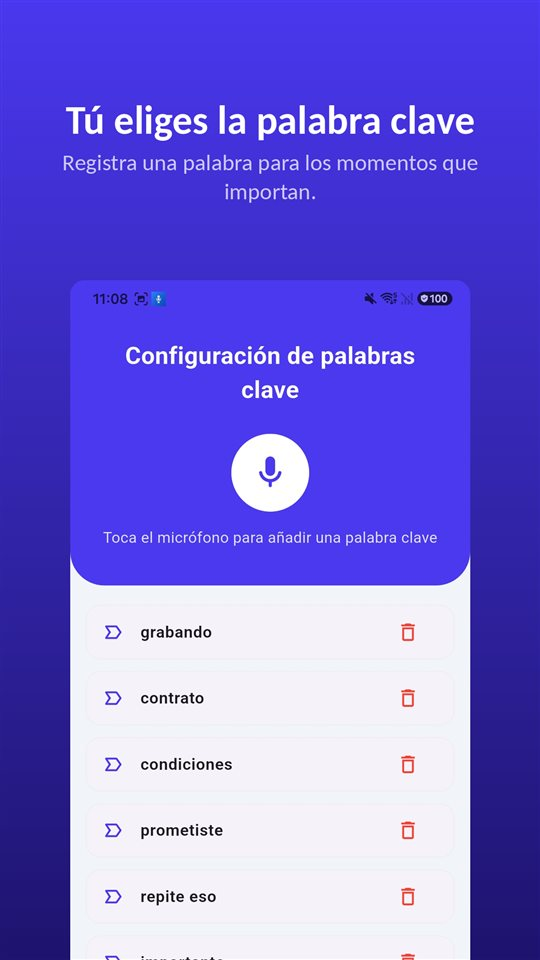

Una semana después de la reunión, llega un mensaje al grupo del equipo: "¿No habíamos quedado en eso?"

Cada uno lo recuerda un poco distinto. Quién lo propuso primero, si el plazo era el viernes o la semana siguiente. "Tendría que haberlo grabado" es justo lo que se piensa en ese momento. No es un problema de memoria. Durante una reunión estás escuchando, pensando y respondiendo, y nadie tiene una mano libre para llevar el registro.

Lo importante de una reunión se dice antes de pulsar grabar.

## Cinco momentos que una grabación de reunión suele perder

| Momento | Qué se pierde | Función de TalkSafe |
|---|---|---|
| Empieza la reunión | Lo que se dijo antes de pulsar grabar | Las palabras de quien dirige como palabra clave; se guardan los 30 segundos que ya pasaron |
| Una reunión a solas en una cafetería | Voces tapadas por el ruido | Eliminación de ruido con IA en el teléfono; el original se conserva |
| Termina la reunión | Qué se decidió realmente | Un resumen con IA con un toque, en el idioma hablado |
| Al compartir | Los pocos minutos de una hora en que se decidió algo | Recortar (el original se conserva) y el menú de compartir de Android o iPhone |
| Se pierde el teléfono | La grabación misma | Recuperar desde la copia en la nube |

## El teléfono en el centro, con el micrófono libre

Para grabar una reunión presencial con el teléfono, ponlo en el centro de la mesa, entre las personas que hablan. El micrófono suele estar en el borde inferior, así que deja ese borde libre de papeles y cuadernos. Junto al teclado de un portátil, el tecleo acaba sonando más fuerte que las voces.

En una sala alargada, puede ayudar acercar un poco el teléfono a quien toma las decisiones. Normalmente es la voz que vas a querer volver a escuchar.

## Una reunión empieza antes del "Bueno, empezamos"

"¿Cómo va lo de aquello?" mientras la gente se sienta. "Ah, eso lo hago yo" mientras se levanta. El botón de grabar suele perder los dos momentos. Cuando piensas en pulsarlo, las palabras ya han pasado.

[TalkSafe](/talksafe/es/) es una grabadora de voz para Android y iPhone que empieza a grabar cuando detecta una palabra elegida de antemano. Las palabras clave no están ligadas a una persona, así que puedes registrar **lo que dirá quien dirige la reunión**, no solo lo que dirás tú. Cuando se detecta una, la grabación empieza al instante sin desbloquear el teléfono, y se guardan también **los 30 segundos que ya habían pasado**.

<figure class="shot"><figcaption>Ajustes de palabras clave. Puedes registrar varias; basta con que se detecte una para que empiece la grabación.</figcaption></figure>

Puedes registrar varias palabras clave, y basta con que se detecte una para que empiece la grabación. **Dos palabras que suelan aparecer en la misma frase** hacen la detección mucho más fiable. Piensa en la frase "Bueno, empezamos la reunión" y registra "empezamos" y "reunión". Para reuniones, ajusta el tiempo de grabación tras la detección a una hora o a parada manual, para que no se corte a la mitad.

En la reunión de equipo de la semana que viene, en el momento en que tu jefa diga "Bueno, empezamos la reunión", el teléfono empieza a grabar tal como está sobre la mesa, y los 30 segundos de justo antes también quedan. Cómo funciona empezar a grabar con una palabra está en [Lo primero que se mueve no es la mano](/blog/es/say-it-first/).

## En una cafetería, primero quita el ruido

Escucha de nuevo una reunión a solas con un cliente en una cafetería y la cafetera, la música y las risas de la mesa de al lado pueden sonar más fuerte que la conversación. La cifra que oíste perfectamente en la mesa apenas se distingue en la grabación.

La **eliminación de ruido con IA** de TalkSafe quita el ruido de fondo de una grabación terminada y deja la conversación. Se procesa **en el teléfono**, y la versión limpia se guarda como un archivo nuevo **dejando el original como estaba**. Con dos personas hablando frente a frente, lo que queda es la conversación. También funciona con un fragmento recortado, así que puedes limpiar solo los minutos en que salió la cifra. La comparación con otras opciones está en [Cómo quitar el ruido de fondo de una grabación de voz en Android](/blog/es/remove-background-noise/).

## Al terminar, lee primero el resumen

Grabar una reunión no significa que alguien vaya a escuchar un archivo de una hora desde el principio. Por eso quien grabó acaba fiándose de la memoria igualmente.

TalkSafe crea **un resumen con IA** de una grabación cuando lo pides con un toque y lo muestra como una lista de puntos bajo el reproductor, en la pantalla de detalle. Una reunión en español se resume en español. Busca la decisión en el resumen y escucha esa parte para comprobar las palabras exactas.

- **Es un resumen, no una transcripción.** No hay un texto palabra por palabra de toda la reunión.
- **Los resúmenes se hacen en un servidor.** La detección de palabras clave funciona en el teléfono, pero para el resumen la grabación se envía a un servidor.
- **Los fragmentos recortados y los archivos sin ruido** también se pueden resumir.

Las grabadoras de serie de los teléfonos Galaxy y Pixel también ofrecen resúmenes en los modelos compatibles. Las diferencias entre apps están en [Cómo resumir una grabación de audio con IA en Android](/blog/es/summarize-recording/).

## Envía solo los minutos en que se decidió algo

Lo que compartes después de una reunión no suele ser la hora entera, sino los pocos minutos en que se tomó la decisión. El **recorte** de TalkSafe guarda el tramo que eliges como un archivo nuevo y deja el original en su sitio. Para enviarlo se usa el **menú de compartir de Android o iPhone**, así que el fragmento puede ir a cualquier app que acepte archivos: el correo, una app de mensajería, una carpeta compartida. Cómo recortar está en [Cómo cortar una grabación de audio en Android sin perder el original](/blog/es/trim-recording/).

## Aunque pierdas el teléfono, la reunión queda

Una grabación de reunión a menudo solo hace falta meses después. Mientras tanto puedes cambiar de teléfono, o borrar el archivo al hacer espacio.

Las grabaciones guardadas en la **copia en la nube** de TalkSafe se pueden recuperar si se borran del teléfono por error, y si el teléfono se pierde y se cambia, se pueden recuperar desde la nube en el nuevo. La copia no es automática: la haces tú. Qué más conviene hacer después de grabar está en [Qué hacer con una grabación, y qué no hacer con ella](/blog/es/after-recording/).

## Grabar una reunión en la que participas

En España, grabar una conversación en la que participas es lícito con carácter general: el Tribunal Constitucional estableció en la STC 114/1984 que no cabe invocar el secreto de las comunicaciones frente al propio interlocutor. Está explicado en [¿Es legal grabar una conversación en España? Grabar sí, difundir no](/blog/es/recording-consent-law/).

En Hispanoamérica la regla cambia según el país: el repaso de diez países está en [Grabar tu propia conversación: país por país](/blog/es/grabar-latinoamerica/).

Una norma de la empresa que prohíba grabar es una cuestión distinta de la ley penal. Eso se trata en [Grabar a tu jefe es lícito. Grabarlo todo puede costarte el empleo.](/blog/es/grabar-en-el-trabajo/)

## Para que todos recuerden la misma reunión

La próxima vez que alguien pregunte "¿Qué habíamos decidido sobre eso?", no hace falta comparar memorias. Abre el resumen y comprueba esa parte.

Una reunión no se graba para ganar una discusión. Se graba para que quienes estaban en la sala recuerden la misma reunión.

Grabar una clase funciona algo distinto; está en [Cómo grabar clases con el celular o el móvil: la clase entera o solo lo importante](/blog/es/lecture-recording/).

Información general, no asesoramiento jurídico. Para un caso concreto, consulta con un abogado de tu país. Las funciones de otras apps se describen según su información oficial en el momento de escribir y pueden cambiar. Hacemos la app de grabación TalkSafe.

