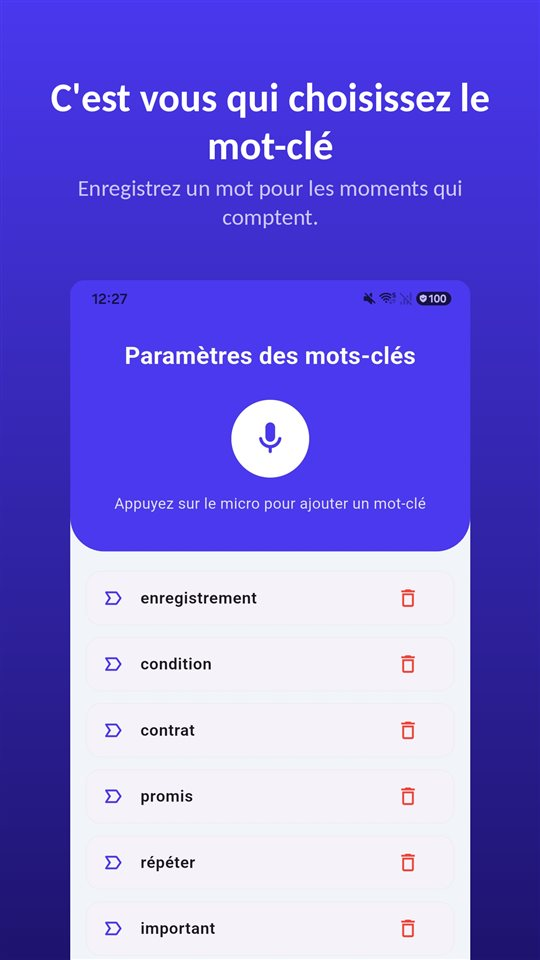

Une semaine après la réunion, un message arrive dans le groupe de l'équipe : « On n'avait pas décidé ça ? »

Chacun s'en souvient un peu différemment. Qui l'a proposé en premier, si l'échéance était vendredi ou la semaine suivante. « J'aurais dû l'enregistrer », c'est toujours à ce moment-là qu'on le pense. Ce n'est pas un problème de mémoire. Pendant une réunion, on écoute, on réfléchit, on répond, et personne n'a une main libre pour garder la trace.

Ce qui compte dans une réunion se dit avant qu'on appuie sur enregistrer.

## Cinq moments qu'un enregistrement de réunion perd souvent

| Moment | Ce qui se perd | Fonction de TalkSafe |
|---|---|---|
| La réunion commence | Ce qui a été dit avant d'appuyer sur enregistrer | Les mots de la personne qui anime comme mot-clé ; les 30 secondes déjà passées sont conservées |
| Un rendez-vous à deux au café | Des voix couvertes par le bruit | Suppression du bruit par IA sur le téléphone ; l'original est conservé |
| La réunion se termine | Ce qui a vraiment été décidé | Un résumé par IA de chaque enregistrement, dans la langue parlée |
| Au moment de partager | Les quelques minutes, sur une heure, où l'on a décidé | Découpe (l'original est conservé) et le menu de partage d'Android ou d'iPhone |
| Le téléphone est perdu | L'enregistrement lui-même | Restauration depuis la sauvegarde dans le cloud |

## Le téléphone au milieu, le micro dégagé

Pour enregistrer une réunion en présentiel avec votre téléphone, posez-le au milieu de la table, entre les personnes qui parlent. Le micro se trouve en général sur le bord inférieur : gardez ce bord dégagé de feuilles et de carnets. À côté du clavier d'un ordinateur portable, la frappe finit par couvrir les voix.

Dans une longue salle de réunion, il peut être utile de rapprocher un peu le téléphone de la personne qui décide. C'est généralement la voix que vous voudrez réécouter.

## Une réunion commence avant « Bon, on commence »

« Au fait, on en est où sur ce dossier ? » pendant qu'on s'installe. « Ah, ça, je m'en occupe » pendant qu'on se lève. Le bouton d'enregistrement rate en général ces deux moments. Quand on pense à appuyer, les mots sont déjà passés.

[TalkSafe](/talksafe/fr/) est une application d'enregistrement pour Android et iPhone qui démarre quand elle détecte un mot choisi à l'avance. Les mots-clés ne sont pas liés à une personne : vous pouvez donc choisir **les mots que dira la personne qui anime**, pas seulement les vôtres. Quand l'un d'eux est détecté, l'enregistrement démarre aussitôt sans déverrouiller le téléphone, et **les 30 secondes déjà passées** sont conservées aussi.

<figure class="shot"><figcaption>Réglages des mots-clés. Vous pouvez en enregistrer plusieurs ; il suffit que l'un d'eux soit détecté pour que l'enregistrement démarre.</figcaption></figure>

Vous pouvez enregistrer plusieurs mots-clés, et il suffit que l'un d'eux soit détecté pour que l'enregistrement démarre. **Deux mots qui apparaissent souvent dans la même phrase** rendent la détection bien plus fiable. Pensez à la phrase « Bon, on commence la réunion » et enregistrez « commence » et « réunion ». Pour une réunion, réglez la durée d'enregistrement après détection sur une heure ou sur l'arrêt manuel, pour qu'il ne s'interrompe pas au milieu.

À la réunion d'équipe de la semaine prochaine, au moment où votre responsable dit « Bon, on commence la réunion », le téléphone se met à enregistrer, posé tel quel sur la table, et les 30 secondes juste avant restent aussi. Le principe du démarrage par un mot est expliqué dans [On dit d'abord quelque chose : lancer un enregistrement avec la voix](/blog/fr/say-it-first/).

## Au café, retirez d'abord le bruit

Réécoutez un rendez-vous à deux avec un client au café, et la machine à café, la musique et les rires de la table voisine peuvent couvrir la conversation. Le chiffre que vous avez parfaitement entendu à table se devine à peine sur l'enregistrement.

La **suppression du bruit par IA** de TalkSafe retire le bruit de fond d'un enregistrement terminé et garde la conversation. Le traitement se fait **sur le téléphone**, et la version nettoyée est enregistrée dans un nouveau fichier, **l'original restant tel quel**. Avec deux personnes face à face, ce qui reste, c'est la conversation. La fonction s'applique aussi à un extrait découpé : vous pouvez nettoyer seulement les minutes où le chiffre a été donné. La comparaison avec d'autres solutions se trouve dans [Comment retirer le bruit de fond d'un enregistrement vocal sur Android](/blog/fr/remove-background-noise/).

## Après la réunion, lisez d'abord le résumé

Enregistrer une réunion ne veut pas dire que quelqu'un réécoutera un fichier d'une heure depuis le début. C'est pour cela que même ceux qui ont enregistré finissent par se fier à leur mémoire.

TalkSafe crée **un résumé par IA de chaque enregistrement** et l'affiche sous forme de liste à puces sous le lecteur, dans l'écran de détail. Une réunion en français est résumée en français. Cherchez la décision dans le résumé, puis écoutez ce passage pour les mots exacts.

- **C'est un résumé, pas une transcription.** Il n'y a pas de texte mot à mot de toute la réunion.
- **Les résumés sont faits sur un serveur.** La détection des mots-clés fonctionne sur le téléphone, mais pour le résumé l'enregistrement est envoyé à un serveur.
- **Les extraits découpés et les fichiers débarrassés du bruit** peuvent aussi être résumés.

Les enregistreurs intégrés des téléphones Galaxy et Pixel proposent eux aussi des résumés sur les modèles compatibles. Les différences entre applications sont expliquées dans [Comment résumer un enregistrement vocal avec l'IA sur Android](/blog/fr/summarize-recording/).

## N'envoyez que les minutes où l'on a décidé

Ce qu'on partage après une réunion, ce n'est généralement pas l'heure entière, mais les quelques minutes où la décision a été prise. La **découpe** de TalkSafe enregistre le passage choisi dans un nouveau fichier et laisse l'original en place. L'envoi passe par le **menu de partage d'Android ou d'iPhone** : l'extrait peut aller vers toute application qui accepte un fichier, que ce soit l'e-mail, une messagerie ou un dossier partagé. La découpe est expliquée dans [Comment couper un enregistrement audio sur Android sans perdre l'original](/blog/fr/trim-recording/).

## Téléphone perdu, réunion gardée

Un enregistrement de réunion ne sert souvent que des mois plus tard. Entre-temps, on change parfois de téléphone, ou on supprime le fichier en faisant de la place.

Les enregistrements placés dans la **sauvegarde dans le cloud** de TalkSafe peuvent être restaurés s'ils sont supprimés du téléphone par erreur, et si le téléphone est perdu et remplacé, ils peuvent être restaurés depuis le cloud sur le nouveau. La sauvegarde n'est pas automatique : c'est vous qui la lancez. Ce qu'il faut faire d'autre après l'enregistrement est expliqué dans [Ce qu'il faut faire d'un enregistrement, et ce qu'il ne faut pas en faire](/blog/fr/after-recording/).

## Ce que dit la loi en France, en Belgique, en Suisse et au Québec

**En France**, l'article 226-1 du Code pénal punit l'enregistrement sans consentement de paroles prononcées à titre privé ou confidentiel, même par un participant. Pour une réunion, le plus simple est d'obtenir l'accord des participants au début.

**En Suisse**, l'article 179ter du Code pénal exige aussi le consentement des autres participants à une conversation non publique.

**En Belgique**, la Cour de cassation a confirmé en 2015 qu'un participant qui enregistre ne commet pas d'infraction ; c'est l'usage de l'enregistrement dans une intention frauduleuse ou de nuire que punit l'article 314bis du Code pénal. **Au Québec**, un participant peut enregistrer une conversation à laquelle il prend part.

Le détail des textes et de la jurisprudence est dans [Enregistrer une conversation à l'insu de quelqu'un : interdit en France, permis en Belgique et au Québec](/blog/fr/enregistrer-conversation/).

## Pour que tout le monde se souvienne de la même réunion

La prochaine fois que quelqu'un demande « Qu'est-ce qu'on avait décidé là-dessus ? », inutile de comparer les souvenirs. Ouvrez le résumé et vérifiez ce passage.

On n'enregistre pas une réunion pour gagner une dispute. On l'enregistre pour que les personnes présentes se souviennent de la même réunion.

Enregistrer un cours fonctionne un peu différemment ; c'est expliqué dans [Comment enregistrer un cours avec son téléphone : tout le cours ou seulement l'essentiel](/blog/fr/lecture-recording/).

Information générale, pas un conseil juridique. Pour une situation précise, consultez un avocat. Les fonctions des autres applications sont décrites d'après leurs informations officielles au moment de la rédaction et peuvent changer. Nous développons l'application d'enregistrement TalkSafe.

