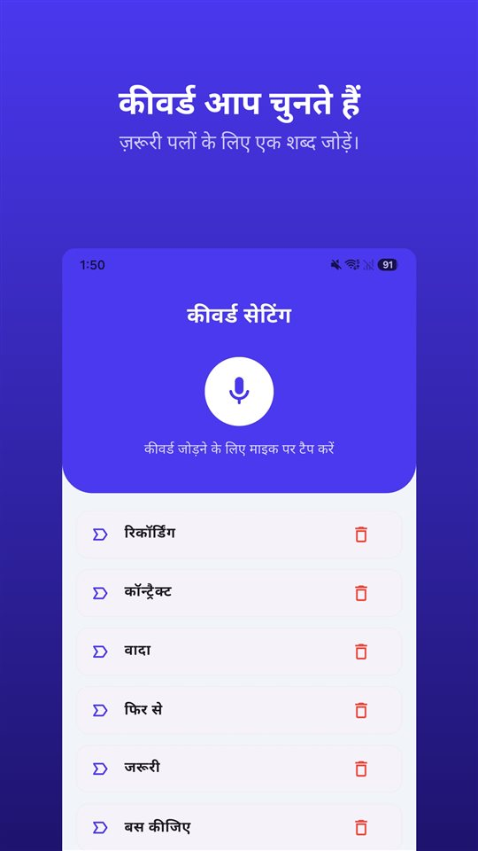

मीटिंग के एक हफ़्ते बाद टीम के ग्रुप में मैसेज आता है: "हमने तो यही तय किया था न?"

हर किसी को थोड़ा अलग याद है। पहले किसने सुझाव दिया था, डेडलाइन शुक्रवार थी या अगला हफ़्ता। "काश रिकॉर्ड कर लिया होता" वाला ख़याल हमेशा इसी पल आता है। यह याददाश्त की कमी नहीं है। मीटिंग में आप सुनते हैं, सोचते हैं, जवाब देते हैं, और रिकॉर्ड रखने के लिए किसी का हाथ ख़ाली नहीं होता।

मीटिंग की ज़रूरी बातें रिकॉर्ड बटन से पहले कही जाती हैं।

## पाँच पल जो मीटिंग की रिकॉर्डिंग से अक्सर छूट जाते हैं

| पल | क्या छूटता है | TalkSafe की सुविधा |
|---|---|---|
| मीटिंग शुरू होती है | रिकॉर्ड बटन दबाने से पहले कही गई बातें | मीटिंग चलाने वाले के शब्द कीवर्ड के रूप में; जो 30 सेकंड बीत चुके, वे भी सेव |
| कैफ़े में दो लोगों की मीटिंग | शोर में दबी आवाज़ें | फ़ोन के अंदर AI नॉइज़ रिमूवल; मूल फ़ाइल रहती है |
| मीटिंग ख़त्म होती है | असल में क्या तय हुआ | हर रिकॉर्डिंग का AI सारांश, बोली गई भाषा में |
| शेयर करते समय | एक घंटे में से वे कुछ मिनट जब फ़ैसला हुआ | ट्रिम (मूल फ़ाइल रहती है) और Android या iPhone का शेयर मेन्यू |
| फ़ोन खो जाता है | ख़ुद रिकॉर्डिंग | क्लाउड बैकअप से वापस लाना |

## फ़ोन बीच में, माइक्रोफ़ोन खुला

आमने-सामने की मीटिंग को फ़ोन से रिकॉर्ड करने के लिए फ़ोन को मेज़ के बीच में, बोलने वालों के बीच रखें। माइक्रोफ़ोन आम तौर पर नीचे वाले किनारे पर होता है, इसलिए उस किनारे को काग़ज़ों और नोटबुक से ढकने न दें। लैपटॉप के कीबोर्ड के पास रखने पर टाइपिंग की आवाज़ बातों से ज़्यादा तेज़ आती है।

लंबे मीटिंग रूम में फ़ोन को फ़ैसला लेने वाले व्यक्ति के थोड़ा पास रखना मदद कर सकता है। बाद में जिसे दोबारा सुनना चाहेंगे, वह आम तौर पर उसी की आवाज़ होती है।

## मीटिंग "चलिए, शुरू करते हैं" से पहले शुरू हो जाती है

बैठते-बैठते "उस काम का क्या हुआ?", उठते-उठते "अच्छा, वह मैं कर दूँगा।" रिकॉर्ड बटन आम तौर पर ये दोनों पल छोड़ देता है। जब तक बटन दबाने का ख़याल आता है, बात निकल चुकी होती है।

[TalkSafe](/talksafe/hi/) Android और iPhone के लिए एक वॉइस रिकॉर्डर ऐप है, जो पहले से चुना हुआ शब्द पहचानते ही रिकॉर्डिंग शुरू कर देता है। कीवर्ड किसी एक व्यक्ति से बँधे नहीं होते, इसलिए आप सिर्फ़ अपने नहीं, **मीटिंग चलाने वाले के शब्द** भी सेव कर सकते हैं। कोई कीवर्ड पहचाना जाते ही फ़ोन अनलॉक किए बिना रिकॉर्डिंग तुरंत शुरू हो जाती है, और **जो 30 सेकंड बीत चुके हैं**, वे भी सेव होते हैं।

<figure class="shot"><figcaption>कीवर्ड सेटिंग। आप कई कीवर्ड सेव कर सकते हैं; उनमें से कोई एक पहचाना जाते ही रिकॉर्डिंग शुरू हो जाती है।</figcaption></figure>

आप कई कीवर्ड सेव कर सकते हैं, और उनमें से कोई एक पहचाना जाते ही रिकॉर्डिंग शुरू हो जाती है। **एक ही वाक्य में साथ आने वाले दो शब्द** पहचान को कहीं ज़्यादा भरोसेमंद बनाते हैं। "चलिए, मीटिंग शुरू करते हैं" वाक्य सोचिए और "मीटिंग" और "शुरू" दोनों सेव कीजिए। मीटिंग के लिए कीवर्ड पहचाने जाने के बाद की रिकॉर्डिंग अवधि एक घंटा या हाथ से रोकना रखें, ताकि रिकॉर्डिंग बीच में न कटे।

अगले हफ़्ते की टीम मीटिंग में जैसे ही मैनेजर कहेंगी "चलिए, मीटिंग शुरू करते हैं", मेज़ पर रखा फ़ोन वैसे ही रिकॉर्डिंग शुरू कर देगा, और ठीक पहले के 30 सेकंड भी रहेंगे। शब्द से रिकॉर्डिंग शुरू होने का तरीका [पहले आप कुछ कहते हैं: आवाज़ से रिकॉर्डिंग शुरू करना](/blog/hi/say-it-first/) में बताया गया है।

## कैफ़े में पहले शोर हटाइए

किसी क्लाइंट के साथ कैफ़े में हुई दो लोगों की मीटिंग दोबारा सुनें, तो कॉफ़ी मशीन, म्यूज़िक और बगल की मेज़ की हँसी बातचीत से तेज़ सुनाई दे सकती है। जो रकम आपने मेज़ पर साफ़ सुनी थी, रिकॉर्डिंग में मुश्किल से समझ आती है।

TalkSafe का **AI नॉइज़ रिमूवल** पूरी हो चुकी रिकॉर्डिंग से पीछे का शोर हटाता है और बातचीत रहने देता है। प्रोसेसिंग **फ़ोन के अंदर** होती है, और साफ़ किया गया संस्करण नई फ़ाइल के रूप में सेव होता है, **मूल फ़ाइल जैसी थी वैसी रहती है**। आमने-सामने बैठे दो लोगों की बातचीत में बातचीत बच जाती है। यह ट्रिम किए गए हिस्से पर भी काम करता है, इसलिए आप सिर्फ़ वे मिनट साफ़ कर सकते हैं जब रकम की बात हुई। दूसरे तरीकों से तुलना [Android पर वॉइस रिकॉर्डिंग से पीछे का शोर कैसे हटाएँ](/blog/hi/remove-background-noise/) में है।

## मीटिंग के बाद पहले सारांश पढ़िए

मीटिंग रिकॉर्ड करने का मतलब यह नहीं कि कोई एक घंटे की फ़ाइल शुरू से सुनेगा। इसीलिए रिकॉर्ड करने वाले भी आख़िर में याददाश्त पर ही भरोसा करते हैं।

TalkSafe **हर रिकॉर्डिंग का AI सारांश** बनाता है और उसे रिकॉर्डिंग के विवरण वाली स्क्रीन पर प्लेयर के नीचे बिंदुओं की सूची के रूप में दिखाता है। हिंदी में हुई मीटिंग का सारांश हिंदी में बनता है। सारांश में फ़ैसला ढूँढिए और ठीक शब्दों के लिए वह हिस्सा सुनिए।

- **यह सारांश है, ट्रांसक्रिप्ट नहीं।** पूरी मीटिंग का शब्दशः टेक्स्ट नहीं होता।
- **सारांश सर्वर पर बनते हैं।** कीवर्ड की पहचान फ़ोन के अंदर होती है, लेकिन सारांश के लिए रिकॉर्डिंग सर्वर पर भेजी जाती है।
- **ट्रिम किए गए हिस्सों और शोर हटाई गई फ़ाइलों** का भी सारांश बन सकता है।

Galaxy और Pixel फ़ोन के बिल्ट-इन रिकॉर्डर भी समर्थित मॉडलों पर सारांश देते हैं। ऐप्स के बीच के फ़र्क़ [Android पर AI से वॉइस रिकॉर्डिंग का सारांश कैसे बनाएँ](/blog/hi/summarize-recording/) में हैं।

## सिर्फ़ वे मिनट भेजिए जब फ़ैसला हुआ

मीटिंग के बाद आम तौर पर पूरा घंटा नहीं, बल्कि वे कुछ मिनट शेयर किए जाते हैं जब फ़ैसला हुआ। TalkSafe का **ट्रिम** चुने हुए हिस्से को नई फ़ाइल के रूप में सेव करता है और मूल फ़ाइल को अपनी जगह रहने देता है। भेजने के लिए **Android या iPhone का शेयर मेन्यू** इस्तेमाल होता है, इसलिए हिस्सा फ़ाइल लेने वाले किसी भी ऐप में जा सकता है: ईमेल, मैसेजिंग ऐप, शेयर्ड फ़ोल्डर। ट्रिम करने का तरीका [Android पर वॉइस रिकॉर्डिंग कैसे ट्रिम करें, मूल फ़ाइल खोए बिना](/blog/hi/trim-recording/) में है।

## फ़ोन खो जाए, मीटिंग नहीं

मीटिंग की रिकॉर्डिंग की ज़रूरत अक्सर महीनों बाद पड़ती है। इस बीच आप फ़ोन बदल सकते हैं, या जगह ख़ाली करते समय फ़ाइल डिलीट कर सकते हैं।

TalkSafe के **क्लाउड बैकअप** में रखी गई रिकॉर्डिंग फ़ोन से गलती से डिलीट हो जाए तो उसे वापस लाया जा सकता है, और फ़ोन खो जाने पर नया फ़ोन लेने के बाद भी रिकॉर्डिंग क्लाउड से वापस लाई जा सकती हैं। रिकॉर्डिंग के बाद और क्या करना चाहिए, वह [रिकॉर्डिंग के बाद क्या करें, और क्या न करें](/blog/hi/after-recording/) में है।

## भारत में जिस मीटिंग में आप शामिल हैं

जिस बातचीत में आप शामिल हैं, उसकी रिकॉर्डिंग को भारतीय कानून सीधे अपराध नहीं बनाता। सुप्रीम कोर्ट ने 1973 में आर. एम. मलकानी बनाम महाराष्ट्र राज्य मामले में कहा कि बातचीत के एक पक्ष की अनुमति से की गई टेलीफ़ोन रिकॉर्डिंग इंटरसेप्शन नहीं है। रिकॉर्डिंग पर कंपनी का कोई नियम हो, तो वह आपराधिक कानून से अलग मामला है।

रिकॉर्डिंग को अदालत तक ले जाने के लिए क्या चाहिए, यह [भारत में बातचीत रिकॉर्ड करना: रिकॉर्डिंग आसान हिस्सा है, प्रमाणपत्र नहीं](/blog/hi/recording-law-india/) में है। भारत के बाहर के हिंदी भाषी देशों के नियम हमने नहीं जाँचे हैं।

## ताकि सबको एक ही मीटिंग याद रहे

अगली बार कोई पूछे "उस बारे में हमने क्या तय किया था?", तो यादों का मिलान करने की ज़रूरत नहीं। सारांश खोलिए और वह हिस्सा देख लीजिए।

मीटिंग किसी बहस को जीतने के लिए रिकॉर्ड नहीं की जाती। उसे इसलिए रिकॉर्ड किया जाता है ताकि कमरे में मौजूद सभी लोगों को एक ही मीटिंग याद रहे।

यह सामान्य जानकारी है, कानूनी सलाह नहीं। किसी ख़ास मामले के लिए वकील से सलाह लें। दूसरे ऐप्स की सुविधाएँ लिखते समय की उनकी आधिकारिक जानकारी के आधार पर बताई गई हैं और बदल सकती हैं। हम रिकॉर्डिंग ऐप TalkSafe बनाते हैं।

