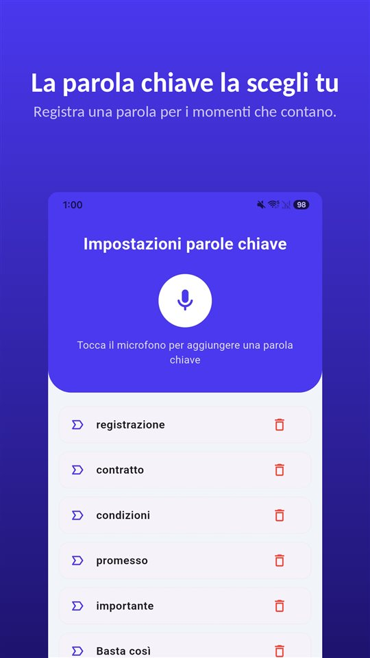

Una settimana dopo la riunione, arriva un messaggio nel gruppo del team: "Ma non avevamo deciso così?"

Ognuno ricorda in modo un po' diverso. Chi l'ha proposto per primo, se la scadenza era venerdì o la settimana dopo. "Avrei dovuto registrarla" è il pensiero che arriva sempre in quel momento. Non è un problema di memoria. Durante una riunione ascolti, pensi e rispondi, e nessuno ha una mano libera per tenere traccia.

Le parole che contano in una riunione arrivano prima del tasto registra.

## Cinque momenti che una registrazione di riunione tende a perdere

| Momento | Cosa si perde | Funzione di TalkSafe |
|---|---|---|
| La riunione inizia | Quello che si è detto prima di premere registra | Le parole di chi conduce come parola chiave; si salvano i 30 secondi già passati |
| Un incontro a due al bar | Voci coperte dal rumore | Rimozione del rumore con IA sul telefono; l'originale resta |
| La riunione finisce | Cosa si è deciso davvero | Un riassunto con IA di ogni registrazione, nella lingua parlata |
| Condividere | I pochi minuti, su un'ora, in cui si è deciso | Ritaglio (l'originale resta) e il menu di condivisione di Android o iPhone |
| Il telefono va perso | La registrazione stessa | Recupero dal backup sul cloud |

## Il telefono al centro, con il microfono libero

Per registrare una riunione in presenza con il telefono, mettilo al centro del tavolo, tra le persone che parlano. Il microfono di solito è sul bordo inferiore, quindi lascia quel bordo libero da fogli e quaderni. Accanto alla tastiera di un portatile, la digitazione finisce per sentirsi più delle voci.

In una sala lunga, può aiutare avvicinare un po' il telefono a chi prende le decisioni. Di solito è la voce che vorrai riascoltare.

## Una riunione inizia prima di "Bene, iniziamo"

"A che punto siamo con quella cosa?" mentre ci si siede. "Ah, quella la faccio io" mentre ci si alza. Il tasto registra di solito perde entrambi i momenti. Quando pensi di premerlo, le parole sono già passate.

[TalkSafe](/talksafe/it/) è un registratore vocale per Android e iPhone che inizia a registrare quando rileva una parola scelta in anticipo. Le parole chiave non sono legate a una persona, quindi puoi impostare **le parole che dirà chi conduce la riunione**, non solo le tue. Quando ne viene rilevata una, la registrazione parte subito senza sbloccare il telefono, e vengono salvati anche **i 30 secondi già trascorsi**.

<figure class="shot"><figcaption>Impostazioni delle parole chiave. Puoi registrarne diverse; basta che ne venga rilevata una perché la registrazione parta.</figcaption></figure>

Puoi registrare più parole chiave, e basta che ne venga rilevata una perché la registrazione parta. **Due parole che di solito compaiono nella stessa frase** rendono il rilevamento molto più affidabile. Pensa alla frase "Bene, iniziamo la riunione" e registra sia "iniziamo" sia "riunione". Per le riunioni, imposta la durata della registrazione dopo il rilevamento su un'ora o sull'arresto manuale, così non si interrompe a metà.

Alla riunione di team della settimana prossima, nel momento in cui la responsabile dice "Bene, iniziamo la riunione", il telefono inizia a registrare così com'è sul tavolo, e restano anche i 30 secondi appena precedenti. Come funziona l'avvio con una parola è spiegato in [Prima della mano si muove la voce](/blog/it/say-it-first/).

## Al bar, prima togli il rumore

Riascolta un incontro a due con un cliente al bar e la macchina del caffè, la musica e le risate del tavolo accanto possono sentirsi più della conversazione. La cifra che al tavolo hai sentito benissimo, nella registrazione si distingue a fatica.

La **rimozione del rumore con IA** di TalkSafe toglie il rumore di fondo da una registrazione finita e lascia la conversazione. L'elaborazione avviene **sul telefono**, e la versione ripulita viene salvata come nuovo file **lasciando l'originale com'era**. Con due persone che parlano una di fronte all'altra, ciò che rimane è la conversazione. Funziona anche su un tratto ritagliato, quindi puoi ripulire solo i minuti in cui è uscita la cifra. Il confronto con altre soluzioni è in [Come togliere il rumore di fondo da una registrazione vocale su Android](/blog/it/remove-background-noise/).

## A riunione finita, leggi prima il riassunto

Registrare una riunione non significa che qualcuno riascolterà un file di un'ora dall'inizio. Per questo chi ha registrato finisce comunque per affidarsi alla memoria.

TalkSafe crea **un riassunto con IA di ogni registrazione** e lo mostra come elenco di punti sotto il lettore, nella schermata di dettaglio. Una riunione in italiano viene riassunta in italiano. Trova la decisione nel riassunto e ascolta quel punto per verificare le parole esatte.

- **È un riassunto, non una trascrizione.** Non c'è un testo parola per parola di tutta la riunione.
- **I riassunti si fanno su un server.** Il rilevamento delle parole chiave avviene sul telefono, ma per il riassunto la registrazione viene inviata a un server.
- **Anche i tratti ritagliati e i file ripuliti dal rumore** si possono riassumere.

Anche i registratori integrati dei telefoni Galaxy e Pixel offrono riassunti sui modelli compatibili. Le differenze tra le app sono in [Come riassumere una registrazione vocale con l'IA su Android](/blog/it/summarize-recording/).

## Invia solo i minuti in cui si è deciso

Quello che condividi dopo una riunione di solito non è l'ora intera, ma i pochi minuti in cui è stata presa la decisione. Il **ritaglio** di TalkSafe salva il tratto che scegli come nuovo file e lascia l'originale al suo posto. Per inviarlo si usa il **menu di condivisione di Android o iPhone**, quindi il tratto può andare in qualunque app che accetti file: la mail, un'app di messaggi, una cartella condivisa. Come ritagliare è spiegato in [Come tagliare una registrazione vocale su Android senza perdere l'originale](/blog/it/trim-recording/).

## Anche se perdi il telefono, la riunione resta

Una registrazione di riunione spesso serve solo mesi dopo. Nel frattempo potresti cambiare telefono, o cancellare il file per fare spazio.

Le registrazioni salvate nel **backup sul cloud** di TalkSafe si possono recuperare se vengono cancellate dal telefono per errore, e se il telefono va perso e lo cambi, puoi recuperarle dal cloud su quello nuovo. Il backup non è automatico: lo avvii tu. Cos'altro conviene fare dopo aver registrato è in [Cosa fare con una registrazione, e cosa non farne](/blog/it/after-recording/).

## Registrare una riunione a cui partecipi

In Italia registrare una conversazione a cui partecipi è lecito: secondo l'orientamento consolidato della Cassazione, la registrazione di chi partecipa alla conversazione non costituisce intercettazione e non richiede alcuna autorizzazione del giudice. Il quadro completo è in [È legale registrare una conversazione in Italia? Registrare sì, diffondere no](/blog/it/registrare-conversazione/).

Una regola aziendale che vieti di registrare è una questione distinta dalla legge penale. Ne parliamo in [Non è reato, ma può costarti il posto](/blog/it/registrare-sul-lavoro/).

## Perché tutti ricordino la stessa riunione

La prossima volta che qualcuno chiede "Cosa avevamo deciso su quella cosa?", non serve confrontare i ricordi. Apri il riassunto e verifica quel punto.

Una riunione non si registra per vincere una discussione. Si registra perché chi era nella stanza ricordi la stessa riunione.

Registrare una lezione funziona in modo un po’ diverso; è spiegato in [Come registrare le lezioni con il telefono: tutta la lezione o solo le parti importanti](/blog/it/lecture-recording/).

Informazioni generali, non consulenza legale. Per un caso specifico, rivolgiti a un avvocato. Le funzioni di altre app sono descritte in base alle loro informazioni ufficiali al momento della scrittura e possono cambiare. Realizziamo l'app di registrazione TalkSafe.

