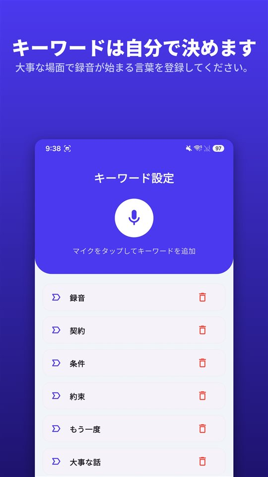

会議から一週間後、チャットにこんなメッセージが届きます。「あのとき、そう決めましたよね？」

みんな少しずつ覚え方が違います。誰が先に言い出したのか、締め切りは金曜だったのか翌週だったのか。「録音しておけばよかった」と思うのは、いつもこの瞬間です。記憶力のせいではありません。会議中は聞いて、考えて、答えるので手いっぱいで、記録する手は残っていません。

会議で大事な言葉は、録音ボタンより先に出てきます。

## 会議の録音で抜け落ちやすい5つの瞬間

| 瞬間 | 抜け落ちやすいもの | TalkSafeで使う機能 |
|---|---|---|
| 会議が始まるとき | 録音ボタンを押す前に出た言葉 | 司会が言う言葉をキーワードに登録、すでに過ぎた30秒まで保存 |
| カフェ・飲食店での1対1の打ち合わせ | 周りの雑音に埋もれた声 | スマホの中で処理するAIノイズ除去、原本はそのまま |
| 会議が終わったあと | 何を決めたのか | 録音ごとのAI要約、録音した言語のまま |
| 共有するとき | 1時間のうち決定が出た数分 | 切り取り（原本は残る）、Android・iPhoneの共有メニュー |
| スマホをなくしたとき | 録音ファイルそのもの | クラウドバックアップから復元 |

## スマホはテーブルの中央に、マイクをふさがずに

対面の会議をスマホで録音するときは、スマホをテーブルの中央、話す人たちの間に置きます。スマホのマイクはたいてい下の端にあるので、そこが紙やノートで覆われないようにします。ノートパソコンのキーボードのすぐ横に置くと、タイピングの音が声より大きく残ります。

細長い会議室なら、決定を下す人の側に少し寄せて置くのも一つの方法です。あとで聞き直したくなるのは、たいていその人の言葉です。

## 会議は「始めます」より先に始まっています

席に着きながらの「あの件、どうなりました？」、終わって立ち上がりながらの「あ、それは私がやります」。録音ボタンはたいていこの2つの瞬間を逃します。押そうと思ったときには、もうその言葉は過ぎています。

[TalkSafe](/talksafe/ja/)は、あらかじめ決めておいた言葉が検知されると録音を始めるAndroid・iPhone向けの録音アプリです。キーワードは話す人に結びついていないので、自分の言葉ではなく**司会が言う言葉**を登録しておけます。検知されるとロック画面を解除しなくてもすぐに録音が始まり、**すでに過ぎた30秒**まで一緒に保存されます。

<figure class="shot"><figcaption>キーワード設定画面。複数登録でき、どれか一つが検知されれば録音が始まります。</figcaption></figure>

キーワードは複数登録でき、どれか一つが検知されれば録音が始まります。**同じ文に一緒に出てきそうな2つの言葉**を登録すると、検知の精度がずっと上がります。「では、会議を始めます」という文を思い浮かべて、「会議」と「始めます」を両方登録する、といった具合です。会議なら、キーワード検知後の録音時間を1時間か手動停止にしておくと途中で切れません。

来週の定例会議で課長が「じゃあ、会議を始めます」と言った瞬間、スマホはテーブルに置かれたまま録音を始めます。その直前に交わされた30秒も一緒に残ります。キーワードで録音を始める仕組みは[先に出るのは、手ではなく言葉です](/blog/ja/say-it-first/)で詳しく書いています。

## カフェでの打ち合わせは、まず雑音を取り除く

取引先の担当者とカフェで会った1対1の打ち合わせは、聞き直すとコーヒーマシンの音や音楽、隣の席の笑い声が会話より大きく聞こえることがあります。その場では確かに聞いた金額が、録音でははっきり聞こえません。

TalkSafeの**AIノイズ除去**は、録音し終えたファイルから周りの雑音を取り除き、会話だけを残します。処理は**スマホの中**で行われ、**原本はそのまま残したうえで**、整えたファイルを新しく保存します。向かい合った2人の会話なら、会話だけが残ります。切り取ったファイルにも使えるので、金額が出た数分だけを選んで整えることもできます。ほかの方法との比較は[録音の雑音を消す方法、Androidでできる4つのやり方](/blog/ja/remove-background-noise/)にあります。

## 終わったら、まず要約を読む

録音を残しても、1時間のファイルを最初から聞き直す人は多くありません。録音しておいたのに、結局は記憶に頼ってしまう理由です。

TalkSafeは**録音ごとにAI要約**を作り、録音の詳細画面で再生バーの下に箇条書きで表示します。日本語の会議は日本語で要約されます。要約で決定事項を探し、その部分だけを聞いて正確な言い回しを確かめれば十分です。

- **文字起こしではなく要約です。** 会議全体を一字一句書き起こしたテキストはありません。
- **要約はサーバーで作られます。** キーワード検知はスマホの中で行われますが、要約のためには録音をサーバーへ送ります。
- **切り取ったファイルやノイズを除去したファイルにも**要約を使えます。

GalaxyやPixelの標準録音アプリにも、対応機種では要約機能があります。アプリごとの違いは[録音をAIで要約する方法、Androidで使えるアプリ](/blog/ja/summarize-recording/)にまとめました。

## 決定が出た数分だけを切り取って送る

会議のあとで共有するのは、たいてい1時間全部ではなく、決定が出た数分です。TalkSafeの**切り取り**は、原本を残したまま選んだ区間を新しいファイルとして保存します。送るときは**Android・iPhoneの共有メニュー**を使うので、メール、メッセンジャー、社内のドライブなど、ファイルを受け取れるアプリならどこへでも送れます。切り取り方は[録音の切り取り方：Androidで必要な部分だけ切り取り、原本は残す方法](/blog/ja/trim-recording/)にあります。

## スマホをなくしても、会議の記録は残ります

会議の録音は、数か月たってから必要になることがよくあります。その間に機種変更をしたり、容量を空けようとしてファイルを消してしまったりすることもあります。

TalkSafeの**クラウドバックアップ**に保存した録音は、端末から誤って削除しても復元でき、端末をなくして買い替えても、新しい端末でクラウドから復元できます。録音したあとに気をつけることは[録音したあとにすべきことと、してはいけないこと](/blog/ja/after-recording/)にまとめています。

## 自分が参加している会議は録音できます

自分が参加している会議の録音は、原則として違法ではありません。日本には秘密録音そのものを直接禁じる規定がなく、最高裁平成12年7月12日判決も、相手の同意がない当事者の録音を違法ではないとしています。

会社が録音を禁止している場合は、刑事上の問題とは別に社内ルールの問題になります。社内ルールについては[就業規則に書いていなくても、会社は録音を禁止できます](/blog/ja/workplace-recording-policy/)に、法律全体は[日本には「盗聴罪」がありません](/blog/ja/recording-consent-law/)にまとめました。

## 同じ会議を、同じ内容で覚えておくために

次の会議で「あれ、何て決めましたっけ？」と聞かれたら、お互いの記憶をすり合わせる代わりに、要約を開いてその部分を確かめればいいのです。

会議を録音するのは、誰かを言い負かすためではありません。同じ場にいた人たちが、同じ会議を同じ内容で覚えておくためです。

この記事は一般的な情報提供を目的としたもので、法的助言ではありません。具体的な事案は弁護士にご相談ください。ほかのアプリの機能は執筆時点の公式案内に基づいており、変わることがあります。私たちは録音アプリTalkSafeを作っています。

