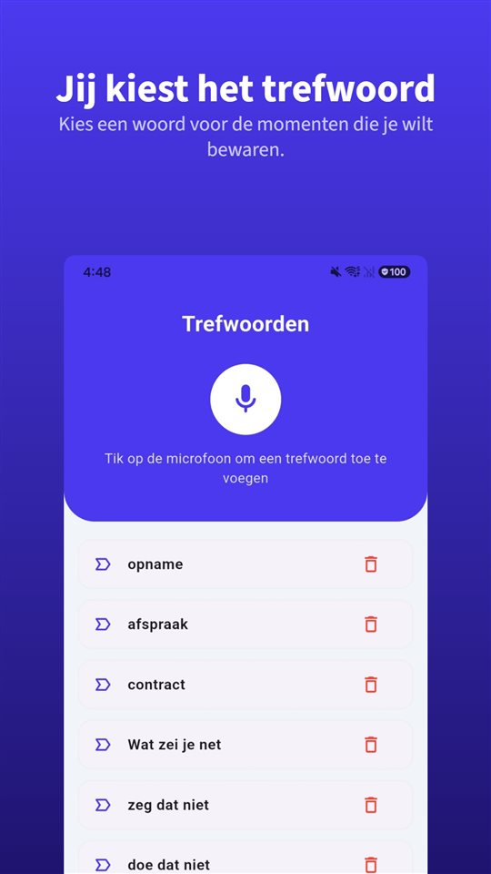

Een week na de vergadering verschijnt er een bericht in de teamchat: "Hadden we dat niet zo afgesproken?"

Iedereen herinnert het zich net iets anders. Wie het als eerste voorstelde, of de deadline vrijdag was of de week erna. "Had ik het maar opgenomen" is precies de gedachte die op dat moment komt. Het ligt niet aan je geheugen. In een vergadering luister je, denk je na en antwoord je, en niemand heeft een hand vrij om bij te houden wat er gezegd wordt.

Wat telt in een vergadering, wordt gezegd voordat iemand op opnemen drukt.

## Vijf momenten die een vergaderopname vaak mist

| Moment | Wat verloren gaat | TalkSafe-functie |
|---|---|---|
| De vergadering begint | Wat er werd gezegd voordat je op opnemen drukte | Woorden van de voorzitter als trefwoord; de 30 seconden die al voorbij waren, worden bewaard |
| Een gesprek met z'n tweeën in een café | Stemmen die in het lawaai verdwijnen | AI-ruisonderdrukking op de telefoon; het origineel blijft |
| De vergadering is voorbij | Wat er echt besloten is | Een AI-samenvatting met één tik, in de gesproken taal |
| Delen | De paar minuten van een uur waarin het besluit viel | Inkorten (het origineel blijft) en het deelmenu van Android of iPhone |
| De telefoon is kwijt | De opname zelf | Terugzetten uit de cloudback-up |

## De telefoon in het midden, de microfoon vrij

Om een vergadering op locatie met je telefoon op te nemen, leg je hem midden op tafel, tussen de mensen die praten. De microfoon zit meestal aan de onderrand, dus houd die vrij van papieren en notitieboeken. Naast het toetsenbord van een laptop klinkt het typen uiteindelijk harder dan de stemmen.

In een lange vergaderzaal kan het helpen de telefoon iets dichter bij degene te leggen die de besluiten neemt. Dat is meestal de stem die je later nog eens wilt horen.

## Een vergadering begint vóór "Goed, we beginnen"

"Hoe staat het eigenlijk met dat ene punt?" terwijl iedereen gaat zitten. "O, dat doe ik wel" terwijl iedereen opstaat. De opnameknop mist meestal allebei. Als je eraan denkt om te drukken, zijn de woorden al voorbij.

[TalkSafe](/talksafe/nl/) is een opname-app voor Android en iPhone die begint met opnemen als hij een vooraf gekozen woord herkent. Trefwoorden zijn niet aan een persoon gekoppeld, dus je kunt **de woorden van de voorzitter** instellen, niet alleen je eigen woorden. Wordt er één herkend, dan start de opname meteen zonder de telefoon te ontgrendelen, en **de 30 seconden die al voorbij waren** worden ook bewaard.

<figure class="shot"><figcaption>Trefwoordinstellingen. Je kunt meerdere woorden instellen; het is genoeg dat er één herkend wordt.</figcaption></figure>

Je kunt meerdere trefwoorden instellen, en het is genoeg dat er één herkend wordt. **Twee woorden die meestal in dezelfde zin voorkomen**, maken de herkenning veel betrouwbaarder. Denk aan de zin "Goed, we beginnen met de vergadering" en stel "beginnen" en "vergadering" in. Zet voor vergaderingen de opnameduur na herkenning op een uur of op handmatig stoppen, zodat de opname niet halverwege afbreekt.

Bij het teamoverleg volgende week begint de telefoon op het moment dat je leidinggevende zegt "Goed, we beginnen met de vergadering" gewoon op tafel met opnemen, en de 30 seconden vlak daarvoor blijven ook bewaard. Hoe starten met een woord werkt, staat in [Eerst zeg je iets: een opname starten met je stem](/blog/nl/say-it-first/).

## In een café eerst het lawaai weghalen

Luister een gesprek met z'n tweeën met een klant in een café terug, en het koffieapparaat, de muziek en het gelach aan de tafel ernaast kunnen harder klinken dan het gesprek. Het bedrag dat je aan tafel duidelijk hoorde, is op de opname nauwelijks te verstaan.

De **AI-ruisonderdrukking** van TalkSafe haalt het achtergrondgeluid uit een afgeronde opname en laat het gesprek over. De verwerking gebeurt **op de telefoon**, en de opgeschoonde versie wordt als nieuw bestand bewaard, **het origineel blijft zoals het was**. Bij twee mensen die tegenover elkaar zitten, blijft het gesprek over. Het werkt ook op een ingekort fragment, dus je kunt alleen de minuten opschonen waarin het bedrag viel. De vergelijking met andere manieren staat in [Achtergrondgeluid uit een spraakopname halen op Android](/blog/nl/remove-background-noise/).

## Na afloop eerst de samenvatting lezen

Een vergadering opnemen betekent niet dat iemand een bestand van een uur vanaf het begin terugluistert. Daarom vertrouwen ook mensen die hebben opgenomen uiteindelijk toch op hun geheugen.

TalkSafe maakt met één tik **een AI-samenvatting** van een opname en toont die als lijst met punten onder de speler in het detailscherm. Een Nederlandstalige vergadering wordt in het Nederlands samengevat. Zoek het besluit in de samenvatting en luister dat stuk voor de precieze woorden.

- **Het is een samenvatting, geen transcriptie.** Er is geen woord-voor-woordtekst van de hele vergadering.
- **Samenvattingen worden op een server gemaakt.** De trefwoordherkenning werkt op de telefoon, maar voor de samenvatting wordt de opname naar een server gestuurd.
- **Ingekorte fragmenten en opgeschoonde bestanden** kun je ook laten samenvatten.

De ingebouwde recorders op Galaxy- en Pixel-telefoons bieden op ondersteunde modellen ook samenvattingen. De verschillen tussen de apps staan in [Een spraakopname samenvatten met AI op Android](/blog/nl/summarize-recording/).

## Stuur alleen de minuten waarin het besluit viel

Wat je na een vergadering deelt, is meestal niet het hele uur, maar de paar minuten waarin het besluit viel. Met **inkorten** in TalkSafe bewaar je het gekozen stuk als nieuw bestand en blijft het origineel staan. Versturen gaat via het **deelmenu van Android of iPhone**, dus het fragment kan naar elke app die bestanden aanneemt: e-mail, een berichtenapp, een gedeelde map. Hoe inkorten werkt, staat in [Een spraakopname inkorten op Android zonder het origineel te verliezen](/blog/nl/trim-recording/).

## Telefoon kwijt, vergadering niet

Een vergaderopname is vaak pas maanden later nodig. In de tussentijd neem je misschien een nieuwe telefoon, of wis je het bestand om ruimte te maken.

Opnames die in de **cloudback-up** van TalkSafe staan, kun je terugzetten als je ze per ongeluk van de telefoon wist, en als je je telefoon kwijtraakt en een nieuwe neemt, kun je de opnames daar uit de cloud terugzetten. De back-up gaat niet automatisch; je start hem zelf. Wat je na het opnemen verder kunt doen, staat in [Wat je met een opname doet, en wat je er niet mee doet](/blog/nl/after-recording/).

## Wat de wet zegt in Nederland en België

**In Nederland** mag je een vergadering opnemen waaraan je zelf deelneemt. Artikel 139a van het Wetboek van Strafrecht stelt het opnemen van een gesprek alleen strafbaar voor wie geen deelnemer is en niet in opdracht van een deelnemer handelt.

**In België** pleegt een deelnemer die een communicatie opneemt volgens het Hof van Cassatie (2015) geen misdrijf. Wie de opname met bedrieglijk opzet of met het oogmerk te schaden gebruikt, is wel strafbaar volgens artikel 314bis van het Strafwetboek.

Ook in Suriname, Aruba, Curaçao en Sint Maarten mag je een gesprek opnemen waaraan je zelf deelneemt; Caribisch Nederland hebben we niet onderzocht. De details staan in [Mag je een gesprek stiekem opnemen? In Nederland en België wel, als je zelf meepraat](/blog/nl/gesprek-opnemen/).

Een bedrijfsregel die opnemen verbiedt, is een andere kwestie dan het strafrecht.

## Zodat iedereen dezelfde vergadering onthoudt

Als iemand de volgende keer vraagt "Wat hadden we daar ook alweer over besloten?", hoef je geen herinneringen naast elkaar te leggen. Open de samenvatting en luister dat stuk terug.

Je neemt een vergadering niet op om een discussie te winnen. Je neemt hem op zodat de mensen die in de zaal zaten zich dezelfde vergadering herinneren.

Een college opnemen werkt iets anders; dat staat in [Een college opnemen met je telefoon: het hele college of alleen wat telt](/blog/nl/lecture-recording/).

Algemene informatie, geen juridisch advies. Raadpleeg voor een concrete situatie een advocaat. De functies van andere apps zijn beschreven op basis van hun officiële informatie op het moment van schrijven en kunnen veranderen. Wij maken de opname-app TalkSafe.

