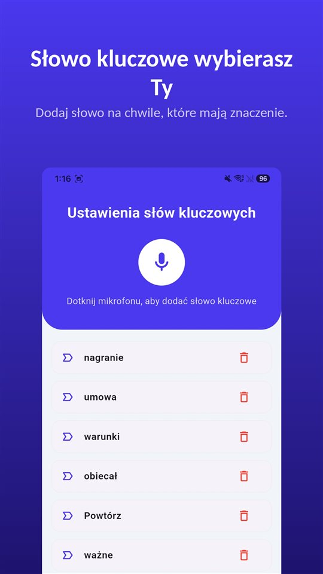

Tydzień po spotkaniu na czacie zespołu pojawia się wiadomość: „Przecież tak ustaliliśmy, prawda?”

Każdy pamięta to trochę inaczej. Kto pierwszy to zaproponował, czy termin był w piątek, czy w następnym tygodniu. „Trzeba było to nagrać” – ta myśl przychodzi zawsze właśnie wtedy. To nie kwestia pamięci. Na spotkaniu słuchasz, myślisz i odpowiadasz, i nikt nie ma wolnej ręki, żeby notować.

To, co ważne na spotkaniu, pada, zanim ktoś naciśnie „nagrywaj”.

## Pięć momentów, które nagranie spotkania często gubi

| Moment | Co przepada | Funkcja TalkSafe |
|---|---|---|
| Spotkanie się zaczyna | To, co padło przed naciśnięciem nagrywania | Słowa prowadzącego jako słowo kluczowe; zapisuje się 30 sekund, które już minęły |
| Spotkanie we dwoje w kawiarni | Głosy zagłuszone hałasem | Usuwanie szumów z AI w telefonie; oryginał zostaje |
| Spotkanie się kończy | Co tak naprawdę ustalono | Podsumowanie AI każdego nagrania, w języku rozmowy |
| Udostępnianie | Kilka minut z godziny, w których zapadła decyzja | Wycinanie (oryginał zostaje) i menu udostępniania Androida lub iPhone'a |
| Telefon ginie | Samo nagranie | Przywrócenie z kopii zapasowej w chmurze |

## Telefon na środku, mikrofon odsłonięty

Żeby nagrać spotkanie na żywo telefonem, połóż go na środku stołu, między osobami, które mówią. Mikrofon jest zwykle na dolnej krawędzi, więc nie zasłaniaj jej kartkami ani notesem. Obok klawiatury laptopa stukanie w klawisze wychodzi głośniej niż głosy.

W długiej sali może pomóc położenie telefonu trochę bliżej osoby, która podejmuje decyzje. Zwykle to właśnie jej głos zechcesz odsłuchać jeszcze raz.

## Spotkanie zaczyna się przed „Dobrze, zaczynamy”

„A co z tamtą sprawą?”, kiedy wszyscy siadają. „A, to ja zrobię”, kiedy wstają. Przycisk nagrywania zwykle przegapia oba te momenty. Kiedy pomyślisz, żeby go nacisnąć, słowa już padły.

[TalkSafe](/talksafe/pl/) to aplikacja do nagrywania na Androida i iPhone'a, która zaczyna nagrywać, gdy wykryje wybrane wcześniej słowo. Słowa kluczowe nie są przypisane do osoby, więc możesz zapisać **słowa, które powie prowadzący**, a nie tylko swoje. Gdy któreś zostanie wykryte, nagrywanie zaczyna się od razu, bez odblokowywania telefonu, i zapisuje się też **30 sekund, które już minęły**.

<figure class="shot"><figcaption>Ustawienia słów kluczowych. Można zapisać kilka słów; wystarczy, że zostanie wykryte jedno z nich.</figcaption></figure>

Możesz zapisać kilka słów kluczowych, a nagrywanie zaczyna się, gdy zostanie wykryte którekolwiek z nich. **Dwa słowa, które zwykle pojawiają się w tym samym zdaniu**, sprawiają, że wykrywanie jest znacznie pewniejsze. Pomyśl o zdaniu „Dobrze, zaczynamy spotkanie” i zapisz „zaczynamy” oraz „spotkanie”. Na spotkania ustaw czas nagrywania po wykryciu na godzinę albo na ręczne zatrzymanie, żeby nagranie nie urwało się w połowie.

Na przyszłotygodniowym spotkaniu zespołu, w chwili gdy szefowa powie „Dobrze, zaczynamy spotkanie”, telefon zacznie nagrywać tak, jak leży na stole, a 30 sekund tuż przedtem też zostanie. Jak działa uruchamianie nagrywania słowem, opisujemy w [Najpierw coś mówisz: jak zacząć nagrywanie głosem](/blog/pl/say-it-first/).

## W kawiarni najpierw usuń hałas

Odsłuchaj spotkanie we dwoje z klientem w kawiarni, a ekspres, muzyka i śmiech przy sąsiednim stoliku mogą być głośniejsze od rozmowy. Kwota, którą przy stole słyszałeś wyraźnie, na nagraniu ledwo się przebija.

**Usuwanie szumów z AI** w TalkSafe zdejmuje hałas w tle z gotowego nagrania i zostawia rozmowę. Przetwarzanie odbywa się **w telefonie**, a oczyszczona wersja zapisuje się jako nowy plik, **oryginał zostaje bez zmian**. Gdy dwie osoby siedzą naprzeciw siebie, zostaje sama rozmowa. Funkcja działa też na wyciętym fragmencie, więc możesz oczyścić tylko te minuty, w których padła kwota. Porównanie z innymi sposobami jest w [Jak usunąć hałas w tle z nagrania głosu na Androidzie](/blog/pl/remove-background-noise/).

## Po spotkaniu najpierw przeczytaj podsumowanie

Nagranie spotkania nie znaczy, że ktoś odsłucha godzinny plik od początku. Dlatego nawet ci, którzy nagrali, w końcu i tak polegają na pamięci.

TalkSafe tworzy **podsumowanie AI każdego nagrania** i pokazuje je jako listę punktów pod odtwarzaczem na ekranie szczegółów. Spotkanie po polsku jest streszczane po polsku. Znajdź decyzję w podsumowaniu i odsłuchaj ten fragment, żeby sprawdzić dokładne słowa.

- **To podsumowanie, nie transkrypcja.** Nie ma tekstu całego spotkania słowo w słowo.
- **Podsumowania powstają na serwerze.** Wykrywanie słów kluczowych działa w telefonie, ale do podsumowania nagranie jest wysyłane na serwer.
- **Wycięte fragmenty i pliki oczyszczone z szumów** też można streścić.

Wbudowane dyktafony w telefonach Galaxy i Pixel też oferują podsumowania na obsługiwanych modelach. Różnice między aplikacjami opisujemy w [Jak streścić nagranie głosowe za pomocą AI na Androidzie](/blog/pl/summarize-recording/).

## Wyślij tylko te minuty, w których zapadła decyzja

Po spotkaniu zwykle udostępnia się nie całą godzinę, tylko kilka minut, w których zapadła decyzja. **Wycinanie** w TalkSafe zapisuje wybrany fragment jako nowy plik i zostawia oryginał na miejscu. Wysyłanie odbywa się przez **menu udostępniania Androida lub iPhone'a**, więc fragment może trafić do każdej aplikacji, która przyjmuje pliki: poczty, komunikatora, wspólnego folderu. Jak wycinać, opisujemy w [Jak przyciąć nagranie głosu na Androidzie i nie stracić oryginału](/blog/pl/trim-recording/).

## Telefon zginie, spotkanie zostanie

Nagranie spotkania często jest potrzebne dopiero po kilku miesiącach. W tym czasie możesz zmienić telefon albo usunąć plik, robiąc miejsce.

Nagrania zapisane w **kopii zapasowej w chmurze** TalkSafe można przywrócić, jeśli zostaną usunięte z telefonu przez pomyłkę, a jeśli telefon zginie i zmienisz go na nowy, można je przywrócić z chmury na nowym telefonie. Kopia nie powstaje automatycznie, trzeba ją wykonać samodzielnie. Co jeszcze warto zrobić po nagraniu, opisujemy w [Co zrobić z nagraniem, a czego z nim nie robić](/blog/pl/after-recording/).

## Co mówi prawo w Polsce i tam, gdzie mieszka wielu Polaków

**W Polsce** nagranie rozmowy, w której się uczestniczy, co do zasady nie jest przestępstwem. Art. 267 § 3 Kodeksu karnego karze tego, kto w celu uzyskania informacji, do której nie jest uprawniony, posługuje się urządzeniem podsłuchowym, a uczestnik rozmowy jest uprawniony do tego, co mówi się do niego. Szczegóły są w [Czy można nagrywać rozmowę bez zgody? W Polsce uczestnik może, rozpowszechnianie to inna sprawa](/blog/pl/nagrywanie-rozmowy/).

**W Niemczech** nagranie rozmowy niepublicznej wymaga zgody pozostałych uczestników także wtedy, gdy samemu się w niej bierze udział (§ 201 StGB). **W Holandii** wolno nagrać rozmowę, w której się uczestniczy (art. 139a Kodeksu karnego karze tylko tego, kto w rozmowie nie bierze udziału). **W Wielkiej Brytanii** nagranie własnej rozmowy na własny użytek co do zasady nie jest przestępstwem.

## Żeby wszyscy pamiętali to samo spotkanie

Kiedy następnym razem ktoś zapyta „Co my właściwie ustaliliśmy w tej sprawie?”, nie trzeba porównywać wspomnień. Otwórz podsumowanie i sprawdź ten fragment.

Spotkania nie nagrywa się po to, żeby wygrać spór. Nagrywa się je po to, żeby ci, którzy byli w sali, pamiętali to samo spotkanie.

Informacja ogólna, a nie porada prawna. W konkretnej sprawie skonsultuj się z prawnikiem. Funkcje innych aplikacji opisano na podstawie ich oficjalnych informacji z chwili pisania i mogą się zmienić. Tworzymy aplikację do nagrywania TalkSafe.

