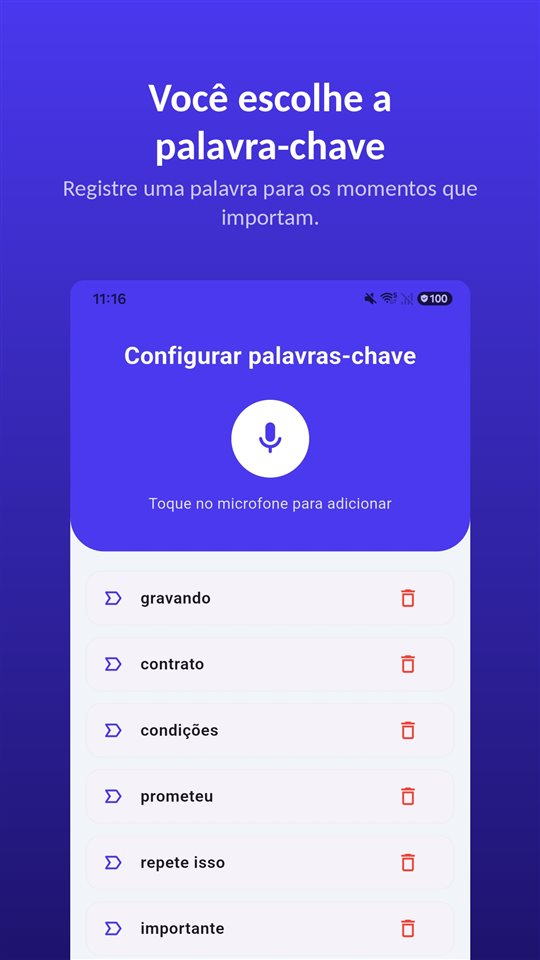

Uma semana depois da reunião, chega uma mensagem no grupo da equipe: "A gente não tinha combinado isso?"

Cada um lembra de um jeito um pouco diferente. Quem sugeriu primeiro, se o prazo era sexta ou a semana seguinte. "Devia ter gravado" é o pensamento que sempre aparece nessa hora. Não é falta de memória. Numa reunião você está ouvindo, pensando e respondendo, e ninguém tem uma mão livre para registrar.

O que importa numa reunião é dito antes de alguém apertar o botão de gravar.

## Cinco momentos que a gravação de uma reunião costuma perder

| Momento | O que se perde | Recurso do TalkSafe |
|---|---|---|
| A reunião começa | O que foi dito antes de apertar gravar | As palavras de quem conduz como palavra-chave; os 30 segundos que já passaram são salvos |
| Um encontro a dois no café | Vozes abafadas pelo ruído | Remoção de ruído com IA no celular; o original fica |
| A reunião termina | O que foi decidido de fato | Um resumo por IA de cada gravação, no idioma falado |
| Na hora de compartilhar | Os poucos minutos, numa hora, em que se decidiu | Corte (o original fica) e o menu de compartilhamento do Android ou do iPhone |
| O celular é perdido | A própria gravação | Recuperação pelo backup na nuvem |

## O celular no meio, com o microfone livre

Para gravar uma reunião presencial pelo celular, coloque-o no meio da mesa, entre as pessoas que falam. O microfone costuma ficar na borda de baixo, então deixe essa borda livre de papéis e cadernos. Ao lado do teclado de um notebook, a digitação acaba ficando mais alta que as vozes.

Numa sala comprida, pode ajudar deixar o celular um pouco mais perto de quem toma as decisões. Normalmente é a voz que você vai querer ouvir de novo.

## A reunião começa antes do "Bom, vamos começar"

"E aquele assunto, como ficou?" enquanto o pessoal se senta. "Ah, isso eu resolvo" enquanto todo mundo se levanta. O botão de gravar costuma perder os dois momentos. Quando você pensa em apertar, as palavras já passaram.

O [TalkSafe](/talksafe/pt-br/) é um app de gravação de voz para Android e iPhone que começa a gravar quando detecta uma palavra escolhida antes. As palavras-chave não estão ligadas a uma pessoa, então você pode cadastrar **o que quem conduz a reunião vai dizer**, não só o que você vai dizer. Quando uma é detectada, a gravação começa na hora, sem desbloquear o celular, e **os 30 segundos que já tinham passado** também são salvos.

<figure class="shot"><figcaption>Configuração de palavras-chave. Dá para cadastrar várias; basta uma delas ser detectada para a gravação começar.</figcaption></figure>

Dá para cadastrar várias palavras-chave, e basta uma ser detectada para a gravação começar. **Duas palavras que costumam aparecer na mesma frase** deixam a detecção muito mais confiável. Pense na frase "Bom, vamos começar a reunião" e cadastre "começar" e "reunião". Para reuniões, ajuste o tempo de gravação depois da detecção para uma hora ou parada manual, para não cortar no meio.

Na reunião da equipe da semana que vem, no momento em que sua chefe disser "Bom, vamos começar a reunião", o celular começa a gravar do jeito que está sobre a mesa, e os 30 segundos logo antes também ficam. Como funciona começar a gravar com uma palavra está em [Primeiro você diz alguma coisa](/blog/pt-br/say-it-first/).

## No café, tire o ruído primeiro

Ouça de novo um encontro a dois com um cliente num café e a máquina de café, a música e as risadas da mesa ao lado podem ficar mais altas que a conversa. O valor que você ouviu perfeitamente na mesa mal se entende na gravação.

A **remoção de ruído com IA** do TalkSafe tira o ruído de fundo de uma gravação pronta e deixa a conversa. O processamento acontece **no celular**, e a versão limpa é salva como um arquivo novo, **com o original do jeito que estava**. Com duas pessoas conversando frente a frente, o que sobra é a conversa. O recurso também funciona num trecho cortado, então você pode limpar só os minutos em que o valor apareceu. A comparação com outras opções está em [Como tirar o ruído de fundo de uma gravação de voz no Android](/blog/pt-br/remove-background-noise/).

## Depois da reunião, leia o resumo primeiro

Gravar uma reunião não significa que alguém vai ouvir um arquivo de uma hora desde o começo. Por isso até quem gravou acaba confiando na memória.

O TalkSafe cria **um resumo por IA de cada gravação** e o mostra como uma lista de tópicos abaixo do player, na tela de detalhes. Uma reunião em português é resumida em português. Ache a decisão no resumo e ouça esse trecho para conferir as palavras exatas.

- **É um resumo, não uma transcrição.** Não há um texto palavra por palavra da reunião inteira.
- **Os resumos são feitos em um servidor.** A detecção de palavras-chave funciona no celular, mas para o resumo a gravação é enviada a um servidor.
- **Trechos cortados e arquivos com o ruído removido** também podem ser resumidos.

Os gravadores de fábrica dos celulares Galaxy e Pixel também oferecem resumos nos modelos compatíveis. As diferenças entre os apps estão em [Como resumir um áudio gravado com IA no Android](/blog/pt-br/summarize-recording/).

## Envie só os minutos em que se decidiu

O que se compartilha depois de uma reunião normalmente não é a hora inteira, mas os poucos minutos em que a decisão foi tomada. O **corte** do TalkSafe salva o trecho escolhido como um arquivo novo e deixa o original no lugar. O envio usa o **menu de compartilhamento do Android ou do iPhone**, então o trecho pode ir para qualquer app que aceite arquivos: e-mail, um app de mensagens, uma pasta compartilhada. Como cortar está em [Como cortar uma gravação de voz no Android sem perder o original](/blog/pt-br/trim-recording/).

## Perdeu o celular, a reunião continua

A gravação de uma reunião muitas vezes só é necessária meses depois. Nesse meio-tempo você pode trocar de celular, ou apagar o arquivo para liberar espaço.

As gravações salvas no **backup na nuvem** do TalkSafe podem ser recuperadas se forem apagadas do celular por engano, e se o celular for perdido e trocado, podem ser recuperadas da nuvem no novo. O backup não é automático: é você quem faz. O que mais vale fazer depois de gravar está em [O que fazer com uma gravação, e o que não fazer](/blog/pt-br/after-recording/).

## O que diz a lei no Brasil e em Portugal

**No Brasil**, gravar uma reunião da qual você participa é lícito: o STF fixou no Tema 237 (RE 583.937) que é lícita a gravação ambiental feita por um dos interlocutores sem o conhecimento do outro, e o § 1º do art. 10-A da Lei 9.296/1996 diz que não há crime quando a captação é feita por um dos interlocutores.

**Em Portugal** é diferente: o artigo 199.º do Código Penal pune a gravação sem consentimento, mesmo que as palavras tenham sido ditas a você. Para gravar uma reunião em Portugal, o caminho é obter o consentimento dos participantes no início.

Os detalhes, inclusive a exceção da Justiça Eleitoral no Brasil, estão em [Gravar conversa sem a outra pessoa saber é crime? No Brasil e em Portugal, a resposta é oposta](/blog/pt-br/gravar-conversa/).

## Para que todos lembrem da mesma reunião

Da próxima vez que alguém perguntar "O que a gente tinha decidido sobre isso?", não precisa comparar lembranças. Abra o resumo e confira o trecho.

Ninguém grava uma reunião para ganhar uma discussão. Grava para que quem estava na sala lembre da mesma reunião.

Gravar uma aula funciona um pouco diferente; está em [Como gravar aula pelo celular: a aula inteira ou só o que importa](/blog/pt-br/lecture-recording/).

Informação geral, não é aconselhamento jurídico. Para um caso concreto, consulte um advogado. Os recursos de outros apps são descritos de acordo com as informações oficiais no momento da escrita e podem mudar. Nós desenvolvemos o app de gravação TalkSafe.

