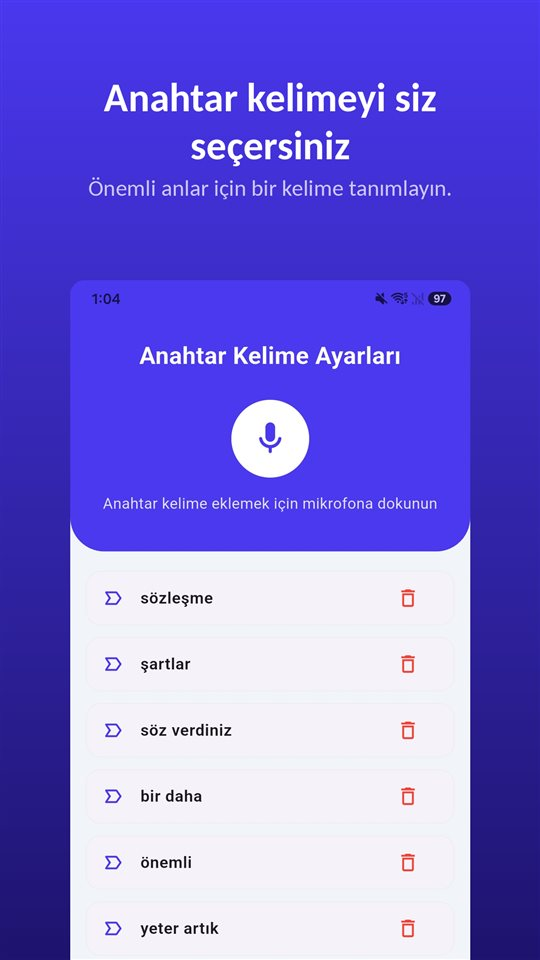

Toplantıdan bir hafta sonra ekip grubuna bir mesaj düşer: "O konuda böyle anlaşmamış mıydık?"

Herkes biraz farklı hatırlar. Önce kimin önerdiğini, son tarihin cuma mı yoksa ertesi hafta mı olduğunu. "Keşke kaydetseydim" düşüncesi hep tam bu anda gelir. Bu bir hafıza sorunu değil. Toplantıda dinler, düşünür, cevap verirsiniz; kayıt tutacak boş bir el kalmaz.

Toplantıda önemli olan sözler kayıt tuşundan önce söylenir.

## Toplantı kaydının sık kaçırdığı beş an

| An | Kaybolan | TalkSafe özelliği |
|---|---|---|
| Toplantı başlıyor | Kayıt tuşuna basmadan önce söylenenler | Toplantıyı yönetenin sözleri anahtar kelime olarak; geçmiş 30 saniye saklanır |
| Kafede iki kişilik görüşme | Gürültüye karışan sesler | Telefonda yapay zekâ ile gürültü giderme; orijinal kalır |
| Toplantı bitiyor | Gerçekte neye karar verildiği | Her kaydın yapay zekâ özeti, konuşulan dilde |
| Paylaşırken | Bir saatin içinde kararın verildiği birkaç dakika | Kırpma (orijinal kalır) ve Android veya iPhone paylaşım menüsü |
| Telefon kayboluyor | Kaydın kendisi | Bulut yedeklemeden geri yükleme |

## Telefon ortada, mikrofon açıkta

Yüz yüze bir toplantıyı telefonla kaydetmek için telefonu masanın ortasına, konuşanların arasına koyun. Mikrofon genellikle alt kenardadır; o kenarı kâğıt ve defterlerden uzak tutun. Dizüstü bilgisayar klavyesinin yanında, tuş sesleri konuşmalardan yüksek çıkar.

Uzun bir toplantı salonunda telefonu karar veren kişiye biraz daha yakın koymak işe yarayabilir. Sonradan tekrar dinlemek isteyeceğiniz ses genellikle odur.

## Toplantı "Evet, başlayalım"dan önce başlar

Yerlere oturulurken "O iş ne oldu?", kalkılırken "Ha, onu ben hallederim." Kayıt tuşu genellikle iki anı da kaçırır. Basmayı düşündüğünüzde o sözler çoktan geçmiştir.

[TalkSafe](/talksafe/tr/), önceden belirlenen bir kelimeyi algıladığında kayda başlayan Android ve iPhone için bir ses kayıt uygulamasıdır. Anahtar kelimeler bir kişiye bağlı değildir; bu yüzden yalnızca kendi sözlerinizi değil, **toplantıyı yönetenin söyleyeceği sözleri** de kaydedebilirsiniz. Biri algılandığında telefonun kilidini açmadan kayıt hemen başlar ve **geçmiş 30 saniye** de saklanır.

<figure class="shot"><figcaption>Anahtar kelime ayarları. Birden fazla kelime kaydedebilirsiniz; herhangi birinin algılanması kaydı başlatır.</figcaption></figure>

Birden fazla anahtar kelime kaydedebilirsiniz; herhangi birinin algılanması kaydı başlatır. **Aynı cümlede birlikte geçmesi muhtemel iki kelime** algılamayı çok daha güvenilir hale getirir. "Evet, toplantıya başlayalım" cümlesini düşünün ve "toplantıya" ile "başlayalım" kelimelerini kaydedin. Toplantılar için algılamadan sonraki kayıt süresini bir saate ya da elle durdurmaya ayarlayın; böylece kayıt yarıda kesilmez.

Gelecek haftaki ekip toplantısında müdürünüz "Evet, toplantıya başlayalım" dediği anda telefon masada durduğu yerde kayda başlar; hemen öncesindeki 30 saniye de kalır. Kelimeyle kayıt başlatmanın nasıl çalıştığı [Önce bir şey söylersiniz: kaydı sesle başlatmak](/blog/tr/say-it-first/) yazısında anlatılıyor.

## Kafede önce gürültüyü giderin

Bir müşteriyle kafede yaptığınız iki kişilik görüşmeyi tekrar dinlediğinizde kahve makinesi, müzik ve yan masadaki kahkahalar konuşmadan yüksek çıkabilir. Masada gayet net duyduğunuz rakam, kayıtta zor seçilir.

TalkSafe'in **yapay zekâ ile gürültü giderme** özelliği, tamamlanmış bir kayıttan arka plan gürültüsünü alır ve konuşmayı bırakır. İşlem **telefonda** yapılır; temizlenmiş sürüm yeni bir dosya olarak kaydedilir, **orijinal olduğu gibi kalır**. Karşılıklı oturan iki kişinin konuşmasında geriye konuşma kalır. Özellik kırpılmış bir bölüme de uygulanabilir; yani yalnızca rakamın geçtiği dakikaları temizleyebilirsiniz. Diğer yollarla karşılaştırma [Android'de bir ses kaydındaki arka plan gürültüsü nasıl giderilir](/blog/tr/remove-background-noise/) yazısında.

## Toplantıdan sonra önce özeti okuyun

Bir toplantıyı kaydetmek, birinin bir saatlik dosyayı baştan dinleyeceği anlamına gelmez. Kaydedenler de bu yüzden sonunda yine hafızalarına güvenir.

TalkSafe **her kayıt için bir yapay zekâ özeti** oluşturur ve bunu kayıt ayrıntısı ekranında oynatıcının altında madde listesi olarak gösterir. Türkçe bir toplantı Türkçe özetlenir. Kararı özette bulun, tam ifade için o bölümü dinleyin.

- **Bu bir özettir, döküm değil.** Toplantının tamamının kelimesi kelimesine metni yoktur.
- **Özetler bir sunucuda yapılır.** Anahtar kelime algılama telefonda çalışır, ancak özet için kayıt bir sunucuya gönderilir.
- **Kırpılmış ve gürültüsü giderilmiş dosyalar** da özetlenebilir.

Galaxy ve Pixel telefonların yerleşik kayıt uygulamaları da desteklenen modellerde özet sunar. Uygulamalar arasındaki farklar [Android'de ses kaydı yapay zekâ ile nasıl özetlenir](/blog/tr/summarize-recording/) yazısında.

## Yalnızca kararın verildiği dakikaları gönderin

Toplantıdan sonra paylaşılan şey genellikle saatin tamamı değil, kararın verildiği birkaç dakikadır. TalkSafe'in **kırpma** özelliği seçtiğiniz bölümü yeni bir dosya olarak kaydeder, orijinali yerinde bırakır. Gönderme **Android veya iPhone paylaşım menüsüyle** yapılır; bölüm dosya kabul eden her uygulamaya gidebilir: e-posta, bir mesajlaşma uygulaması, ortak bir klasör. Nasıl kırpılacağı [Android'de bir ses kaydı orijinali kaybetmeden nasıl kırpılır](/blog/tr/trim-recording/) yazısında.

## Telefon gitse de toplantı kalır

Bir toplantı kaydına çoğu zaman aylar sonra ihtiyaç duyulur. Bu arada telefonunuzu değiştirebilir ya da yer açarken dosyayı silebilirsiniz.

TalkSafe'in **bulut yedekleme** özelliğiyle yedeklenen kayıtlar telefondan yanlışlıkla silinse de geri yüklenebilir; telefon kaybolup değiştirildiğinde de yeni telefonda buluttan geri yüklenebilir. Yedekleme otomatik değildir; kendiniz başlatırsınız. Kayıttan sonra dikkat edilecek diğer şeyler [Bir kayıtla ne yapmalı, ne yapmamalı](/blog/tr/after-recording/) yazısında.

## Türkiye'de toplantı kaydı ve rıza

Türkiye'de katıldığınız aleni olmayan bir söyleşiyi diğer konuşanların rızası olmadan ses alma cihazıyla kaydetmek, Türk Ceza Kanunu'nun 133. maddesinin 2. fıkrasına göre altı aydan iki yıla kadar hapis veya adli para cezası gerektiren bir suçtur. Toplantıyı kaydetmek için en kolay yol, toplantının başında katılımcıların rızasını almaktır.

Ayrıntılar, kayıtların mahkemede nasıl değerlendirildiği ve Türklerin çok yaşadığı ülkelerdeki durum [Gizli ses kaydı almak suç mu? Türkiye'de kendi konuşmanızı kaydetmek de suç](/blog/tr/ses-kaydi-suc-mu/) yazısında.

## Herkes aynı toplantıyı hatırlasın diye

Bir dahaki sefere biri "O konuda ne karar vermiştik?" diye sorduğunda hatıraları karşılaştırmanız gerekmez. Özeti açın ve o bölüme bakın.

Toplantı bir tartışmayı kazanmak için kaydedilmez. Odada bulunanların aynı toplantıyı aynı şekilde hatırlaması için kaydedilir.

Genel bilgilendirme amaçlıdır, hukuki tavsiye değildir. Somut bir durum için bir avukata danışın. Diğer uygulamaların özellikleri yazıldığı tarihteki resmi bilgilerine göre anlatılmıştır ve değişebilir. Ses kayıt uygulaması TalkSafe'i biz geliştiriyoruz.

