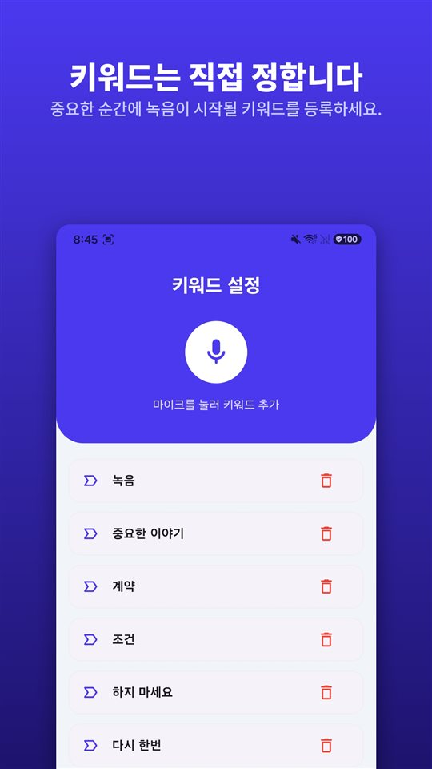

회의가 끝나고 일주일 뒤, 단톡방에 이런 말이 올라옵니다. "그때 그렇게 하기로 한 거 아니었어요?"

다들 기억이 조금씩 다릅니다. 누가 먼저 꺼낸 얘기인지, 마감이 금요일이었는지 다음 주였는지. "녹음해 둘걸" 하는 생각은 늘 이때 듭니다. 기억력 탓이 아닙니다. 회의 중에는 듣고, 생각하고, 대답하느라 기록할 손이 남지 않습니다.

회의에서 중요한 말은 녹음 버튼보다 먼저 나옵니다.

## 회의 녹음에서 빠지기 쉬운 다섯 순간

| 순간 | 놓치기 쉬운 것 | TalkSafe에서 쓰는 기능 |
|---|---|---|
| 회의가 시작될 때 | 녹음 버튼을 누르기 전에 나온 말 | 진행자가 할 말을 키워드로 등록, 이미 지나간 30초까지 저장 |
| 카페·식당의 1:1 미팅 | 주변 소음에 묻힌 목소리 | 휴대폰 안에서 처리하는 AI 노이즈 제거, 원본은 그대로 |
| 회의가 끝난 뒤 | 무엇을 정했는지 | 녹음마다 AI 요약, 녹음한 언어 그대로 |
| 공유할 때 | 1시간 중 결정이 나온 몇 분 | 잘라내기(원본은 남음), 안드로이드·아이폰 공유 시트 |
| 휴대폰을 잃어버렸을 때 | 녹음 파일 자체 | 클라우드 백업에서 복구 |

## 휴대폰은 테이블 가운데, 마이크가 가려지지 않게

휴대폰으로 대면 회의를 녹음할 때는 휴대폰을 테이블 가운데, 말하는 사람들 사이에 둡니다. 휴대폰 마이크는 보통 아래쪽 가장자리에 있으니 그쪽이 종이나 노트에 덮이지 않게 합니다. 노트북 자판 바로 옆에 두면 타자 소리가 목소리보다 크게 남습니다.

자리가 길게 늘어선 회의실이라면, 결정을 내리는 사람 쪽에 조금 더 가깝게 두는 것도 방법입니다. 나중에 다시 들을 말은 대개 그 사람의 말입니다.

## 회의는 "시작하겠습니다"보다 먼저 시작됩니다

자리에 앉으면서 나오는 "그 건은 어떻게 됐어요?", 끝나고 일어서면서 나오는 "아 참, 그건 제가 할게요." 녹음 버튼은 대개 이 두 순간을 놓칩니다. 버튼을 누를 생각이 들었을 때는 이미 그 말이 지나간 뒤입니다.

[TalkSafe](/talksafe/)는 미리 정해둔 말이 감지되면 녹음을 시작하는 안드로이드·아이폰 녹음 앱입니다. 키워드는 화자에 묶여 있지 않아서, 내가 할 말이 아니라 **진행자가 할 말**을 걸어 둘 수 있습니다. 감지되면 잠금화면을 풀 필요 없이 바로 녹음이 시작되고, **이미 지나간 30초**까지 함께 저장됩니다.

<figure class="shot"><figcaption>키워드 설정 화면. 여러 개를 등록할 수 있고, 어느 하나만 감지되어도 녹음이 시작됩니다.</figcaption></figure>

키워드는 여러 개 등록할 수 있고, 어느 하나만 감지되어도 녹음이 시작됩니다. **한 문장에 함께 나올 법한 두 단어**를 등록하면 감지가 훨씬 정확해집니다. "그럼 회의 시작하겠습니다"라는 문장을 떠올리고 '회의'와 '시작'을 함께 등록하는 식입니다. 회의라면 키워드 감지 후 녹음 시간을 1시간이나 수동 종료로 맞춰 두면 중간에 끊기지 않습니다.

다음 주간 회의에서 팀장이 "자, 회의 시작하죠"라고 말하는 순간, 휴대폰은 테이블 위에 놓인 그대로 녹음을 시작합니다. 그 직전에 오간 30초도 같이 남습니다. 키워드로 녹음을 시작하는 방식은 [말이 먼저 나옵니다: 목소리로 녹음을 시작한다는 것](/blog/ko/say-it-first/)에서 더 자세히 다룹니다.

## 카페 미팅은 소음부터 걷어냅니다

거래처 담당자와 카페에서 만난 1:1 미팅은 다시 들으면 커피 머신 소리, 음악, 옆 테이블 웃음소리가 대화보다 크게 들릴 때가 있습니다. 그 자리에서는 분명히 들은 금액이 녹음에서는 잘 들리지 않습니다.

TalkSafe의 **AI 노이즈 제거**는 녹음이 끝난 파일에서 주변 소음을 걷어내고 대화만 남깁니다. 처리는 **휴대폰 안에서** 이루어지고, **원본은 그대로 둔 채** 정리된 파일을 새로 저장합니다. 마주 앉은 두 사람의 대화라면 대화만 남습니다. 잘라낸 파일에도 적용할 수 있어서, 금액이 나온 몇 분만 골라 정리해도 됩니다. 다른 방법과의 비교는 [녹음 파일 잡음 제거, 안드로이드에서 하는 네 가지 방법](/blog/ko/remove-background-noise/)에 있습니다.

## 끝난 뒤에는 요약부터 읽습니다

녹음을 남겨도 1시간짜리 파일을 처음부터 다시 듣는 사람은 많지 않습니다. 녹음해 놓고도 결국 기억에 기대게 되는 이유입니다.

TalkSafe는 **녹음마다 AI 요약**을 만들어 녹음 상세 화면의 재생기 아래에 글머리 목록으로 보여 줍니다. 한국어 회의는 한국어로 요약됩니다. 요약에서 결정 사항을 찾고, 그 부분만 들어서 정확한 표현을 확인하면 됩니다.

- **받아쓰기가 아니라 요약입니다.** 회의 전체를 말 그대로 옮긴 글은 없습니다.
- **요약은 서버에서 만들어집니다.** 키워드 감지는 휴대폰 안에서 이루어지지만, 요약을 위해서는 녹음을 서버로 보냅니다.
- **잘라낸 파일과 노이즈를 제거한 파일에도** 요약을 쓸 수 있습니다.

갤럭시와 픽셀의 기본 녹음 앱에도 지원 기종에서 요약 기능이 있습니다. 앱마다 다른 점은 [녹음 요약 AI, 안드로이드에서 쓰는 방법](/blog/ko/summarize-recording/)에 정리했습니다.

## 결정이 나온 몇 분만 잘라서 보냅니다

회의 뒤에 공유할 것은 대개 1시간 전체가 아니라 결정이 나온 몇 분입니다. TalkSafe의 **잘라내기**는 원본을 남기고 고른 구간을 새 파일로 저장합니다. 보내기는 **안드로이드·아이폰 공유 시트**를 쓰므로 메일, 메신저, 사내 드라이브처럼 파일을 받는 앱이면 어디로든 보낼 수 있습니다. 자르는 방법은 [녹음 파일 자르기, 원본은 남기고 필요한 부분만](/blog/ko/trim-recording/)에 있습니다.

## 휴대폰을 잃어버려도 회의 기록은 남습니다

회의 녹음은 몇 달 뒤에야 필요해지는 경우가 많습니다. 그 사이 휴대폰을 바꾸거나 파일을 정리하다 지울 수도 있습니다.

TalkSafe의 **클라우드 백업**에 백업해 둔 녹음은 휴대폰에서 실수로 지워도 복구할 수 있고, 휴대폰을 잃어버려 바꾸더라도 새 휴대폰에서 클라우드로부터 되살릴 수 있습니다. 백업은 자동이 아니라 직접 실행합니다. 녹음 뒤에 챙길 것은 [녹음한 다음에 해야 할 일과 하지 말아야 할 일](/blog/ko/after-recording/)에 모아 두었습니다.

## 내가 참여한 회의는 녹음해도 됩니다

내가 참여한 회의를 녹음하는 것은 통신비밀보호법 위반이 아닙니다. 대법원은 세 사람 이상의 대화에서도 참여자 한 사람이 녹음하면, 다른 사람들의 발언은 그 녹음자에게 '타인 간의 대화'가 아니라고 보았습니다(대법원 2006. 10. 12. 선고 2006도4981 판결). 현행법상 대화 당사자가 녹음할 때 미리 알릴 의무도 없습니다.

회사에 녹음 금지 규정이 있다면 그것은 형사 처벌과는 별개의 문제입니다. 회사 규정은 [형사 처벌은 없어도 징계는 가능합니다](/blog/ko/workplace-recording-policy/)에, 법 전체는 [한국에서 대화 녹음은 합법인가](/blog/ko/korea-recording-law/)에 정리했습니다.

## 같은 회의를 같은 내용으로 기억하기 위해

다음 회의에서 "그때 뭐라고 정했죠?"라는 질문이 나오면, 서로의 기억을 맞춰 보는 대신 요약을 열어 그 부분을 확인하면 됩니다.

회의를 녹음하는 이유는 누군가를 이기기 위해서가 아닙니다. 같은 자리에 있던 사람들이 같은 회의를 같은 내용으로 기억하기 위해서입니다.

이 글은 일반적인 정보 제공을 위한 것이며 법률 자문이 아닙니다. 구체적인 사안은 변호사와 상담하시기 바랍니다. 다른 앱의 기능은 작성 시점의 공식 안내를 기준으로 했으며 바뀔 수 있습니다. 저희는 녹음 앱 TalkSafe를 만들고 있습니다.

