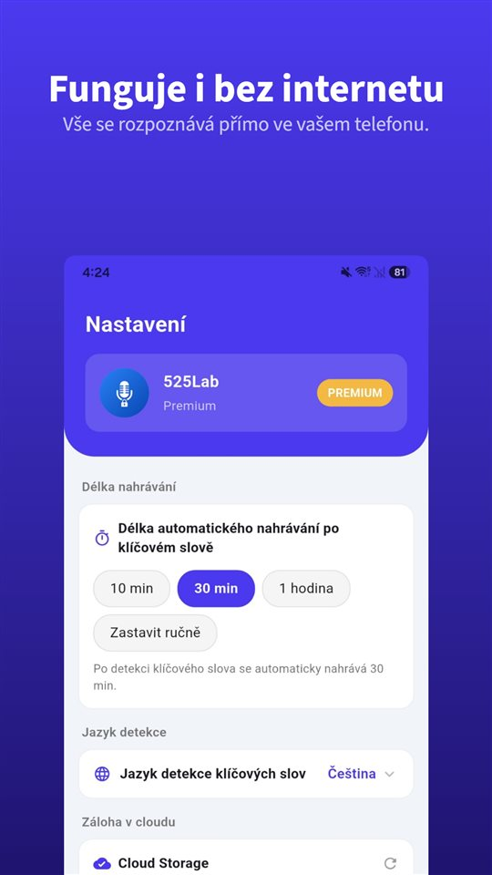

Projíždíte seznam nahrávek znovu a znovu a soubor tam není. Smazat jste chtěli tu vedle.

Stačí jedno klepnutí. U několika souborů s podobným datem a délkou se splete každý. Teď nejde o to, proč se to stalo, ale kde hledat nejdřív.

Jestli se smazaná nahrávka vrátí, se obvykle rozhodne dřív, než byla smazána.

## Kam která aplikace pošle smazaný soubor

| Aplikace | Po smazání | Jak ji získat zpět |
|---|---|---|
| Diktafon Samsung (One UI 6.0 a novější) | Jde do koše; koš nelze vypnout | Diktafon > Více (tři tečky) > Koš > Obnovit |
| Diktafon Google (Pixel) | Bez koše; trvale odstraněno ze synchronizovaných zařízení a z recorder.google.com | Veřejná kopie pro jiné aplikace (ve výchozím stavu zapnutá) se sama nesmaže; podívejte se do aplikace Files |
| Jakákoli aplikace | Poslané kopie zůstávají | E-mail sobě, chaty, cloud |
| TalkSafe | Nahrávky zálohované do cloudu zůstávají | Obnovení ze zálohy v cloudu, i v novém telefonu |

Následující vychází z oficiální nápovědy Samsungu a Googlu v době psaní a může se změnit.

## Na Galaxy nejdřív otevřete koš

Podle Samsungu od One UI 6.0 soubory smazané v Diktafonu hned nezmizí, ale přesunou se do **koše**. Funkci koše **nelze vypnout**.

1. Otevřete aplikaci Diktafon.
2. Klepněte na **Více (tři tečky)** a zvolte **Koš**.
3. Vyberte soubory, které chcete vrátit, a klepněte na **Obnovit**, nebo **Obnovit vše**.

Stejný koš je vidět i v aplikaci **Moje soubory**. Nápověda Samsungu neuvádí, kolik dní hlasové nahrávky v koši zůstávají, takže nejjistější je otevřít ho hned teď, když jste si toho právě všimli.

## Na Pixelu hledejte kopii pro jiné aplikace

Podle Googlu Diktafon Google na Pixelu koš nemá a smazané nahrávky se **trvale odstraní ze všech synchronizovaných zařízení a z recorder.google.com**. Na recorder.google.com ji tedy také nenajdete.

Zbývá jedna cesta. Když je v nastavení Diktafonu zapnutá volba **Access recordings in other apps** (přístup k nahrávkám v jiných aplikacích), vytvoří se zvlášť **veřejná kopie**, kterou mohou používat jiné aplikace, a volba je ve výchozím stavu zapnutá. Nápověda Googlu vysvětluje, že smazání nahrávky v aplikaci **tuto veřejnou kopii automaticky nesmaže**. Hledejte nahrávku v aplikaci Files.

## Není ani v koši? Vzpomeňte si, kam jste ji poslali

Pokud nahrávka opustila telefon aspoň jednou, tato kopie přežije smazání originálu.

- Příloha v **e-mailu sobě**
- Soubor poslaný do **chatu**, s rodinou, kolegou nebo sami se sebou
- Soubor přesunutý do **cloudu** nebo do počítače

Pokud není v koši Samsungu, ve veřejné kopii na Pixelu ani nikde, kam jste ji poslali, oficiální nápověda aplikací jiný způsob, jak ji vrátit, nepopisuje.

## Aby se ta další neztratila

Zůstává z toho jedno ponaučení. Obnovení skoro vždy závisí na tom, **jestli před smazáním někde existovala kopie**. Nejjistější ochranou proto je mít od každé důležité nahrávky hned po skončení druhou kopii mimo telefon.

[TalkSafe](/talksafe/cs/) je aplikace pro nahrávání na Android a iPhone, která začne nahrávat, když rozpozná předem zvolené slovo, a má **zálohu do cloudu**. Nahrávky zálohované do cloudu lze obnovit, když je omylem smažete z telefonu, a když telefon ztratíte a vyměníte, lze je obnovit z cloudu v novém telefonu.

<figure class="shot"><figcaption>Nastavení. Vedle doby nahrávání po rozpoznání a jazyka rozpoznávání je i položka zálohování do cloudu.</figcaption></figure>

**Záloha neprobíhá automaticky, spouštíte ji sami.** Proto se vrátí jen nahrávky zálohované před smazáním. Až budete příště mít nahrávku, o které si řeknete „tuhle si musím nechat“, můžete ji zálohovat do cloudu dřív, než telefon schováte do kapsy. Když pak znovu přijde den jako dnes, nebudete muset prohledávat žádný koš.

Co dalšího udělat po nahrání a proč neměnit název ani datum originálu, popisujeme v [Co s nahrávkou dělat, a co s ní nedělat](/blog/cs/after-recording/). Chcete-li si nechat jen potřebnou část, [Jak na Androidu zkrátit hlasovou nahrávku a nepřijít o originál](/blog/cs/trim-recording/) ji uloží jako nový soubor a originál nechá na místě.

Funkce jiných aplikací jsou popsány podle jejich oficiální nápovědy v době psaní a mohou se změnit. Vyvíjíme aplikaci pro nahrávání TalkSafe.

