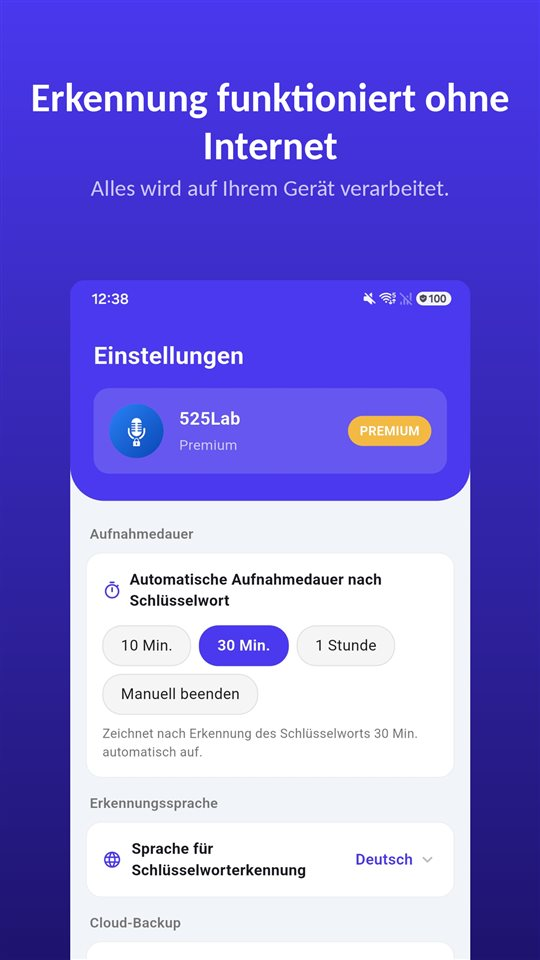

Sie scrollen die Liste der Aufnahmen wieder und wieder durch, und die Datei ist nicht da. Löschen wollten Sie eigentlich die daneben.

Ein Fingertipp genügt. Bei mehreren Dateien mit ähnlichem Datum und ähnlicher Länge verwechselt jeder mal etwas. Wichtig ist jetzt nicht, warum es passiert ist, sondern wo Sie zuerst nachsehen.

Ob eine gelöschte Aufnahme zurückkommt, entscheidet sich meist, bevor sie gelöscht wurde.

## Wohin jede Aufnahme-App eine gelöschte Datei schickt

| App | Beim Löschen | So kommt sie zurück |
|---|---|---|
| Samsung-Sprachrekorder (ab One UI 6.0) | Wandert in den Papierkorb; der Papierkorb lässt sich nicht ausschalten | Sprachrekorder > Mehr (drei Punkte) > Papierkorb > Wiederherstellen |
| Googles Rekorder (Pixel) | Kein Papierkorb; dauerhaft von synchronisierten Geräten und recorder.google.com entfernt | Die öffentliche Kopie für andere Apps (standardmäßig an) wird nicht automatisch gelöscht; in der App Files nachsehen |
| Jede App | Verschickte Kopien bleiben erhalten | E-Mail an sich selbst, Messenger-Chats, Cloud-Speicher |
| TalkSafe | In der Cloud gesicherte Aufnahmen bleiben | Wiederherstellung aus dem Cloud-Backup, auch auf einem neuen Handy |

Das Folgende beruht auf den offiziellen Hilfeseiten von Samsung und Google zum Zeitpunkt des Schreibens und kann sich ändern.

## Auf einem Galaxy zuerst den Papierkorb öffnen

Laut Samsung verschwinden seit One UI 6.0 im Sprachrekorder gelöschte Dateien nicht sofort, sondern landen im **Papierkorb**. Die Papierkorb-Funktion lässt sich **nicht ausschalten**.

1. Öffnen Sie die App Sprachrekorder.
2. Tippen Sie auf **Mehr (drei Punkte)** und wählen Sie **Papierkorb**.
3. Markieren Sie die Dateien, die zurückkommen sollen, und tippen Sie auf **Wiederherstellen** oder **Alle wiederherstellen**.

Derselbe Papierkorb ist auch in der App **Eigene Dateien** zu sehen. Samsungs Hilfe nennt nicht, wie viele Tage Sprachaufnahmen im Papierkorb bleiben; am sichersten ist es also, ihn jetzt zu öffnen, wo Sie es gerade bemerkt haben.

## Auf einem Pixel die Kopie für andere Apps suchen

Laut Google hat Googles Rekorder auf Pixel keinen Papierkorb, und gelöschte Aufnahmen werden **dauerhaft von allen synchronisierten Geräten und von recorder.google.com entfernt**. Auch auf recorder.google.com ist die Aufnahme also nicht mehr zu finden.

Ein Weg bleibt. Ist in den Einstellungen des Rekorders **Access recordings in other apps** (Zugriff auf Aufnahmen in anderen Apps) eingeschaltet, wird zusätzlich eine **öffentliche Kopie** angelegt, die andere Apps nutzen können, und die Einstellung ist standardmäßig an. Googles Hilfe erklärt, dass das Löschen in der App **diese öffentliche Kopie nicht automatisch löscht**. Suchen Sie die Aufnahme in der App Files.

## Nicht im Papierkorb? Überlegen Sie, wohin Sie sie geschickt haben

Hat die Aufnahme das Handy auch nur einmal verlassen, übersteht diese Kopie das Löschen des Originals.

- Ein Anhang in einer **E-Mail an sich selbst**
- Eine Datei in einem **Messenger-Chat**, mit der Familie, einer Kollegin oder sich selbst
- Eine Datei in einem **Cloud-Speicher** oder auf dem Computer

Ist sie weder im Samsung-Papierkorb noch in der öffentlichen Pixel-Kopie noch an einem Ort, an den Sie sie geschickt haben, beschreiben die offiziellen Hilfeseiten der Apps keinen weiteren Weg, sie zurückzuholen.

## Damit die nächste nicht verloren geht

Daraus bleibt eine Lehre. Ob sich etwas wiederherstellen lässt, hängt fast immer davon ab, **ob es vor dem Löschen irgendwo eine Kopie gab**. Der sicherste Schutz ist deshalb, von jeder wichtigen Aufnahme direkt nach dem Ende eine zweite Kopie außerhalb des Handys abzulegen.

[TalkSafe](/talksafe/de/) ist eine Aufnahme-App für Android und iPhone, die mit der Aufnahme beginnt, wenn sie ein vorher festgelegtes Wort erkennt, und sie hat ein **Cloud-Backup**. In der Cloud gesicherte Aufnahmen lassen sich wiederherstellen, wenn sie versehentlich auf dem Handy gelöscht werden, und wenn das Handy verloren geht und ersetzt wird, lassen sie sich auf dem neuen Handy aus der Cloud wiederherstellen.

<figure class="shot"><figcaption>Einstellungen. Neben der Aufnahmedauer nach einer Erkennung und der Erkennungssprache gibt es den Punkt Cloud-Sicherung.</figcaption></figure>

**Das Backup läuft nicht automatisch, Sie starten es selbst.** Wiederherstellen lassen sich deshalb nur Aufnahmen, die vor dem Löschen gesichert wurden. Wenn Ihnen das nächste Mal eine Aufnahme vorkommt wie eine, die Sie behalten müssen, können Sie sie in der Cloud sichern, bevor das Handy wieder in die Tasche wandert. Kommt dann noch einmal ein Tag wie heute, müssen Sie keinen Papierkorb durchsuchen.

Was nach der Aufnahme sonst noch wichtig ist, auch warum Name und Datum des Originals bleiben sollten, steht in [Was man mit einer Aufnahme tun sollte – und was nicht](/blog/de/after-recording/). Wer nur den nötigen Teil behalten will, findet in [Sprachaufnahme auf Android kürzen, ohne das Original zu verlieren](/blog/de/trim-recording/), wie man ihn als neue Datei speichert und das Original stehen lässt.

Wer zwischen Android und iPhone wechselt, findet in [Sprachaufnahmen beim Wechsel zwischen Android und iPhone mitnehmen](/blog/de/transfer-recordings/), wie die Aufnahmen mitkommen.

Die Funktionen anderer Apps sind nach deren offiziellen Hilfeseiten zum Zeitpunkt des Schreibens beschrieben und können sich ändern. Wir entwickeln die Aufnahme-App TalkSafe.

