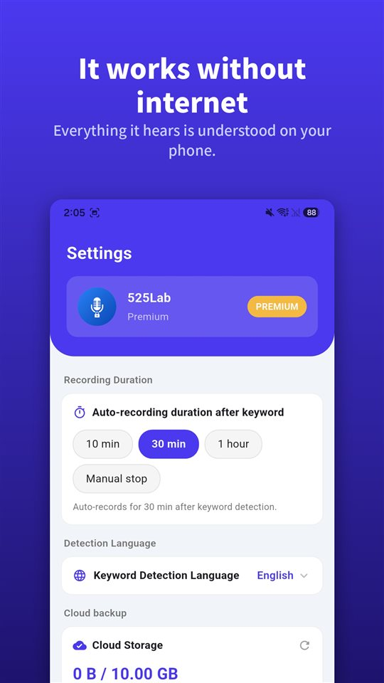

You scroll the list of recordings again and again, and the file isn't there. The one you meant to delete was the one next to it.

It takes one tap. With several files from similar dates and of similar length, anyone mixes them up. What matters now isn't why it happened, but where to look first.

Whether a deleted recording comes back is usually decided before it was deleted.

## Where each recorder app sends a deleted file

| App | When you delete | How to get it back |
|---|---|---|
| Samsung Voice Recorder (One UI 6.0 or later) | Moves to the Recycle bin; the bin cannot be turned off | Voice Recorder > More (three dots) > Recycle bin > Restore |
| Google Recorder (Pixel) | No trash; permanently removed from synced devices and recorder.google.com | The public copy for other apps (on by default) is not deleted automatically; check the Files app |
| Any app | Copies you sent stay where they are | Email to yourself, messaging chats, cloud drive |
| TalkSafe | Recordings you backed up to the cloud remain | Restore from cloud backup, also on a new phone |

What follows is based on Samsung's and Google's official help at the time of writing and may change.

## On a Galaxy phone, open the Recycle bin first

According to Samsung, since One UI 6.0 files deleted in the Voice Recorder app don't disappear right away; they move to the **Recycle bin**. The recycle bin function **cannot be turned off**.

1. Open the Voice Recorder app.
2. Tap **More (three dots)** and select **Recycle bin**.
3. Choose the files to bring back and tap **Restore**, or **Restore All** for everything.

The same bin also shows up in the **My Files** app. Samsung's help doesn't say how many days voice recordings stay in the bin, so the safest move is to open it now, while you've just noticed.

## On a Pixel, look for the copy made for other apps

According to Google, the Recorder app on Pixel has no trash, and deleted recordings are **permanently removed from all synced devices and from recorder.google.com**. So the recording won't be on recorder.google.com either.

There is one path left. When **Access recordings in other apps** is on in Recorder's settings, a separate **public copy** is made for other apps to use, and the setting is on by default. Google's help says that deleting a recording in Recorder **doesn't automatically delete this public copy**. Look for the recording in the Files app.

## Not in the trash? Think about where you sent it

If the recording ever left the phone, that copy survives the original being deleted.

- An attachment in an **email to yourself**
- A file posted in a **messaging chat**, with family, a colleague or yourself
- A file moved to a **cloud drive** or a computer

If it isn't in the Samsung bin, in the Pixel public copy or anywhere you sent it, the apps' official help doesn't describe another way to bring it back.

## Keep the next one from being lost

This leaves one lesson. Recovery mostly comes down to **whether a copy existed somewhere before the deletion**. So the surest protection is to keep a second copy of any important recording off the phone right after it ends.

[TalkSafe](/talksafe/en/) is a voice recorder for Android and iPhone that starts recording when it detects a word you set in advance, and it has **cloud backup**. Recordings backed up to the cloud can be restored if they are deleted from the phone by mistake, and if the phone is lost and replaced, they can be restored from the cloud on the new phone.

<figure class="shot"><figcaption>Settings. Along with recording time after detection and detection language, there is a cloud backup item.</figcaption></figure>

**Backup is not automatic; you run it yourself.** So only recordings backed up before deletion can be brought back. Next time a recording feels like one you need to keep, one option is to back it up to the cloud before the phone goes back in your pocket. Then if a day like today comes again, there's no trash to dig through.

Other things to take care of after recording, including why the original's name and date should stay as they are, are in [What to do with a recording, and what not to do with it](/blog/en/after-recording/). To keep only the part you need, [How to cut or trim a voice recording on Android, keeping the original](/blog/en/trim-recording/) saves it as a new file and leaves the original in place.

Other apps' features are described from their official help at the time of writing and may change. We make the recording app TalkSafe.

