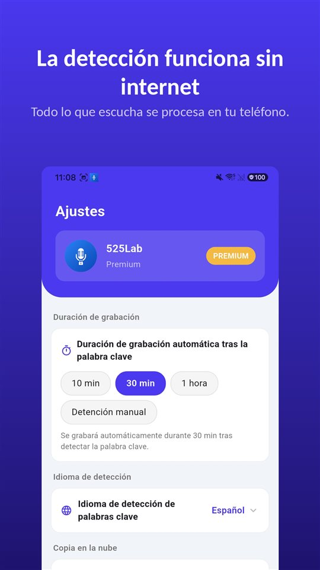

Repasas la lista de grabaciones una y otra vez, y el archivo no está. La que querías borrar era la de al lado.

Pasa con un solo toque. Con varios archivos de fechas y duración parecidas, cualquiera se confunde. Ahora lo que importa no es por qué pasó, sino dónde mirar primero.

Que una grabación borrada vuelva suele decidirse antes de borrarla.

## Adónde manda cada app un archivo borrado

| App | Al borrar | Cómo recuperarlo |
|---|---|---|
| Grabadora de voz de Samsung (One UI 6.0 o posterior) | Pasa a la papelera; la papelera no se puede desactivar | Grabadora de voz > Más (tres puntos) > Papelera > Restaurar |
| Grabadora de Google (Pixel) | Sin papelera; se elimina para siempre de los dispositivos sincronizados y de recorder.google.com | La copia pública para otras apps (activada de serie) no se borra sola; revisa la app Files |
| Cualquier app | Las copias que enviaste siguen ahí | Correo a ti mismo, chats de mensajería, nube |
| TalkSafe | Las grabaciones que copiaste en la nube se conservan | Recuperar desde la copia en la nube, también en un teléfono nuevo |

Lo que sigue se basa en la ayuda oficial de Samsung y Google en el momento de escribir y puede cambiar.

## En un Galaxy, abre primero la papelera

Según Samsung, desde One UI 6.0 los archivos borrados en la Grabadora de voz no desaparecen de inmediato: pasan a la **papelera**. La función de papelera **no se puede desactivar**.

1. Abre la app Grabadora de voz.
2. Toca **Más (tres puntos)** y elige **Papelera**.
3. Selecciona los archivos que quieres recuperar y toca **Restaurar**, o **Restaurar todo**.

La misma papelera aparece también en la app **Mis archivos**. La ayuda de Samsung no dice cuántos días se quedan las grabaciones en la papelera, así que lo más seguro es abrirla ahora, que acabas de darte cuenta.

## En un Pixel, busca la copia para otras apps

Según Google, la Grabadora de Google en Pixel no tiene papelera, y las grabaciones borradas **se eliminan de forma permanente de todos los dispositivos sincronizados y de recorder.google.com**. Así que tampoco estará en recorder.google.com.

Queda un camino. Cuando la opción **Access recordings in other apps** (acceder a las grabaciones desde otras apps) está activada en los ajustes de la Grabadora, se crea aparte una **copia pública** para que otras apps la usen, y viene activada de serie. La ayuda de Google explica que borrar una grabación en la app **no borra automáticamente esa copia pública**. Búscala en la app Files.

## ¿No está en la papelera? Piensa adónde la enviaste

Si la grabación salió alguna vez del teléfono, esa copia sobrevive aunque borres el original.

- Un adjunto en un **correo a ti mismo**
- Un archivo enviado a un **chat de mensajería**, con tu familia, un compañero o contigo mismo
- Un archivo pasado a una **nube** o a un ordenador

Si no está en la papelera de Samsung, ni en la copia pública del Pixel, ni en ningún sitio al que la enviaras, la ayuda oficial de las apps no describe otra forma de recuperarla.

## Que la próxima no se pierda

De esto queda una lección. Recuperar algo depende casi siempre de **si existía una copia en algún sitio antes de borrarlo**. Por eso la protección más segura es guardar una segunda copia de cualquier grabación importante fuera del teléfono justo al terminar.

[TalkSafe](/talksafe/es/) es una grabadora de voz para Android y iPhone que empieza a grabar cuando detecta una palabra elegida de antemano, y tiene **copia en la nube**. Las grabaciones copiadas en la nube se pueden recuperar si se borran del teléfono por error, y si el teléfono se pierde y se cambia, se pueden recuperar desde la nube en el nuevo.

<figure class="shot"><figcaption>Ajustes. Junto al tiempo de grabación tras la detección y el idioma de detección, está la opción de copia en la nube.</figcaption></figure>

**La copia no es automática: la haces tú.** Por eso solo se pueden recuperar las grabaciones copiadas antes de borrarlas. La próxima vez que una grabación te parezca de las que hay que guardar, una opción es copiarla en la nube antes de volver a meter el teléfono en el bolsillo. Así, si vuelve un día como hoy, no tendrás que rebuscar en ninguna papelera.

Qué más conviene hacer después de grabar, y por qué no hay que cambiar el nombre ni la fecha del original, está en [Qué hacer con una grabación, y qué no hacer con ella](/blog/es/after-recording/). Para quedarte solo con la parte que necesitas, [Cómo cortar una grabación de audio en Android sin perder el original](/blog/es/trim-recording/) la guarda como archivo nuevo y deja el original en su sitio.

Si cambias entre Android y iPhone, cómo llevarte las grabaciones está en [Cómo pasar grabaciones de voz entre Android y iPhone al cambiar de teléfono](/blog/es/transfer-recordings/).

Las funciones de otras apps se describen según su ayuda oficial en el momento de escribir y pueden cambiar. Hacemos la app de grabación TalkSafe.

