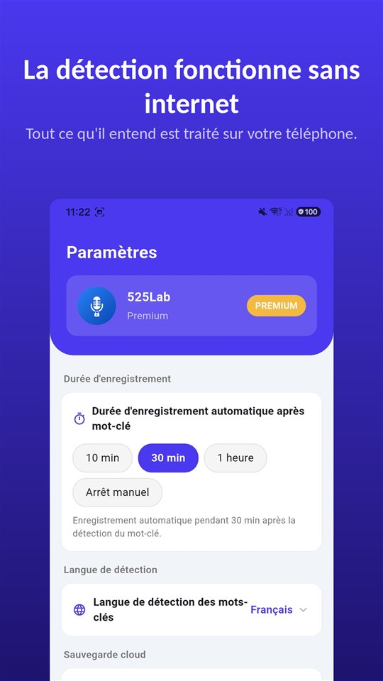

Vous faites défiler la liste des enregistrements encore et encore, et le fichier n'y est pas. Celui que vous vouliez supprimer, c'était celui d'à côté.

Il suffit d'un geste. Avec plusieurs fichiers de dates et de durées proches, tout le monde peut se tromper. Ce qui compte maintenant, ce n'est pas pourquoi c'est arrivé, mais où chercher d'abord.

Qu'un enregistrement supprimé revienne se décide en général avant sa suppression.

## Où chaque application envoie un fichier supprimé

| Application | Quand on supprime | Comment le récupérer |
|---|---|---|
| Enregistreur vocal de Samsung (One UI 6.0 ou ultérieur) | Va dans la corbeille ; la corbeille ne peut pas être désactivée | Enregistreur vocal > Plus (trois points) > Corbeille > Restaurer |
| Enregistreur de Google (Pixel) | Pas de corbeille ; retiré définitivement des appareils synchronisés et de recorder.google.com | La copie publique pour les autres applications (activée par défaut) n'est pas supprimée automatiquement ; vérifier l'application Files |
| Toute application | Les copies envoyées restent | E-mail à soi-même, conversations de messagerie, stockage en ligne |
| TalkSafe | Les enregistrements sauvegardés dans le cloud restent | Restauration depuis la sauvegarde dans le cloud, aussi sur un nouveau téléphone |

Ce qui suit repose sur l'aide officielle de Samsung et de Google au moment de la rédaction et peut changer.

## Sur un Galaxy, ouvrez d'abord la corbeille

Selon Samsung, depuis One UI 6.0 les fichiers supprimés dans l'Enregistreur vocal ne disparaissent pas tout de suite : ils vont dans la **corbeille**. La fonction corbeille **ne peut pas être désactivée**.

1. Ouvrez l'application Enregistreur vocal.
2. Touchez **Plus (trois points)** et choisissez **Corbeille**.
3. Sélectionnez les fichiers à récupérer et touchez **Restaurer**, ou **Tout restaurer**.

La même corbeille apparaît aussi dans l'application **Mes fichiers**. L'aide de Samsung n'indique pas combien de jours les enregistrements vocaux restent dans la corbeille : le plus sûr est de l'ouvrir maintenant, au moment où vous vous en rendez compte.

## Sur un Pixel, cherchez la copie destinée aux autres applications

Selon Google, l'Enregistreur de Google sur Pixel n'a pas de corbeille, et les enregistrements supprimés sont **retirés définitivement de tous les appareils synchronisés et de recorder.google.com**. Vous ne le retrouverez donc pas non plus sur recorder.google.com.

Il reste une piste. Quand l'option **Access recordings in other apps** (accéder aux enregistrements depuis d'autres applications) est activée dans les réglages de l'Enregistreur, une **copie publique** est créée à part pour les autres applications, et l'option est activée par défaut. L'aide de Google explique que supprimer un enregistrement dans l'application **ne supprime pas automatiquement cette copie publique**. Cherchez l'enregistrement dans l'application Files.

## Pas dans la corbeille ? Pensez aux endroits où vous l'avez envoyé

Si l'enregistrement a quitté le téléphone ne serait-ce qu'une fois, cette copie survit à la suppression de l'original.

- Une pièce jointe dans un **e-mail à vous-même**
- Un fichier envoyé dans une **conversation de messagerie**, avec la famille, un collègue ou vous-même
- Un fichier placé sur un **stockage en ligne** ou sur un ordinateur

S'il n'est ni dans la corbeille Samsung, ni dans la copie publique du Pixel, ni à un endroit où vous l'avez envoyé, l'aide officielle des applications ne décrit pas d'autre moyen de le récupérer.

## Pour que le prochain ne soit pas perdu

Il en reste une leçon. La récupération dépend presque toujours de **l'existence d'une copie quelque part avant la suppression**. La protection la plus sûre est donc de garder une deuxième copie de tout enregistrement important hors du téléphone juste après la fin.

[TalkSafe](/talksafe/fr/) est une application d'enregistrement pour Android et iPhone qui démarre quand elle détecte un mot choisi à l'avance, et elle propose une **sauvegarde dans le cloud**. Les enregistrements sauvegardés dans le cloud peuvent être restaurés s'ils sont supprimés du téléphone par erreur, et si le téléphone est perdu et remplacé, ils peuvent être restaurés depuis le cloud sur le nouveau.

<figure class="shot"><figcaption>Réglages. À côté de la durée d'enregistrement après détection et de la langue de détection, il y a l'option de sauvegarde dans le cloud.</figcaption></figure>

**La sauvegarde n'est pas automatique : c'est vous qui la lancez.** Seuls les enregistrements sauvegardés avant la suppression peuvent donc être restaurés. La prochaine fois qu'un enregistrement vous semble de ceux qu'il faut garder, une possibilité est de le sauvegarder dans le cloud avant de remettre le téléphone dans votre poche. Ainsi, si un jour comme aujourd'hui revient, vous n'aurez pas à fouiller une corbeille.

Ce qu'il faut faire d'autre après l'enregistrement, et pourquoi ne pas changer le nom ni la date de l'original, se trouve dans [Ce qu'il faut faire d'un enregistrement, et ce qu'il ne faut pas en faire](/blog/fr/after-recording/). Pour ne garder que le passage utile, [Comment couper un enregistrement audio sur Android sans perdre l'original](/blog/fr/trim-recording/) l'enregistre dans un nouveau fichier et laisse l'original en place.

Si vous passez d'Android à iPhone ou l'inverse, comment emporter vos enregistrements est expliqué dans [Comment transférer ses enregistrements vocaux entre Android et iPhone quand on change de téléphone](/blog/fr/transfer-recordings/).

Les fonctions des autres applications sont décrites d'après leur aide officielle au moment de la rédaction et peuvent changer. Nous développons l'application d'enregistrement TalkSafe.

