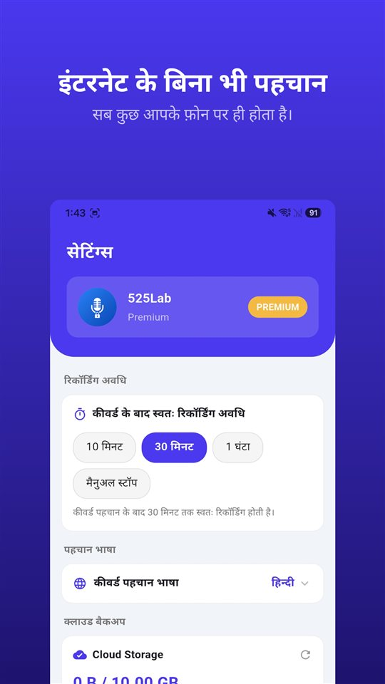

आप रिकॉर्डिंग की लिस्ट बार-बार नीचे खिसकाते हैं, और वह फ़ाइल नहीं मिलती। डिलीट तो आप उसके बगल वाली करना चाहते थे।

यह एक टैप में हो जाता है। मिलती-जुलती तारीख़ और लंबाई की कई फ़ाइलें हों, तो कोई भी गड़बड़ा सकता है। अभी ज़रूरी यह नहीं कि ऐसा क्यों हुआ, बल्कि यह कि पहले कहाँ देखें।

डिलीट हुई रिकॉर्डिंग वापस आएगी या नहीं, यह अक्सर डिलीट होने से पहले ही तय हो चुका होता है।

## हर रिकॉर्डर ऐप डिलीट की गई फ़ाइल कहाँ भेजता है

| ऐप | डिलीट करने पर | वापस कैसे लाएँ |
|---|---|---|
| Samsung Voice Recorder (One UI 6.0 या बाद का) | रीसायकल बिन में जाती है; बिन बंद नहीं किया जा सकता | Voice Recorder > More (तीन बिंदु) > Recycle bin > Restore |
| Google Recorder (Pixel) | बिन नहीं; सिंक किए गए डिवाइस और recorder.google.com से हमेशा के लिए हटती है | दूसरे ऐप्स के लिए पब्लिक कॉपी (डिफ़ॉल्ट रूप से चालू) अपने आप डिलीट नहीं होती; Files ऐप देखें |
| कोई भी ऐप | भेजी गई कॉपियाँ बची रहती हैं | ख़ुद को भेजा ईमेल, चैट, क्लाउड |
| TalkSafe | क्लाउड पर बैकअप की गई रिकॉर्डिंग बची रहती है | क्लाउड बैकअप से वापस लाना, नए फ़ोन पर भी |

नीचे की जानकारी लिखते समय की Samsung और Google की आधिकारिक सहायता पर आधारित है और बदल सकती है।

## Galaxy पर पहले रीसायकल बिन खोलें

Samsung के अनुसार One UI 6.0 से Voice Recorder में डिलीट की गई फ़ाइलें तुरंत ग़ायब नहीं होतीं, बल्कि **रीसायकल बिन** में चली जाती हैं। रीसायकल बिन का फ़ीचर **बंद नहीं किया जा सकता**।

1. Voice Recorder ऐप खोलें।
2. **More (तीन बिंदु)** पर टैप करें और **Recycle bin** चुनें।
3. जो फ़ाइलें वापस चाहिए उन्हें चुनें और **Restore** दबाएँ, या सब वापस लाने के लिए **Restore All**।

यही बिन **My Files** ऐप में भी दिखता है। Samsung की सहायता में यह नहीं लिखा कि वॉइस रिकॉर्डिंग बिन में कितने दिन रहती हैं, इसलिए सबसे पक्का तरीका है कि अभी, जब आपने ध्यान दिया है, उसे खोलें।

## Pixel पर दूसरे ऐप्स के लिए बनी कॉपी ढूँढें

Google के अनुसार Pixel के Google Recorder में बिन नहीं है, और डिलीट की गई रिकॉर्डिंग **सभी सिंक किए गए डिवाइस और recorder.google.com से हमेशा के लिए हट जाती हैं**। इसलिए वह recorder.google.com पर भी नहीं मिलेगी।

एक रास्ता बचता है। Recorder की सेटिंग में **Access recordings in other apps** (दूसरे ऐप्स में रिकॉर्डिंग तक पहुँच) चालू हो, तो दूसरे ऐप्स के इस्तेमाल के लिए अलग से एक **पब्लिक कॉपी** बनती है, और यह सेटिंग डिफ़ॉल्ट रूप से चालू रहती है। Google की सहायता बताती है कि ऐप में रिकॉर्डिंग डिलीट करने से **यह पब्लिक कॉपी अपने आप डिलीट नहीं होती**। Files ऐप में रिकॉर्डिंग ढूँढिए।

## बिन में भी नहीं? याद कीजिए कि कहाँ भेजी थी

अगर रिकॉर्डिंग एक बार भी फ़ोन से बाहर गई थी, तो वह कॉपी मूल फ़ाइल डिलीट होने के बाद भी बची रहती है।

- **ख़ुद को भेजे ईमेल** का अटैचमेंट
- परिवार, किसी सहकर्मी या ख़ुद के साथ **चैट** में भेजी फ़ाइल
- **क्लाउड** या कंप्यूटर पर रखी फ़ाइल

अगर वह न Samsung के बिन में है, न Pixel की पब्लिक कॉपी में, न किसी ऐसी जगह जहाँ आपने भेजी थी, तो ऐप्स की आधिकारिक सहायता उसे वापस लाने का कोई और तरीका नहीं बताती।

## अगली रिकॉर्डिंग न खोए

इससे एक सबक बचता है। वापस लाना लगभग हमेशा इस पर निर्भर करता है कि **डिलीट होने से पहले कहीं कोई कॉपी थी या नहीं**। इसलिए सबसे पक्का बचाव है कि हर ज़रूरी रिकॉर्डिंग ख़त्म होते ही उसकी एक दूसरी कॉपी फ़ोन से बाहर रखी जाए।

[TalkSafe](/talksafe/hi/) Android और iPhone के लिए एक वॉइस रिकॉर्डर ऐप है, जो पहले से चुना हुआ शब्द पहचानते ही रिकॉर्डिंग शुरू कर देता है, और इसमें **क्लाउड बैकअप** है। क्लाउड पर बैकअप की गई रिकॉर्डिंग फ़ोन से गलती से डिलीट हो जाए तो उसे वापस लाया जा सकता है, और फ़ोन खो जाने पर नया फ़ोन लेने के बाद भी रिकॉर्डिंग क्लाउड से वापस लाई जा सकती हैं।

<figure class="shot"><figcaption>सेटिंग। पहचान के बाद रिकॉर्डिंग का समय और पहचान की भाषा के साथ क्लाउड बैकअप का विकल्प भी है।</figcaption></figure>

**बैकअप अपने आप नहीं होता, इसे आपको ख़ुद करना होता है।** इसलिए सिर्फ़ वही रिकॉर्डिंग वापस आती हैं जिनका डिलीट होने से पहले बैकअप लिया गया था। अगली बार जब कोई रिकॉर्डिंग ऐसी लगे कि "इसे रखना है", तो फ़ोन जेब में रखने से पहले उसे क्लाउड पर बैकअप कर लेना एक तरीका है। फिर अगर आज जैसा दिन दोबारा आए, तो किसी बिन में ढूँढने की ज़रूरत नहीं पड़ेगी।

रिकॉर्डिंग के बाद और क्या करना चाहिए, और मूल फ़ाइल का नाम और तारीख़ क्यों नहीं बदलनी चाहिए, यह [रिकॉर्डिंग के बाद क्या करें, और क्या न करें](/blog/hi/after-recording/) में है। सिर्फ़ ज़रूरी हिस्सा रखना हो तो [Android पर वॉइस रिकॉर्डिंग कैसे ट्रिम करें, मूल फ़ाइल खोए बिना](/blog/hi/trim-recording/) उसे नई फ़ाइल के रूप में सेव करता है और मूल फ़ाइल को अपनी जगह रहने देता है।

दूसरे ऐप्स की सुविधाएँ लिखते समय की उनकी आधिकारिक सहायता के आधार पर बताई गई हैं और बदल सकती हैं। हम रिकॉर्डिंग ऐप TalkSafe बनाते हैं।

