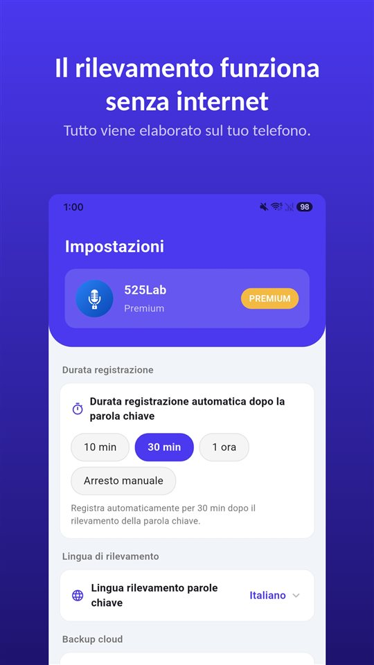

Scorri l'elenco delle registrazioni ancora e ancora, e il file non c'è. Quella che volevi cancellare era quella accanto.

Basta un tocco. Con più file di date e durata simili, chiunque si confonde. Adesso non conta perché è successo, ma dove guardare per primo.

Se una registrazione cancellata torna, di solito si decide prima di cancellarla.

## Dove ogni app manda un file cancellato

| App | Quando cancelli | Come recuperarlo |
|---|---|---|
| Registratore vocale Samsung (One UI 6.0 o successivo) | Va nel cestino; il cestino non si può disattivare | Registratore vocale > Altro (tre puntini) > Cestino > Ripristina |
| Registratore di Google (Pixel) | Nessun cestino; rimossa definitivamente dai dispositivi sincronizzati e da recorder.google.com | La copia pubblica per le altre app (attiva di default) non si cancella da sola; controlla l'app Files |
| Qualsiasi app | Le copie inviate restano | Mail a te stesso, chat di messaggi, cloud |
| TalkSafe | Le registrazioni salvate sul cloud restano | Recupero dal backup sul cloud, anche su un telefono nuovo |

Quanto segue si basa sulle guide ufficiali di Samsung e Google al momento della scrittura e può cambiare.

## Su un Galaxy, apri prima il cestino

Secondo Samsung, da One UI 6.0 i file cancellati nel Registratore vocale non spariscono subito: finiscono nel **cestino**. La funzione cestino **non si può disattivare**.

1. Apri l'app Registratore vocale.
2. Tocca **Altro (tre puntini)** e scegli **Cestino**.
3. Seleziona i file da recuperare e tocca **Ripristina**, oppure **Ripristina tutto**.

Lo stesso cestino compare anche nell'app **Archivio**. La guida di Samsung non dice per quanti giorni le registrazioni restano nel cestino, quindi la cosa più sicura è aprirlo adesso, appena te ne sei accorto.

## Su un Pixel, cerca la copia per le altre app

Secondo Google, il Registratore di Google sui Pixel non ha un cestino, e le registrazioni cancellate vengono **rimosse definitivamente da tutti i dispositivi sincronizzati e da recorder.google.com**. Quindi non la troverai nemmeno su recorder.google.com.

Resta una strada. Quando nelle impostazioni del Registratore è attiva l'opzione **Access recordings in other apps** (accesso alle registrazioni da altre app), viene creata a parte una **copia pubblica** che le altre app possono usare, e l'opzione è attiva di default. La guida di Google spiega che cancellare una registrazione nell'app **non cancella automaticamente questa copia pubblica**. Cercala nell'app Files.

## Non è nel cestino? Pensa a dove l'hai mandata

Se la registrazione è uscita anche solo una volta dal telefono, quella copia sopravvive alla cancellazione dell'originale.

- Un allegato in una **mail a te stesso**
- Un file mandato in una **chat di messaggi**, con la famiglia, un collega o te stesso
- Un file spostato su un **cloud** o su un computer

Se non è nel cestino Samsung, né nella copia pubblica del Pixel, né in nessun posto dove l'hai mandata, le guide ufficiali delle app non descrivono altri modi per recuperarla.

## Perché la prossima non vada persa

Da tutto questo resta una lezione. Il recupero dipende quasi sempre da **se esisteva una copia da qualche parte prima della cancellazione**. Per questo la protezione più sicura è tenere una seconda copia di ogni registrazione importante fuori dal telefono subito dopo la fine.

[TalkSafe](/talksafe/it/) è un registratore vocale per Android e iPhone che inizia a registrare quando rileva una parola scelta in anticipo, e ha il **backup sul cloud**. Le registrazioni salvate sul cloud si possono recuperare se vengono cancellate dal telefono per errore, e se il telefono va perso e lo cambi, si possono recuperare dal cloud su quello nuovo.

<figure class="shot"><figcaption>Impostazioni. Oltre alla durata della registrazione dopo il rilevamento e alla lingua di rilevamento, c'è la voce del backup nel cloud.</figcaption></figure>

**Il backup non è automatico: lo avvii tu.** Per questo si possono recuperare solo le registrazioni salvate prima della cancellazione. La prossima volta che una registrazione ti sembra di quelle da tenere, una possibilità è salvarla sul cloud prima di rimettere il telefono in tasca. Così, se torna una giornata come oggi, non dovrai frugare in nessun cestino.

Cos'altro fare dopo aver registrato, e perché non cambiare nome e data dell'originale, è in [Cosa fare con una registrazione, e cosa non farne](/blog/it/after-recording/). Per tenere solo la parte che ti serve, [Come tagliare una registrazione vocale su Android senza perdere l'originale](/blog/it/trim-recording/) la salva come nuovo file e lascia l'originale al suo posto.

Le funzioni di altre app sono descritte in base alle loro guide ufficiali al momento della scrittura e possono cambiare. Realizziamo l'app di registrazione TalkSafe.

