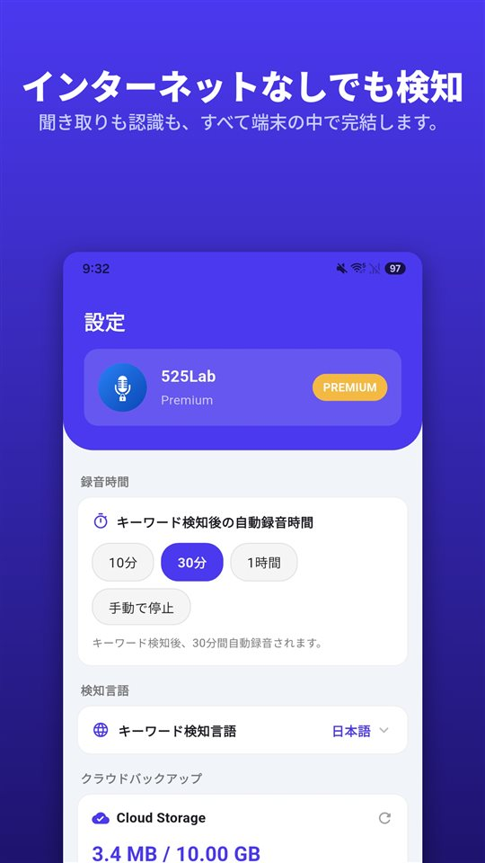

録音の一覧を何度スクロールしても、あのファイルがありません。消すつもりだったのは、すぐ隣の別の録音だったのに。

指一本で起きることです。日付も長さも似たファイルがいくつもあれば、誰でも取り違えます。いま大事なのは、なぜ消したかではなく、どこから探すかです。

削除した録音が戻るかどうかは、たいてい削除する前に決まっています。

## 録音アプリごとの、削除したファイルの行き先

| アプリ | 削除すると | 戻す方法 |
|---|---|---|
| Galaxyのボイスレコーダー（One UI 6.0以降） | ごみ箱に移動、ごみ箱機能はオフにできない | ボイスレコーダー > その他（縦の3点） > ごみ箱 > 復元 |
| Googleレコーダー（Pixel） | ごみ箱なし、同期した端末とrecorder.google.comからも完全に削除 | ほかのアプリ用の公開コピー（初期設定でオン）は自動では消えない、ファイルアプリで確認 |
| どのアプリでも | 送ったコピーはそのまま残る | 自分宛てのメール、メッセージのトーク、クラウドドライブ |
| TalkSafe | クラウドに自分でバックアップした録音は残る | クラウドバックアップから復元、新しい端末でも |

以下は執筆時点のSamsungとGoogleの公式案内に基づいており、変わることがあります。

## Galaxyなら、まずごみ箱を開く

Samsungの案内によると、One UI 6.0以降、ボイスレコーダーで削除したファイルはすぐには消えず、**ごみ箱**に移ります。このごみ箱機能は**オフにできません**。

1. ボイスレコーダーアプリを開きます。
2. **その他（縦の3点）**をタップして**ごみ箱**を選びます。
3. 戻したいファイルを選んで**復元**を押します。全部戻すなら**すべて復元**を押します。

同じごみ箱は**マイファイル**アプリからも見られます。Samsungの案内には、録音がごみ箱に何日残るかは別に書かれていないので、気づいたいま開くのがいちばん確実です。

## Pixelなら、ほかのアプリ用のコピーを探す

Googleの案内によると、PixelのGoogleレコーダーにはごみ箱がなく、削除した録音は**同期しているすべての端末とrecorder.google.comからも完全に削除**されます。recorder.google.comで探し直すこともできません。

残る道が一つあります。レコーダーの設定で**「Access recordings in other apps（ほかのアプリで録音にアクセス）」**がオンなら、ほかのアプリが使える**公開コピー**が別に作られ、この設定は初期状態でオンです。Googleの案内は、アプリで録音を削除しても**この公開コピーは自動では削除されない**と説明しています。ファイルアプリでその録音を探してみてください。

## ごみ箱にもなければ、送った先を思い出す

録音を一度でもスマホの外に送っていれば、そのコピーは原本を削除しても残っています。

- **自分宛てのメール**の添付ファイル
- 家族や同僚、自分とのトークなど**メッセージアプリ**に送ったファイル
- **クラウドドライブ**やパソコンに移したファイル

Samsungのごみ箱にも、Pixelの公開コピーにも、送った先にもなければ、録音アプリの中で戻す公式の方法は案内されていません。

## 次の録音は、最初から失わないように

今回のことから残る教訓は一つです。復元できるかどうかは、ほとんどの場合**削除する前にどこかにコピーがあったか**で決まります。だから大事な録音は、終わった直後にスマホの外にもう一つ置いておくのがいちばん確かな備えです。

[TalkSafe](/talksafe/ja/)は、あらかじめ決めておいた言葉が検知されると録音を始めるAndroid・iPhone向けの録音アプリで、**クラウドバックアップ**があります。クラウドにバックアップした録音は、端末から誤って削除しても復元でき、端末をなくして買い替えても、新しい端末でクラウドから復元できます。

<figure class="shot"><figcaption>設定画面。検知後の録音時間、検知言語とあわせてクラウドバックアップの項目があります。</figcaption></figure>

**バックアップは自動ではなく、自分で実行します。** だから戻せるのは、削除する前にバックアップした録音だけです。次に「これは残しておかないと」と思う録音ができたら、スマホをポケットにしまう前に、その録音からクラウドにバックアップしておく方法があります。そうすれば今日のような日がまた来ても、ごみ箱を探し回らずに済みます。

録音したあとに気をつけること、原本のファイル名や日付を変えない理由は[録音したあとにすべきことと、してはいけないこと](/blog/ja/after-recording/)にまとめています。必要な部分だけ別に残すなら、原本を残して新しいファイルに保存する[録音の切り取り方：Androidで必要な部分だけ切り取り、原本は残す方法](/blog/ja/trim-recording/)もあわせてどうぞ。

AndroidとiPhoneの間で機種変更するときの録音の移し方は[AndroidとiPhoneの機種変更で録音ファイルを移す方法](/blog/ja/transfer-recordings/)にまとめました。

ほかのアプリの機能は執筆時点の公式案内に基づいており、変わることがあります。私たちは録音アプリTalkSafeを作っています。

