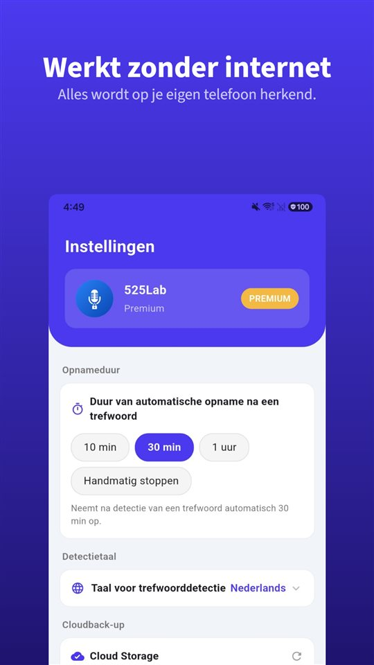

Je scrolt de lijst met opnames keer op keer door, en het bestand staat er niet tussen. Je wilde de opname ernaast verwijderen.

Het gebeurt met één tik. Met meerdere bestanden van een vergelijkbare datum en lengte vergist iedereen zich weleens. Wat nu telt, is niet waarom het gebeurde, maar waar je eerst kijkt.

Of een verwijderde opname terugkomt, wordt meestal beslist voordat hij werd verwijderd.

## Waar elke opname-app een verwijderd bestand naartoe stuurt

| App | Bij verwijderen | Zo komt hij terug |
|---|---|---|
| Samsung Spraakrecorder (One UI 6.0 of nieuwer) | Gaat naar de prullenbak; de prullenbak kan niet uit | Spraakrecorder > Meer (drie puntjes) > Prullenbak > Terugzetten |
| Googles Recorder (Pixel) | Geen prullenbak; definitief weg van gesynchroniseerde apparaten en recorder.google.com | De openbare kopie voor andere apps (standaard aan) wordt niet vanzelf gewist; kijk in de app Files |
| Elke app | Verstuurde kopieën blijven staan | E-mail aan jezelf, chatgesprekken, cloudopslag |
| TalkSafe | Opnames in de cloudback-up blijven | Terugzetten uit de cloudback-up, ook op een nieuwe telefoon |

Wat volgt is gebaseerd op de officiële hulp van Samsung en Google op het moment van schrijven en kan veranderen.

## Op een Galaxy open je eerst de prullenbak

Volgens Samsung verdwijnen bestanden die je in de Spraakrecorder verwijdert sinds One UI 6.0 niet meteen, maar gaan ze naar de **prullenbak**. De prullenbakfunctie kan **niet worden uitgezet**.

1. Open de app Spraakrecorder.
2. Tik op **Meer (drie puntjes)** en kies **Prullenbak**.
3. Selecteer de bestanden die terug moeten en tik op **Terugzetten**, of **Alles terugzetten**.

Dezelfde prullenbak zie je ook in de app **Mijn bestanden**. De hulp van Samsung zegt niet hoeveel dagen spraakopnames in de prullenbak blijven, dus het zekerst is om hem nu te openen, nu je het net merkt.

## Op een Pixel zoek je de kopie voor andere apps

Volgens Google heeft Googles Recorder op Pixel geen prullenbak, en worden verwijderde opnames **definitief verwijderd van alle gesynchroniseerde apparaten en van recorder.google.com**. Ook op recorder.google.com vind je hem dus niet meer.

Er blijft één weg over. Staat in de instellingen van Recorder **Access recordings in other apps** (toegang tot opnames in andere apps) aan, dan wordt apart een **openbare kopie** gemaakt die andere apps kunnen gebruiken, en die instelling staat standaard aan. De hulp van Google legt uit dat het verwijderen van een opname in de app **deze openbare kopie niet automatisch wist**. Zoek de opname in de app Files.

## Niet in de prullenbak? Bedenk waar je hem naartoe stuurde

Is de opname ooit, al was het maar één keer, van de telefoon gegaan, dan overleeft die kopie het verwijderen van het origineel.

- Een bijlage in een **e-mail aan jezelf**
- Een bestand in een **chatgesprek**, met familie, een collega of jezelf
- Een bestand in **cloudopslag** of op een computer

Staat hij niet in de Samsung-prullenbak, niet in de openbare kopie op de Pixel en nergens waar je hem naartoe stuurde, dan beschrijft de officiële hulp van de apps geen andere manier om hem terug te halen.

## Zodat je de volgende niet kwijtraakt

Hier blijft één les van over. Terugzetten hangt bijna altijd af van **of er vóór het verwijderen ergens een kopie was**. De zekerste bescherming is daarom om van elke belangrijke opname direct na afloop een tweede kopie buiten de telefoon te bewaren.

[TalkSafe](/talksafe/nl/) is een opname-app voor Android en iPhone die begint met opnemen als hij een vooraf gekozen woord herkent, en heeft een **cloudback-up**. Opnames in de cloudback-up kun je terugzetten als je ze per ongeluk van de telefoon wist, en als je je telefoon kwijtraakt en een nieuwe neemt, kun je ze daar uit de cloud terugzetten.

<figure class="shot"><figcaption>Instellingen. Naast de opnameduur na een herkenning en de herkenningstaal staat de optie cloudback-up.</figcaption></figure>

**De back-up gaat niet automatisch; je start hem zelf.** Daarom komen alleen opnames terug die vóór het verwijderen zijn geback-upt. Als je de volgende keer een opname hebt waarvan je denkt "deze moet ik bewaren", kun je hem in de cloud zetten voordat de telefoon weer in je zak gaat. Komt er dan nog eens een dag als vandaag, dan hoef je in geen enkele prullenbak te zoeken.

Wat je na het opnemen verder kunt doen, en waarom je de naam en datum van het origineel laat staan, staat in [Wat je met een opname doet, en wat je er niet mee doet](/blog/nl/after-recording/). Wil je alleen het stuk bewaren dat je nodig hebt, dan slaat [Een spraakopname inkorten op Android zonder het origineel te verliezen](/blog/nl/trim-recording/) het op als nieuw bestand en blijft het origineel staan.

De functies van andere apps zijn beschreven op basis van hun officiële hulp op het moment van schrijven en kunnen veranderen. Wij maken de opname-app TalkSafe.

