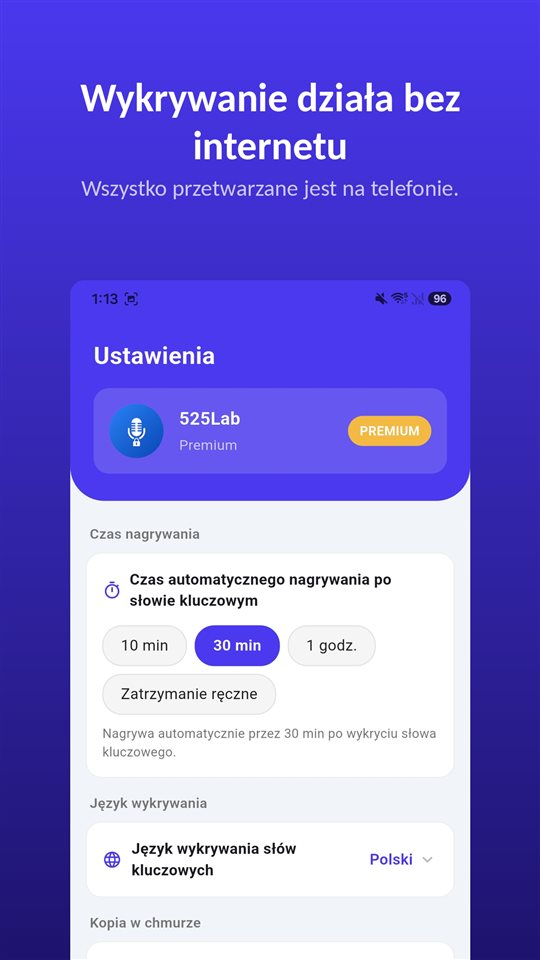

Przewijasz listę nagrań raz za razem, a pliku nie ma. Usunąć chciałeś to obok.

Wystarczy jedno stuknięcie. Przy kilku plikach o podobnej dacie i długości każdemu zdarza się pomylić. Teraz nie liczy się, dlaczego to się stało, tylko gdzie najpierw szukać.

To, czy usunięte nagranie wróci, zwykle rozstrzyga się, zanim zostało usunięte.

## Dokąd każda aplikacja wysyła usunięty plik

| Aplikacja | Po usunięciu | Jak odzyskać |
|---|---|---|
| Dyktafon Samsunga (One UI 6.0 lub nowszy) | Trafia do kosza; kosza nie można wyłączyć | Dyktafon > Więcej (trzy kropki) > Kosz > Przywróć |
| Dyktafon Google (Pixel) | Brak kosza; trwale usuwane ze zsynchronizowanych urządzeń i z recorder.google.com | Publiczna kopia dla innych aplikacji (domyślnie włączona) nie znika sama; sprawdź aplikację Files |
| Każda aplikacja | Wysłane kopie zostają | E-mail do siebie, czaty w komunikatorze, chmura |
| TalkSafe | Nagrania zapisane w chmurze zostają | Przywrócenie z kopii w chmurze, także na nowym telefonie |

Poniższe opiera się na oficjalnej pomocy Samsunga i Google z chwili pisania i może się zmienić.

## Na Galaxy najpierw otwórz kosz

Według Samsunga od One UI 6.0 pliki usunięte w Dyktafonie nie znikają od razu, tylko trafiają do **kosza**. Funkcji kosza **nie można wyłączyć**.

1. Otwórz aplikację Dyktafon.
2. Stuknij **Więcej (trzy kropki)** i wybierz **Kosz**.
3. Zaznacz pliki, które chcesz odzyskać, i stuknij **Przywróć** albo **Przywróć wszystko**.

Ten sam kosz widać też w aplikacji **Moje pliki**. Pomoc Samsunga nie podaje, ile dni nagrania zostają w koszu, więc najpewniej jest otworzyć go teraz, kiedy właśnie to zauważyłeś.

## Na Pixelu szukaj kopii dla innych aplikacji

Według Google Dyktafon Google na Pixelu nie ma kosza, a usunięte nagrania są **trwale usuwane ze wszystkich zsynchronizowanych urządzeń i z recorder.google.com**. Na recorder.google.com też ich więc nie znajdziesz.

Zostaje jedna droga. Gdy w ustawieniach Dyktafonu włączona jest opcja **Access recordings in other apps** (dostęp do nagrań w innych aplikacjach), osobno powstaje **publiczna kopia**, z której mogą korzystać inne aplikacje, a opcja jest domyślnie włączona. Pomoc Google wyjaśnia, że usunięcie nagrania w aplikacji **nie usuwa automatycznie tej publicznej kopii**. Poszukaj nagrania w aplikacji Files.

## Nie ma w koszu? Pomyśl, dokąd je wysłałeś

Jeśli nagranie choć raz wyszło poza telefon, ta kopia przetrwa usunięcie oryginału.

- Załącznik w **e-mailu do siebie**
- Plik wysłany w **czacie komunikatora**, z rodziną, współpracownikiem albo z samym sobą
- Plik przeniesiony do **chmury** albo na komputer

Jeśli nie ma go ani w koszu Samsunga, ani w publicznej kopii na Pixelu, ani tam, dokąd je wysłałeś, oficjalna pomoc aplikacji nie opisuje innego sposobu na jego odzyskanie.

## Żeby następne nie przepadło

Zostaje z tego jedna lekcja. Odzyskanie prawie zawsze zależy od tego, **czy przed usunięciem gdzieś istniała kopia**. Dlatego najpewniejsze zabezpieczenie to trzymanie drugiej kopii każdego ważnego nagrania poza telefonem zaraz po jego zakończeniu.

[TalkSafe](/talksafe/pl/) to aplikacja do nagrywania na Androida i iPhone'a, która zaczyna nagrywać, gdy wykryje wybrane wcześniej słowo, i ma **kopię zapasową w chmurze**. Nagrania zapisane w chmurze można przywrócić, jeśli zostaną usunięte z telefonu przez pomyłkę, a jeśli telefon zginie i zmienisz go na nowy, można je przywrócić z chmury na nowym telefonie.

<figure class="shot"><figcaption>Ustawienia. Obok czasu nagrywania po wykryciu i języka wykrywania jest pozycja kopii w chmurze.</figcaption></figure>

**Kopia nie powstaje automatycznie, trzeba ją wykonać samodzielnie.** Dlatego wracają tylko nagrania zapisane przed usunięciem. Następnym razem, gdy jakieś nagranie wyda ci się takim, które trzeba zachować, możesz zapisać je w chmurze, zanim schowasz telefon do kieszeni. Wtedy, jeśli znów przyjdzie dzień taki jak dziś, nie będziesz musiał przeszukiwać kosza.

Co jeszcze warto zrobić po nagraniu i dlaczego nie zmieniać nazwy ani daty oryginału, opisujemy w [Co zrobić z nagraniem, a czego z nim nie robić](/blog/pl/after-recording/). Żeby zachować tylko potrzebny fragment, [Jak przyciąć nagranie głosu na Androidzie i nie stracić oryginału](/blog/pl/trim-recording/) zapisuje go jako nowy plik i zostawia oryginał na miejscu.

Funkcje innych aplikacji opisano na podstawie ich oficjalnej pomocy z chwili pisania i mogą się zmienić. Tworzymy aplikację do nagrywania TalkSafe.

