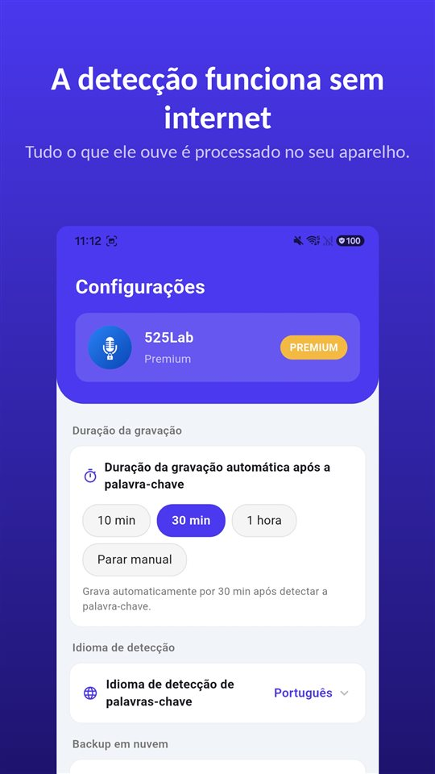

Você rola a lista de gravações de novo e de novo, e o arquivo não está lá. A que você queria apagar era a do lado.

Acontece com um toque. Com vários arquivos de datas e durações parecidas, qualquer um se confunde. Agora o que importa não é por que aconteceu, mas onde olhar primeiro.

Se uma gravação apagada volta ou não, quase sempre se decide antes de ela ser apagada.

## Para onde cada app manda um arquivo apagado

| App | Ao apagar | Como recuperar |
|---|---|---|
| Gravador de Voz da Samsung (One UI 6.0 ou mais recente) | Vai para a lixeira; a lixeira não pode ser desativada | Gravador de Voz > Mais (três pontos) > Lixeira > Restaurar |
| Gravador do Google (Pixel) | Sem lixeira; removida de forma permanente dos dispositivos sincronizados e de recorder.google.com | A cópia pública para outros apps (ativada por padrão) não é apagada sozinha; veja no app Files |
| Qualquer app | As cópias enviadas continuam | E-mail para você mesmo, conversas de mensagens, nuvem |
| TalkSafe | As gravações salvas na nuvem continuam | Recuperar pelo backup na nuvem, também num celular novo |

O que vem a seguir se baseia na ajuda oficial da Samsung e do Google no momento da escrita e pode mudar.

## No Galaxy, abra primeiro a lixeira

Segundo a Samsung, desde a One UI 6.0 os arquivos apagados no Gravador de Voz não somem na hora: vão para a **lixeira**. A função de lixeira **não pode ser desativada**.

1. Abra o app Gravador de Voz.
2. Toque em **Mais (três pontos)** e escolha **Lixeira**.
3. Selecione os arquivos que quer de volta e toque em **Restaurar**, ou **Restaurar tudo**.

A mesma lixeira aparece também no app **Meus Arquivos**. A ajuda da Samsung não diz por quantos dias as gravações ficam na lixeira, então o mais seguro é abrir agora, logo que você percebeu.

## No Pixel, procure a cópia feita para outros apps

Segundo o Google, o Gravador do Google no Pixel não tem lixeira, e as gravações apagadas são **removidas de forma permanente de todos os dispositivos sincronizados e de recorder.google.com**. Então também não vai estar em recorder.google.com.

Resta um caminho. Quando a opção **Access recordings in other apps** (acessar gravações em outros apps) está ativada nas configurações do Gravador, é criada à parte uma **cópia pública** para outros apps usarem, e a opção vem ativada por padrão. A ajuda do Google explica que apagar uma gravação no app **não apaga automaticamente essa cópia pública**. Procure a gravação no app Files.

## Não está na lixeira? Pense para onde você mandou

Se a gravação saiu do celular pelo menos uma vez, essa cópia sobrevive mesmo com o original apagado.

- Um anexo num **e-mail para você mesmo**
- Um arquivo enviado numa **conversa de mensagens**, com a família, um colega ou com você mesmo
- Um arquivo levado para uma **nuvem** ou para o computador

Se não está na lixeira da Samsung, nem na cópia pública do Pixel, nem em nenhum lugar para onde você mandou, a ajuda oficial dos apps não descreve outra forma de recuperar.

## Para a próxima não se perder

Fica uma lição. Recuperar depende quase sempre de **existir uma cópia em algum lugar antes de apagar**. Por isso a proteção mais segura é guardar uma segunda cópia de qualquer gravação importante fora do celular logo que ela terminar.

O [TalkSafe](/talksafe/pt-br/) é um app de gravação de voz para Android e iPhone que começa a gravar quando detecta uma palavra escolhida antes, e tem **backup na nuvem**. As gravações salvas na nuvem podem ser recuperadas se forem apagadas do celular sem querer, e se o celular for perdido e trocado, podem ser recuperadas da nuvem no novo.

<figure class="shot"><figcaption>Configurações. Junto do tempo de gravação depois da detecção e do idioma de detecção, há o item de backup na nuvem.</figcaption></figure>

**O backup não é automático: é você quem faz.** Por isso só voltam as gravações salvas antes de serem apagadas. Da próxima vez que uma gravação parecer daquelas que precisam ficar, uma opção é salvar na nuvem antes de guardar o celular no bolso. Assim, se um dia como hoje voltar, você não vai precisar revirar nenhuma lixeira.

O que mais vale fazer depois de gravar, e por que não mudar o nome nem a data do original, está em [O que fazer com uma gravação, e o que não fazer](/blog/pt-br/after-recording/). Para guardar só a parte que você precisa, [Como cortar uma gravação de voz no Android sem perder o original](/blog/pt-br/trim-recording/) salva o trecho como arquivo novo e deixa o original no lugar.

Os recursos de outros apps são descritos de acordo com a ajuda oficial no momento da escrita e podem mudar. Nós desenvolvemos o app de gravação TalkSafe.

