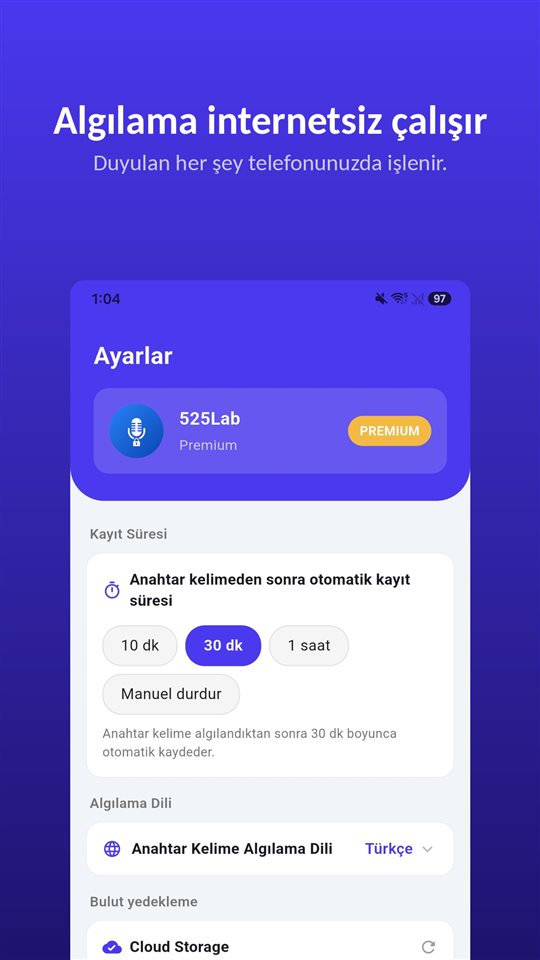

Kayıt listesini tekrar tekrar kaydırıyorsunuz ama dosya yok. Silmek istediğiniz aslında hemen yanındakiydi.

Tek bir dokunuşla olur. Tarihi ve uzunluğu benzer birkaç dosya varsa herkes karıştırabilir. Şimdi önemli olan neden olduğu değil, önce nereye bakılacağı.

Silinen bir kaydın geri gelip gelmeyeceği çoğu zaman silinmeden önce belli olur.

## Her kayıt uygulaması silinen dosyayı nereye gönderir

| Uygulama | Silince | Nasıl geri gelir |
|---|---|---|
| Samsung Ses Kaydedici (One UI 6.0 ve sonrası) | Çöp kutusuna gider; çöp kutusu kapatılamaz | Ses Kaydedici > Diğer (üç nokta) > Çöp kutusu > Geri yükle |
| Google Kaydedici (Pixel) | Çöp kutusu yok; senkronize cihazlardan ve recorder.google.com'dan kalıcı olarak kaldırılır | Diğer uygulamalar için herkese açık kopya (varsayılan olarak açık) otomatik silinmez; Files uygulamasına bakın |
| Her uygulama | Gönderilen kopyalar kalır | Kendinize e-posta, mesajlaşma sohbetleri, bulut depolama |
| TalkSafe | Buluta yedeklenen kayıtlar kalır | Bulut yedeklemeden geri yükleme, yeni telefonda da |

Aşağıdakiler, yazıldığı tarihteki Samsung ve Google resmi yardım sayfalarına dayanır ve değişebilir.

## Galaxy'de önce çöp kutusunu açın

Samsung'a göre One UI 6.0'dan itibaren Ses Kaydedici'de silinen dosyalar hemen yok olmaz, **çöp kutusuna** taşınır. Çöp kutusu işlevi **kapatılamaz**.

1. Ses Kaydedici uygulamasını açın.
2. **Diğer (üç nokta)** seçeneğine dokunup **Çöp kutusu**'nu seçin.
3. Geri getirmek istediğiniz dosyaları seçip **Geri yükle**'ye ya da **Tümünü geri yükle**'ye dokunun.

Aynı çöp kutusu **Dosyalarım** uygulamasında da görünür. Samsung'un yardım sayfası ses kayıtlarının çöp kutusunda kaç gün kaldığını ayrıca belirtmiyor; bu yüzden en garantisi, fark ettiğiniz şu anda açmaktır.

## Pixel'de diğer uygulamalar için olan kopyayı arayın

Google'a göre Pixel'deki Google Kaydedici'nin çöp kutusu yoktur ve silinen kayıtlar **senkronize edilen tüm cihazlardan ve recorder.google.com'dan kalıcı olarak kaldırılır**. Yani recorder.google.com'da da bulamazsınız.

Bir yol kalıyor. Kaydedici ayarlarında **Access recordings in other apps** (kayıtlara diğer uygulamalardan erişim) açıksa, diğer uygulamaların kullanabileceği ayrı bir **herkese açık kopya** oluşturulur ve bu ayar varsayılan olarak açıktır. Google'ın yardım sayfası, uygulamada bir kaydı silmenin **bu herkese açık kopyayı otomatik olarak silmediğini** açıklar. Kaydı Files uygulamasında arayın.

## Çöp kutusunda da yoksa, nereye gönderdiğinizi düşünün

Kayıt telefonun dışına bir kez bile çıktıysa, o kopya orijinal silinse de kalır.

- **Kendinize attığınız bir e-postadaki** ek
- Ailenizle, bir iş arkadaşınızla ya da kendinizle olan bir **mesajlaşma sohbetine** gönderdiğiniz dosya
- **Bulut depolamaya** ya da bilgisayara taşıdığınız dosya

Ne Samsung çöp kutusunda, ne Pixel'in herkese açık kopyasında, ne de gönderdiğiniz bir yerde varsa, uygulamaların resmi yardım sayfaları onu geri getirmenin başka bir yolunu tarif etmiyor.

## Bir sonraki kaybolmasın

Bundan kalan ders şu. Geri getirmek neredeyse her zaman **silinmeden önce bir yerde kopya olup olmadığına** bağlıdır. Bu yüzden en sağlam önlem, önemli her kaydın bittiği anda telefonun dışında ikinci bir kopyasını tutmaktır.

[TalkSafe](/talksafe/tr/), önceden belirlenen bir kelimeyi algıladığında kayda başlayan Android ve iPhone için bir ses kayıt uygulamasıdır ve **bulut yedekleme** özelliği vardır. Buluta yedeklenen kayıtlar telefondan yanlışlıkla silinse de geri yüklenebilir; telefon kaybolup değiştirildiğinde de yeni telefonda buluttan geri yüklenebilir.

<figure class="shot"><figcaption>Ayarlar. Algılamadan sonraki kayıt süresi ve algılama dilinin yanında bulut yedekleme seçeneği de var.</figcaption></figure>

**Yedekleme otomatik değildir; kendiniz başlatırsınız.** Bu yüzden yalnızca silinmeden önce yedeklenen kayıtlar geri getirilebilir. Bir dahaki sefere "bunu saklamam lazım" dediğiniz bir kayıt olduğunda, telefonu cebinize koymadan önce onu buluta yedeklemek bir seçenek. Böylece bugünkü gibi bir gün yeniden gelirse çöp kutusunu karıştırmanız gerekmez.

Kayıttan sonra dikkat edilecek diğer şeyler ve orijinalin adını ve tarihini neden değiştirmemek gerektiği [Bir kayıtla ne yapmalı, ne yapmamalı](/blog/tr/after-recording/) yazısında. Yalnızca ihtiyacınız olan kısmı tutmak için [Android'de bir ses kaydı orijinali kaybetmeden nasıl kırpılır](/blog/tr/trim-recording/) yazısındaki yöntem onu yeni bir dosya olarak kaydeder ve orijinali yerinde bırakır.

Android ile iPhone arasında geçiş yapıyorsanız kayıtları nasıl taşıyacağınız [Android ile iPhone arasında telefon değiştirirken ses kayıtlarını taşımak](/blog/tr/transfer-recordings/) yazısında.

Diğer uygulamaların özellikleri yazıldığı tarihteki resmi yardım sayfalarına göre anlatılmıştır ve değişebilir. Ses kayıt uygulaması TalkSafe'i biz geliştiriyoruz.

