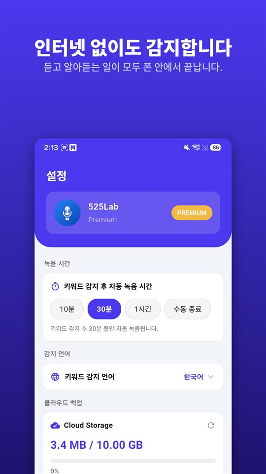

녹음 목록을 아무리 내려도 그 파일이 없습니다. 지우려던 건 바로 옆의 다른 녹음이었는데요.

손가락 한 번이면 일어나는 일입니다. 비슷한 날짜, 비슷한 길이의 파일이 여러 개 있으면 누구나 헷갈립니다. 지금 중요한 건 왜 지웠느냐가 아니라 어디부터 찾아볼지입니다.

지운 녹음이 돌아올지는 대개 지우기 전에 이미 정해져 있습니다.

## 녹음 앱마다 지운 파일이 가는 곳

| 앱 | 지우면 | 되살리는 길 |
|---|---|---|
| 갤럭시 음성 녹음(One UI 6.0 이상) | 휴지통으로 이동, 휴지통 기능은 끌 수 없음 | 음성 녹음 > 더보기(점 세 개) > 휴지통 > 복원 |
| 구글 녹음(픽셀) | 휴지통 없음, 동기화된 기기와 recorder.google.com에서도 영구 삭제 | 다른 앱용 공개 사본(기본으로 켜짐)은 자동으로 지워지지 않음, 파일 앱에서 확인 |
| 어느 앱이든 | 보낸 사본은 그대로 남음 | 나에게 보낸 메일, 메신저 대화방, 클라우드 드라이브 |
| TalkSafe | 클라우드에 직접 백업해 둔 녹음은 남음 | 클라우드 백업에서 복구, 새 휴대폰에서도 |

아래 내용은 작성 시점의 삼성·구글 공식 안내를 기준으로 했으며 바뀔 수 있습니다.

## 갤럭시라면 휴지통부터 엽니다

삼성 안내에 따르면 One UI 6.0부터 음성 녹음 앱에서 지운 파일은 바로 사라지지 않고 **휴지통**으로 옮겨집니다. 이 휴지통 기능은 **끌 수 없습니다.**

1. 음성 녹음 앱을 엽니다.
2. **더보기(점 세 개)**를 누르고 **휴지통**을 고릅니다.
3. 되살릴 파일을 골라 **복원**을 누릅니다. 전부 되살리려면 **모두 복원**을 누릅니다.

같은 휴지통은 **내 파일** 앱에서도 보입니다. 삼성 안내는 음성 녹음 파일이 휴지통에 며칠 남는지 따로 적어 두지 않았으니, 지운 걸 알아챈 지금 바로 열어 보는 것이 가장 확실합니다.

## 픽셀이라면 다른 앱용 사본을 찾습니다

구글 안내에 따르면 픽셀의 구글 녹음 앱에는 휴지통이 없고, 지운 녹음은 **동기화된 모든 기기와 recorder.google.com에서도 영구 삭제**됩니다. 그래서 recorder.google.com에서 다시 찾을 수는 없습니다.

남은 길이 하나 있습니다. 녹음 앱 설정의 **'다른 앱에서 녹음에 접근(Access recordings in other apps)'**이 켜져 있으면 다른 앱이 쓸 수 있는 **공개 사본**이 따로 만들어지고, 이 설정은 기본으로 켜져 있습니다. 구글 안내는 앱에서 녹음을 지워도 **이 공개 사본은 자동으로 지워지지 않는다**고 설명합니다. 파일 앱에서 그 녹음을 찾아보세요.

## 휴지통에도 없다면, 보낸 곳을 떠올립니다

녹음을 한 번이라도 휴대폰 밖으로 보냈다면 그 사본은 원본을 지워도 남아 있습니다.

- **나에게 보낸 메일**의 첨부 파일
- 가족이나 동료, 나와의 **메신저 대화방**에 올린 파일
- **클라우드 드라이브**나 컴퓨터로 옮긴 파일

삼성 휴지통에도, 픽셀 공개 사본에도, 보낸 곳에도 없다면 녹음 앱 안에서 되살리는 공식 방법은 안내되어 있지 않습니다.

## 다음 녹음은 처음부터 잃지 않게

이번 일로 남는 교훈은 하나입니다. 복구는 대부분 **지우기 전에 사본이 어딘가에 있었느냐**로 정해집니다. 그래서 중요한 녹음은 끝난 직후 휴대폰 밖에 한 부를 더 두는 것이 가장 확실한 대비입니다.

[TalkSafe](/talksafe/)는 미리 정해둔 말이 감지되면 녹음을 시작하는 안드로이드·아이폰 녹음 앱이고, **클라우드 백업**이 있습니다. 클라우드에 백업해 둔 녹음은 휴대폰에서 실수로 지워도 복구할 수 있고, 휴대폰을 잃어버려 바꾸더라도 새 휴대폰에서 클라우드로부터 되살릴 수 있습니다.

<figure class="shot"><figcaption>설정 화면. 감지 후 녹음 시간, 감지 언어와 함께 클라우드 백업 항목이 있습니다.</figcaption></figure>

**백업은 자동이 아니라 직접 실행합니다.** 그래서 지우기 전에 백업해 둔 녹음만 되살릴 수 있습니다. 다음에 "이건 남겨야 한다" 싶은 녹음이 생기면, 휴대폰을 주머니에 넣기 전에 그 녹음부터 클라우드에 백업해 두는 방법이 있습니다. 그러면 오늘 같은 날이 다시 와도 휴지통을 뒤질 필요가 없습니다.

녹음한 다음에 챙길 다른 것들, 원본 이름과 날짜를 바꾸지 않는 이유는 [녹음한 다음에 해야 할 일과 하지 말아야 할 일](/blog/ko/after-recording/)에 모아 두었습니다. 필요한 부분만 따로 남기려면 원본을 남기고 새 파일로 저장하는 [녹음 파일 자르기, 원본은 남기고 필요한 부분만](/blog/ko/trim-recording/)도 함께 보세요.

다른 앱의 기능은 작성 시점의 공식 안내를 기준으로 했으며 바뀔 수 있습니다. 저희는 녹음 앱 TalkSafe를 만들고 있습니다.

