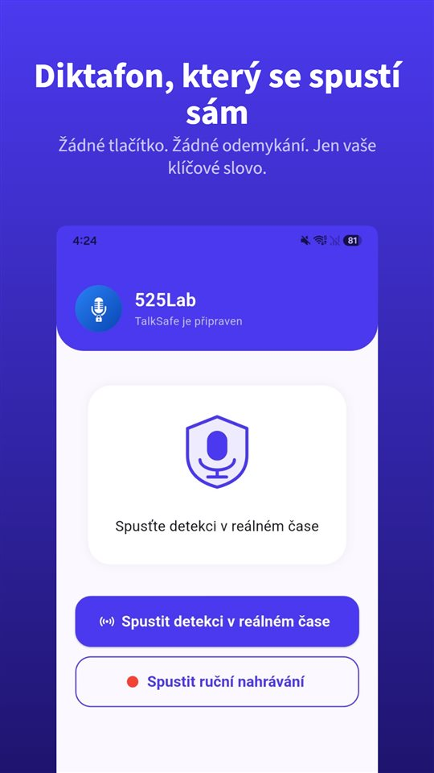

Večer před zkouškou otevřete poznámky a právě tahle část je prázdná. Pamatujete si jen, že přednášející řekla: „Tohle musíte umět.“

Uteklo vám to při psaní. Než zapíšete jednu větu, další už zazněla; než se podíváte na tabuli, výklad skončí. Není to nepozornost. Poslouchat a psát zároveň je prostě těžké.

Nejvíc byste si znovu poslechli většinou právě to, co vám uteklo při psaní poznámek.

## Nahrávání přednášky: co kdy použít

| Situace | Jak | V TalkSafe |
|---|---|---|
| Chcete celou přednášku | Spustit nahrávání na začátku a zastavit na konci | Ruční nahrávání na úvodní obrazovce |
| Chcete jen důležité části | Nechat nahrávání spustit slovy přednášejícího | Rozpoznávání klíčových slov; uloží se 30 sekund, které už uběhly |
| Po přednášce | Nejdřív si projít, co se probíralo | Shrnutí od AI ke každé nahrávce, v jazyce přednášky |
| Při učení | Nechat si jen potřebný výklad | Vystřižení (originál zůstane) |
| Celá přednáška jako text | Žádná aplikace nepřepíše 100 % slovo od slova | Bez přepisu, jen shrnutí |

## Na celou přednášku je základem ruční nahrávání

Chcete-li nahrát přednášku od začátku do konce, nejjistější je spustit nahrávání, když začne, a zastavit ho, když skončí. Položte telefon blíž dopředu, k přednášejícímu, a nezakrývejte knihami ani penálem spodní okraj, kde je mikrofon. Ve velké posluchárně je mluvčí daleko, takže čím blíž sedíte, tím snáz se pak poslouchá.

[TalkSafe](/talksafe/cs/) je aplikace pro nahrávání na Android a iPhone, která začne nahrávat, když rozpozná předem zvolené slovo, ale na úvodní obrazovce má i **tlačítko pro ruční nahrávání**. Na celou přednášku stačí tohle jedno tlačítko.

<figure class="shot"><figcaption>Úvodní obrazovka TalkSafe. Celou přednášku nahrajete ručně, jen důležité části pomocí detekce v reálném čase.</figcaption></figure>

## Když si chcete nechat jen to podstatné

I když nahrajete devadesát minut každé přednášky, málokdy si je pustíte od začátku. Znovu slyšet chcete většinou pár minut: chvíli, kdy přednášející řekl „tohle bude u zkoušky“ nebo „tohle je důležité“.

Protože **klíčová slova v TalkSafe nejsou vázaná na osobu**, můžete uložit **to, co pravděpodobně řekne přednášející**, nejen svá slova. Se zapnutou detekcí v reálném čase začne nahrávání ve chvíli, kdy se ta věta rozpozná, bez odemykání telefonu, a uloží se i **30 sekund, které už uběhly**. Pokud ta věta zazní na konci výkladu, zůstane i výklad před ní.

**Dvě slova, která se obvykle objevují ve stejné větě**, dělají rozpoznávání mnohem spolehlivějším. Vzpomeňte si na větu „tohle je důležité, bude to u zkoušky“ a uložte „důležité“ a „zkoušky“. Po rozpoznání nahrávání trvá 10 minut, 30 minut, 1 hodinu nebo do ručního zastavení.

Příští týden ve chvíli, kdy přednášející řekne „tahle část je důležitá“, začne telefon na lavici nahrávat tak, jak leží. Soubor, který si pustíte večer před zkouškou, bude těch pár minut, ne devadesát.

## Po přednášce si nejdřív přečtěte shrnutí

TalkSafe vytvoří **ke každé nahrávce shrnutí od AI** a zobrazí ho jako seznam bodů pod přehrávačem na obrazovce detailu. Přednáška v češtině se shrne česky. Jeden ze způsobů opakování: nejdřív si ve shrnutí projít průběh hodiny a pak si poslechnout jen místa, kterým jste nerozuměli.

- **Shrnutí vznikají na serveru.** Rozpoznávání klíčových slov běží v telefonu, ale kvůli shrnutí se nahrávka posílá na server.
- **I vystřižené úseky** lze shrnout. Můžete si [vystřihnout jen potřebný výklad a originál nechat](/blog/cs/trim-recording/) a shrnout jen ten.

Vestavěné diktafony v telefonech Galaxy a Pixel nabízejí shrnutí na podporovaných modelech také. Rozdíly mezi aplikacemi popisujeme v [Jak shrnout hlasovou nahrávku pomocí AI na Androidu](/blog/cs/summarize-recording/).

## Proč tu není přepis

Spousta lidí hledá funkci, která přepíše celou přednášku. Ale žádná aplikace pro nahrávání nepřepíše řeč na 100 % slovo od slova. Samotná nápověda Samsungu uvádí, že pro přesný přepis musí mluvčí mluvit zřetelně a blízko mikrofonu. V posluchárně bývá přednášející od mikrofonu daleko.

Proto TalkSafe zatím nabízí **jen shrnutí** a přidání přepisu chce zvážit, až si bude jistý, že je na 100 % přesný. Když záleží na přesném znění, nejjistější je najít místo ve shrnutí a poslechnout si tu část nahrávky.

## Co říká zákon v Česku a na Slovensku

**V Česku** jde hlavně o autorské právo:
- Autorský zákon (121/2000 Sb.) považuje za dílo zejména „dílo slovesné vyjádřené řečí nebo písmem“ (§ 2 odst. 1).
- Podle **§ 30 odst. 2** do autorského práva nezasahuje ten, kdo pro svou osobní potřebu zhotoví záznam díla.
- Tyto výjimky se podle **§ 29 odst. 2** vztahují jen na dílo zveřejněné. Zda je přednáška v tomto smyslu zveřejněná, jsme v rozhodnutích ani oficiálních pokynech nenašli.
- Přednost mají pravidla školy a souhlas přednášejícího.

**Na Slovensku** jsme pravidla pro nahrávání přednášek neověřovali. Pro nahrávání rozhovorů obecně platí, že je potřeba svolení.

Nejjednodušší je po první hodině se jednou zeptat: „Můžu si to nahrávat na opakování?“ Víc o nahrávání rozhovorů najdete v [Je legální nahrávat rozhovor bez souhlasu? V Česku rozhoduje účel, na Slovensku svolení](/blog/cs/nahravani-rozhovoru/).

## Díra v poznámkách

Až budete mít příště večer před zkouškou v poznámkách díru, nemusíte panikařit. Otevřete shrnutí, najděte tu přednášku a poslechněte si znovu těch pár minut, kdy přednášející řekl: „Tohle je důležité.“

Nahrávka poznámky nenahradí. Vrátí vám to, co vám při jejich psaní uteklo.

Obecné informace, nikoli právní rada. V konkrétní věci si ověřte pravidla své školy nebo se obraťte na advokáta. Funkce jiných aplikací jsou popsány podle jejich oficiální nápovědy v době psaní a mohou se změnit. Vyvíjíme aplikaci pro nahrávání TalkSafe.

