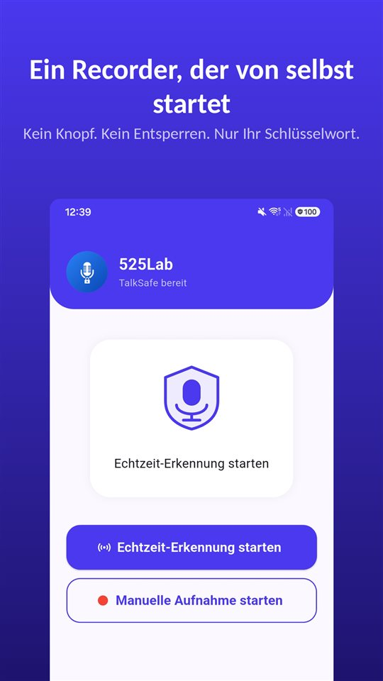

Am Abend vor der Prüfung schlagen Sie Ihre Mitschrift auf, und genau diese Stelle ist leer. Sie wissen nur noch, dass die Professorin gesagt hat: „Das sollten Sie unbedingt können.“

Es ist Ihnen beim Mitschreiben entgangen. Bis ein Satz notiert ist, ist der nächste schon gesagt; während Sie zur Tafel schauen, endet die Erklärung. Das ist kein Mangel an Aufmerksamkeit. Zuhören und Schreiben zugleich ist einfach schwer.

Was man am liebsten noch einmal hören würde, ist meist genau das, was beim Mitschreiben verloren ging.

## Eine Vorlesung aufnehmen: was wann passt

| Situation | Wie | In TalkSafe |
|---|---|---|
| Die ganze Vorlesung | Zu Beginn starten, am Ende beenden | Manuelle Aufnahme auf dem Startbildschirm |
| Nur das Wichtige | Die Worte der Lehrperson starten die Aufnahme | Schlüsselwort-Erkennung; die schon vergangenen 30 Sekunden werden gespeichert |
| Nach der Vorlesung | Zuerst überblicken, was dran war | Eine KI-Zusammenfassung per Antippen, in der Sprache der Vorlesung |
| Beim Lernen | Nur die nötige Erklärung behalten | Kürzen (das Original bleibt) |
| Die ganze Vorlesung als Text | Keine App überträgt 100 % Wort für Wort | Kein Transkript, nur Zusammenfassung |

## Für die ganze Vorlesung ist die manuelle Aufnahme der Normalfall

Um eine Vorlesung von Anfang bis Ende aufzunehmen, starten Sie die Aufnahme am sichersten zu Beginn und beenden sie am Ende. Legen Sie das Handy eher nach vorn, näher an die Lehrperson, und halten Sie den unteren Rand, an dem das Mikrofon sitzt, frei von Büchern und Mäppchen. Im Hörsaal ist die sprechende Person weit weg; je näher Sie sitzen, desto leichter ist das Nachhören.

[TalkSafe](/talksafe/de/) ist eine Aufnahme-App für Android und iPhone, die mit der Aufnahme beginnt, wenn sie ein vorher festgelegtes Wort erkennt, aber auf dem Startbildschirm gibt es auch eine **Taste für eine manuelle Aufnahme**. Für die ganze Vorlesung reicht diese eine Taste.

<figure class="shot"><figcaption>Startbildschirm von TalkSafe. Die ganze Vorlesung per manueller Aufnahme, nur das Wichtige per Echtzeit-Erkennung.</figcaption></figure>

## Wenn nur das Wichtige bleiben soll

Auch wenn Sie jede Vorlesung komplett aufnehmen, werden Sie die neunzig Minuten selten von vorn anhören. Was Sie noch einmal hören wollen, sind meist ein paar Minuten: die Stelle, an der es hieß „Das kommt in der Klausur dran“ oder „Das ist wichtig“.

Weil **Schlüsselwörter in TalkSafe nicht an eine Person gebunden sind**, können Sie hinterlegen, **was die Lehrperson wahrscheinlich sagt**, nicht nur Ihre eigenen Worte. Mit eingeschalteter Echtzeit-Erkennung startet die Aufnahme in dem Moment, in dem der Satz erkannt wird, ohne das Handy zu entsperren, und **die bereits vergangenen 30 Sekunden** werden mitgespeichert. Fällt der Satz am Ende einer Erklärung, bleibt die Erklärung davor mit erhalten.

**Zwei Wörter, die meist im selben Satz vorkommen**, machen die Erkennung deutlich zuverlässiger. Denken Sie an „Das ist wichtig, das kommt in der Klausur dran“ und hinterlegen Sie „wichtig“ und „Klausur“. Nach der Erkennung läuft die Aufnahme 10 Minuten, 30 Minuten, 1 Stunde oder bis Sie sie beenden.

Nächste Woche, in dem Moment, in dem die Professorin sagt „Dieser Teil ist wichtig“, beginnt das Handy auf dem Tisch so, wie es liegt, mit der Aufnahme. Am Abend vor der Prüfung hören Sie dann diese paar Minuten, nicht neunzig.

## Nach der Vorlesung zuerst die Zusammenfassung lesen

TalkSafe erstellt auf Antippen **eine KI-Zusammenfassung** einer Aufnahme und zeigt sie als Stichpunktliste unter dem Player in der Detailansicht. Eine deutsche Vorlesung wird auf Deutsch zusammengefasst. Eine Möglichkeit zum Wiederholen: erst in der Zusammenfassung den Ablauf überblicken, dann nur die Stellen anhören, die unklar geblieben sind.

- **Zusammenfassungen entstehen auf einem Server.** Die Schlüsselwort-Erkennung läuft auf dem Handy, für die Zusammenfassung wird die Aufnahme aber an einen Server geschickt.
- **Auch gekürzte Abschnitte** lassen sich zusammenfassen. Sie können [nur die nötige Erklärung herausschneiden, das Original bleibt](/blog/de/trim-recording/), und nur diese zusammenfassen.

Auch die vorinstallierten Rekorder auf Galaxy- und Pixel-Handys bieten auf unterstützten Modellen Zusammenfassungen. Wie sich die Apps unterscheiden, steht in [Sprachaufnahme mit KI zusammenfassen – so geht es auf Android](/blog/de/summarize-recording/).

## Warum es kein Transkript gibt

Viele suchen eine Funktion, die die ganze Vorlesung mitschreibt. Aber keine Aufnahme-App überträgt Sprache zu 100 % Wort für Wort. Samsung schreibt selbst, dass für eine genaue Transkription die sprechende Person deutlich und nah am Mikrofon sprechen muss. Im Hörsaal ist die Lehrperson meist weit davon entfernt.

Deshalb bietet TalkSafe vorerst **nur die Zusammenfassung** und will eine Transkription erst dann prüfen, wenn sie sicher zu 100 % genau ist. Wenn es auf den genauen Wortlaut ankommt, finden Sie die Stelle am sichersten über die Zusammenfassung und hören sich diesen Teil der Aufnahme an.

## Was in Deutschland, Österreich und der Schweiz gilt

**In Deutschland** führt praktisch jeder Weg zur Einwilligung der Lehrperson:
- **Gilt die Vorlesung als öffentlich**, ist die Aufnahme öffentlicher Vorträge auf Ton- oder Bildträger nach **§ 53 Abs. 7 UrhG** „stets nur mit Einwilligung des Berechtigten zulässig“. Die Privatkopie deckt das nicht.
- **Gilt sie als nichtöffentlich**, erfasst **§ 201 StGB** die Aufnahme des nichtöffentlich gesprochenen Wortes eines anderen. Die TU Dresden etwa schreibt, Vorlesungen seien in der Regel nicht öffentlich und eine Tonaufnahme ohne Einwilligung der Lehrperson sei strafbar.
- Ob eine Vorlesung öffentlich ist, sehen Hochschulen unterschiedlich; ein Gerichtsurteil dazu haben wir nicht gefunden. Die Einwilligung vorher macht beide Fragen überflüssig.

**In Österreich** erfasst § 120 Abs. 1 StGB nur Äußerungen, die nicht für die aufnehmende Person bestimmt sind; eine Vorlesung, die Sie hören, ist an Sie gerichtet. Strafbar ist nach **§ 120 Abs. 2 StGB**, die Tonaufnahme einer nicht öffentlichen Äußerung ohne Einverständnis Dritten zugänglich zu machen oder zu veröffentlichen. Private Vervielfältigungen erlaubt § 42 Abs. 4 UrhG.

**In der Schweiz** bestraft Art. 179ter StGB, wer als Gesprächsteilnehmer ein nichtöffentliches Gespräch ohne Einwilligung der anderen aufnimmt. Ob eine Vorlesung in diesem Sinn nichtöffentlich ist, haben wir nicht geklärt gefunden; auch hier ist die Einwilligung der sichere Weg.

Am einfachsten fragen Sie nach der ersten Sitzung einmal: „Darf ich zum Wiederholen aufnehmen?“ Mehr zum Aufnehmen von Gesprächen steht in [Gespräch heimlich aufnehmen: In Deutschland strafbar, in Österreich nicht – und was das vor Gericht heißt](/blog/de/gespraech-aufnehmen/).

## Die Lücke in der Mitschrift

Wenn am Abend vor der nächsten Prüfung wieder eine Lücke in der Mitschrift ist, müssen Sie nicht in Panik geraten. Öffnen Sie die Zusammenfassung, suchen Sie die Vorlesung und hören Sie die paar Minuten noch einmal, in denen es hieß: „Das ist wichtig.“

Eine Aufnahme ersetzt die Mitschrift nicht. Sie gibt Ihnen zurück, was beim Mitschreiben verloren ging.

Allgemeine Information, keine Rechtsberatung. Für einen konkreten Fall prüfen Sie die Regeln Ihrer Hochschule oder wenden Sie sich an eine Anwältin oder einen Anwalt. Die Funktionen anderer Apps sind nach deren offiziellen Hilfeseiten zum Zeitpunkt des Schreibens beschrieben und können sich ändern. Wir entwickeln die Aufnahme-App TalkSafe.

