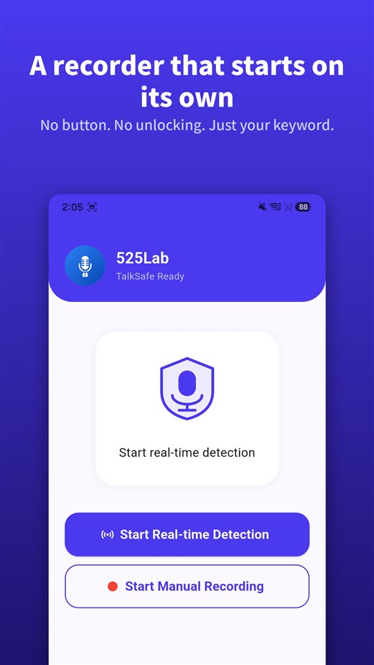

The night before the exam, you open your notes and that one part is blank. All you remember is the lecturer saying, "Make sure you know this."

You missed it while writing. By the time you get one sentence down, the next has gone by; while you look at the board, the explanation ends. It isn't a lack of focus. Listening and writing at the same time is simply hard.

The words you most want to hear again are usually the ones you missed while taking notes.

## Recording a lecture: what to use when

| Situation | How | In TalkSafe |
|---|---|---|
| You want the whole class | Start recording at the beginning, stop at the end | Start manual recording on the start screen |
| You only want the important parts | Let the lecturer's words start the recording | Keyword detection; the 30 seconds already gone are saved |
| After class | Skim what was covered first | An AI summary with one tap, in the language of the lecture |
| Revising | Keep just the explanation you need | Trim (the original stays) |
| The whole lecture as text | No app transcribes 100% word for word | No transcript, summary only |

## For the whole class, manual recording is the default

To record a lecture from start to finish, the surest way is to start recording when the class begins and stop when it ends. Put the phone toward the front, closer to the lecturer, and keep the microphone edge at the bottom clear of books and pencil cases. In a lecture hall the speaker is far away, so the closer you sit, the easier it is to listen back.

[TalkSafe](/talksafe/en/) is a voice recorder for Android and iPhone that starts recording when it detects a word you set in advance, but its start screen also has a **Start manual recording** button. For the whole class, that one button is all you need.

<figure class="shot"><figcaption>TalkSafe start screen. Record the whole class with manual recording, or only the important parts with live detection.</figcaption></figure>

## When you only want the parts that matter

Even if you record all ninety minutes of every class, there won't be many days you listen from the beginning. What you want again is usually a few minutes: the part where the lecturer said "This will be on the exam" or "This is important."

Because **keywords in TalkSafe are not tied to one speaker**, you can set **what the lecturer is likely to say**, not just your own words. With live detection on, recording starts the moment that phrase is detected, without unlocking the phone, and **the 30 seconds that had already passed** are saved too. If that line comes at the end of an explanation, the explanation before it is kept as well.

**Two words likely to appear in the same sentence** make detection much more reliable. Think of "This is important, it will be on the exam" and register both "important" and "exam". After detection, recording runs for 10 minutes, 30 minutes, 1 hour or until you stop it.

Next week, the moment the lecturer says "This part is important," the phone on your desk starts recording as it lies. The file you play the night before the exam is those few minutes, not ninety.

## After class, read the summary first

TalkSafe creates **an AI summary** of a recording when you tap AI summary and shows it as a list of points under the player in the recording's detail screen. A lecture in English is summarized in English. One way to revise is to skim the flow of the class in the summary first, then listen only to the parts you didn't follow.

- **Summaries are made on a server.** Keyword detection runs on the phone, but for the summary the recording is sent to a server.
- **Trimmed clips** can be summarized too. You can [cut out just the explanation you need, keeping the original](/blog/en/trim-recording/), and summarize only that.

The built-in recorders on Galaxy and Pixel phones also offer summaries on supported models. How the apps differ is in [How to get an AI summary of a voice recording on Android](/blog/en/summarize-recording/).

## Why there's no transcript

Many people look for a feature that writes out the whole lecture. But no recording app can transcribe speech 100% word for word. Samsung's own help says that for an accurate transcription the speaker must speak clearly and be close to the microphone. In a lecture hall, the lecturer is usually far from it.

So TalkSafe offers **a summary only** for now, and plans to consider adding transcription when it can be confident it is 100% accurate. When the exact wording matters, the surest way is to find the spot in the summary and listen to that part of the recording.

## Is recording a lecture legal?

In practice, the answer usually comes from **your school's policy and the lecturer's permission**. The law mostly bears on who owns the lecture.

**In the US:**
- A California appeals court held in *Williams v. Weisser* (1969), a case about a business selling notes from UCLA lectures, that absent evidence otherwise the teacher, not the university, owns the common-law copyright in his lectures.
- For students with disabilities, the Section 504 regulation (34 CFR 104.44(b)) says schools receiving federal funds may not impose rules such as "the prohibition of tape recorders in classrooms" where those rules limit participation.
- Some states require everyone's consent to record conversations. Whether that applies to a classroom lecture isn't something we found settled; the details by state are in [Nine states are strict. The rest of the list is an argument.](/blog/en/state-recording-consent/)

**In the UK:**
- A spoken lecture is a literary work, and copyright arises once it is recorded, even when the recording is made without the speaker's permission (CDPA 1988 s.3). The copyright belongs to the lecturer.
- Fair dealing with a work for the purposes of private study does not infringe copyright (s.29(1C)).

Sharing or posting a recording is a different matter from keeping it for study. The simplest step is to ask once, after the first class: "Is it OK if I record to revise?"

## The blank in your notes

The next time there's a gap in your notes the night before an exam, there's no need to panic. Open the summary, find that class, and listen again to the few minutes where the lecturer said "This is important."

A recording doesn't replace your notes. It gives you back what you missed while writing them.

General information, not legal advice. For a specific situation, check your school's policy or consult a lawyer. Other apps' features are described from their official help at the time of writing and may change. We make the recording app TalkSafe.

