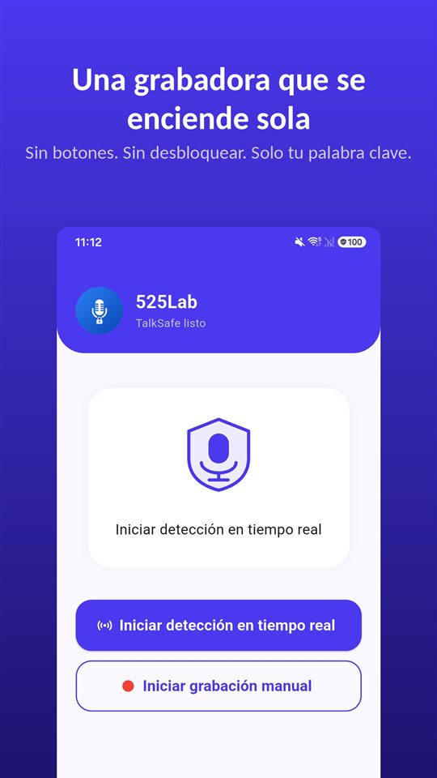

La noche antes del examen abres los apuntes y justo esa parte está en blanco. Solo recuerdas que el profesor dijo: «Esto tenéis que saberlo».

Se te escapó mientras escribías. Cuando terminas una frase, ya va por la siguiente; mientras miras la pizarra, la explicación termina. No es falta de atención. Escuchar y escribir a la vez es difícil de por sí.

Lo que más quieres volver a escuchar suele ser justo lo que se te escapó mientras tomabas apuntes.

## Grabar una clase: qué usar en cada caso

| Situación | Cómo | En TalkSafe |
|---|---|---|
| Quieres la clase entera | Empezar a grabar al principio y parar al final | Iniciar grabación manual en la pantalla de inicio |
| Solo quieres lo importante | Que las palabras del profesor inicien la grabación | Detección de palabras clave; se guardan los 30 segundos que ya pasaron |
| Después de clase | Repasar primero qué se vio | Un resumen con IA de cada grabación, en el idioma de la clase |
| Al estudiar | Quedarte solo con la explicación que necesitas | Recortar (el original se conserva) |
| La clase entera en texto | Ninguna app transcribe al 100 % palabra por palabra | Sin transcripción, solo resumen |

## Para la clase entera, la grabación manual es lo básico

Para grabar una clase de principio a fin, lo más seguro es empezar a grabar cuando empieza y parar cuando termina. Pon el teléfono hacia delante, más cerca del profesor, y deja el borde inferior, donde está el micrófono, libre de libros y estuches. En un aula grande el que habla está lejos, así que cuanto más cerca te sientes, más fácil será volver a escucharla.

[TalkSafe](/talksafe/es/) es una grabadora de voz para Android y iPhone que empieza a grabar cuando detecta una palabra elegida de antemano, pero en su pantalla de inicio también hay un **botón para iniciar una grabación manual**. Para la clase entera, ese botón es todo lo que necesitas.

<figure class="shot"><figcaption>Pantalla de inicio de TalkSafe. La clase entera, con grabación manual; solo lo importante, con la detección en tiempo real.</figcaption></figure>

## Cuando solo quieres lo que importa

Aunque grabes los noventa minutos de cada clase, no habrá muchos días en que los escuches desde el principio. Lo que quieres volver a oír suelen ser unos minutos: cuando el profesor dijo «esto entra en el examen» o «esto es importante».

Como **en TalkSafe las palabras clave no están ligadas a una persona**, puedes registrar **lo que probablemente dirá el profesor**, no solo tus palabras. Con la detección en tiempo real activada, la grabación empieza en el momento en que se detecta esa frase, sin desbloquear el teléfono, y se guardan también **los 30 segundos que ya habían pasado**. Si esa frase llega al final de una explicación, la explicación de antes también queda.

**Dos palabras que suelan aparecer en la misma frase** hacen la detección mucho más fiable. Piensa en «esto es importante, entra en el examen» y registra «importante» y «examen». Tras la detección, la grabación dura 10 minutos, 30 minutos, 1 hora o hasta que la pares.

La semana que viene, en el momento en que el profesor diga «esta parte es importante», el teléfono que tienes en la mesa empieza a grabar tal como está. El archivo que pondrás la noche antes del examen serán esos minutos, no noventa.

## Después de clase, lee primero el resumen

TalkSafe crea **un resumen con IA de cada grabación** y lo muestra como una lista de puntos bajo el reproductor, en la pantalla de detalle. Una clase en español se resume en español. Una forma de repasar es ver primero en el resumen cómo fue la clase y escuchar solo las partes que no entendiste.

- **Los resúmenes se hacen en un servidor.** La detección de palabras clave funciona en el teléfono, pero para el resumen la grabación se envía a un servidor.
- **Los fragmentos recortados** también se pueden resumir. Puedes [quedarte solo con la explicación que necesitas, conservando el original](/blog/es/trim-recording/), y resumir solo eso.

Las grabadoras de serie de los teléfonos Galaxy y Pixel también ofrecen resúmenes en los modelos compatibles. Las diferencias entre apps están en [Cómo resumir una grabación de audio con IA en Android](/blog/es/summarize-recording/).

## Por qué no hay transcripción

Mucha gente busca una función que escriba la clase entera. Pero ninguna app de grabación transcribe la voz al 100 % palabra por palabra. La propia ayuda de Samsung dice que, para una transcripción precisa, quien habla debe hacerlo con claridad y cerca del micrófono. En un aula, el profesor suele estar lejos.

Por eso TalkSafe ofrece **solo el resumen** por ahora, y prevé estudiar añadir la transcripción cuando pueda estar seguro de que es 100 % precisa. Cuando importan las palabras exactas, lo más seguro es localizar el momento en el resumen y escuchar esa parte de la grabación.

## ¿Es legal grabar una clase?

En la práctica, la respuesta suele venir de **las normas del centro y el permiso del profesor**. La ley se ocupa sobre todo de quién es dueño de la clase.

**En España:**
- La Ley de Propiedad Intelectual incluye entre las obras protegidas los discursos, conferencias y **«explicaciones de cátedra»** (art. 10.1 a).
- Su art. 31.2 permite sin autorización del autor la copia hecha por una persona física **exclusivamente para su uso privado**, a partir de una fuente lícita, y siempre que la copia no sea objeto de utilización colectiva ni lucrativa.
- No encontramos una sentencia ni una guía oficial que aplique estas reglas en concreto a grabar clases.

**En Hispanoamérica** no revisamos para este artículo las normas sobre grabar clases.

Pasar la grabación a otros o subirla es otra cosa distinta de guardarla para estudiar. Lo más sencillo es preguntar una vez, al terminar la primera clase: «¿Puedo grabar para repasar?».

## El hueco en tus apuntes

La próxima vez que tus apuntes tengan un hueco la noche antes de un examen, no hace falta agobiarse. Abre el resumen, busca esa clase y vuelve a escuchar los minutos en que el profesor dijo «esto es importante».

Grabar no sustituye a tus apuntes. Te devuelve lo que se te escapó mientras los tomabas.

Información general, no asesoramiento jurídico. Para un caso concreto, revisa las normas de tu centro o consulta con un abogado. Las funciones de otras apps se describen según su ayuda oficial en el momento de escribir y pueden cambiar. Hacemos la app de grabación TalkSafe.

