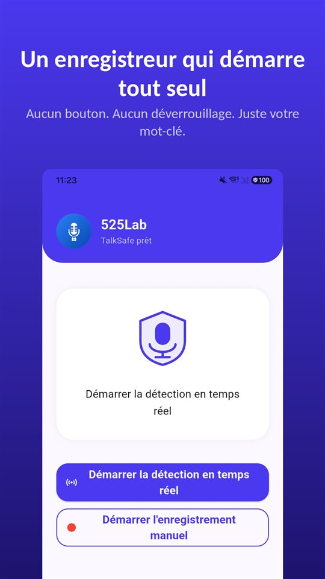

La veille de l'examen, vous ouvrez vos notes et ce passage-là est vide. Vous vous souvenez seulement que l'enseignante a dit : « Ça, il faut le savoir. »

Il vous a échappé pendant que vous écriviez. Le temps de noter une phrase, la suivante est déjà passée ; le temps de regarder le tableau, l'explication est terminée. Ce n'est pas un manque d'attention. Écouter et écrire en même temps, c'est difficile, tout simplement.

Ce qu'on voudrait le plus réentendre, c'est souvent justement ce qui nous a échappé en prenant des notes.

## Enregistrer un cours : quoi utiliser selon le cas

| Situation | Comment | Dans TalkSafe |
|---|---|---|
| Vous voulez tout le cours | Lancer l'enregistrement au début, l'arrêter à la fin | Enregistrement manuel depuis l'écran d'accueil |
| Vous voulez seulement l'essentiel | Laisser les mots de l'enseignant lancer l'enregistrement | Détection de mots-clés ; les 30 secondes déjà passées sont conservées |
| Après le cours | Survoler d'abord ce qui a été vu | Un résumé par IA de chaque enregistrement, dans la langue du cours |
| En révisant | Ne garder que l'explication utile | Découpe (l'original est conservé) |
| Tout le cours en texte | Aucune application ne transcrit à 100 % mot pour mot | Pas de transcription, seulement un résumé |

## Pour tout le cours, l'enregistrement manuel est la base

Pour enregistrer un cours du début à la fin, le plus sûr est de lancer l'enregistrement au début et de l'arrêter à la fin. Posez le téléphone vers l'avant, plus près de l'enseignant, et gardez le bord inférieur, où se trouve le micro, dégagé de livres et de trousses. En amphi, la personne qui parle est loin : plus vous êtes près, plus la réécoute est facile.

[TalkSafe](/talksafe/fr/) est une application d'enregistrement pour Android et iPhone qui démarre quand elle détecte un mot choisi à l'avance, mais son écran d'accueil a aussi un **bouton pour lancer un enregistrement manuel**. Pour tout le cours, ce bouton suffit.

<figure class="shot"><figcaption>Écran d'accueil de TalkSafe. Tout le cours avec l'enregistrement manuel ; seulement l'essentiel avec la détection en temps réel.</figcaption></figure>

## Quand vous ne voulez garder que l'essentiel

Même si vous enregistrez les quatre-vingt-dix minutes de chaque cours, vous ne les réécouterez pas souvent depuis le début. Ce que vous voulez réentendre, ce sont en général quelques minutes : le moment où l'enseignant a dit « ça tombe à l'examen » ou « c'est important ».

Comme **dans TalkSafe les mots-clés ne sont pas liés à une personne**, vous pouvez choisir **ce que l'enseignant dira probablement**, pas seulement vos propres mots. Avec la détection en temps réel activée, l'enregistrement démarre au moment où cette phrase est détectée, sans déverrouiller le téléphone, et **les 30 secondes déjà passées** sont conservées aussi. Si cette phrase arrive à la fin d'une explication, l'explication qui précède est gardée elle aussi.

**Deux mots qui apparaissent souvent dans la même phrase** rendent la détection bien plus fiable. Pensez à « c'est important, ça tombe à l'examen » et enregistrez « important » et « examen ». Après la détection, l'enregistrement dure 10 minutes, 30 minutes, 1 heure ou jusqu'à ce que vous l'arrêtiez.

La semaine prochaine, au moment où l'enseignante dira « cette partie est importante », le téléphone posé sur la table se mettra à enregistrer tel quel. Le fichier que vous écouterez la veille de l'examen, ce seront ces quelques minutes, pas quatre-vingt-dix.

## Après le cours, lisez d'abord le résumé

TalkSafe crée **un résumé par IA de chaque enregistrement** et l'affiche sous forme de liste à puces sous le lecteur, dans l'écran de détail. Un cours en français est résumé en français. Une façon de réviser : survoler d'abord le déroulé du cours dans le résumé, puis n'écouter que les passages que vous n'avez pas compris.

- **Les résumés sont faits sur un serveur.** La détection des mots-clés fonctionne sur le téléphone, mais pour le résumé l'enregistrement est envoyé à un serveur.
- **Les extraits découpés** peuvent aussi être résumés. Vous pouvez [ne garder que l'explication utile, l'original restant en place](/blog/fr/trim-recording/), et ne résumer que celle-ci.

Les enregistreurs intégrés des téléphones Galaxy et Pixel proposent eux aussi des résumés sur les modèles compatibles. Les différences entre applications sont expliquées dans [Comment résumer un enregistrement vocal avec l'IA sur Android](/blog/fr/summarize-recording/).

## Pourquoi il n'y a pas de transcription

Beaucoup cherchent une fonction qui écrive tout le cours. Mais aucune application d'enregistrement ne transcrit la parole à 100 % mot pour mot. L'aide de Samsung indique elle-même que, pour une transcription exacte, la personne doit parler clairement et près du micro. En amphi, l'enseignant en est généralement loin.

C'est pourquoi TalkSafe propose pour l'instant **seulement le résumé**, et prévoit d'étudier l'ajout de la transcription quand il pourra être sûr qu'elle est exacte à 100 %. Quand les mots exacts comptent, le plus sûr est de repérer le moment dans le résumé et d'écouter ce passage de l'enregistrement.

## Ce que dit le droit en France, en Belgique, en Suisse et au Québec

**En France**, la question relève surtout du droit d'auteur :
- Le Code de la propriété intellectuelle range parmi les œuvres de l'esprit « les conférences, allocutions, sermons, plaidoiries et autres œuvres de même nature » (art. L112-2, 2°). Un cours n'est protégé que s'il est original : la Cour de cassation a jugé en 2008 que le cours d'un instituteur filmé dans un documentaire n'était pas protégé faute de méthode pédagogique originale.
- La copie privée (art. L122-5, 2°) couvre les copies « strictement réservées à l'usage privé du copiste et non destinées à une utilisation collective ».
- Que l'article 226-1 du Code pénal, qui protège les paroles prononcées à titre privé ou confidentiel, s'applique à un cours n'est tranché dans aucune des sources que nous avons lues.

**En Suisse**, l'article 179ter du Code pénal punit le participant qui enregistre une conversation non publique sans le consentement des autres. Nous n'avons pas trouvé si un cours entre dans cette catégorie ; l'accord de l'enseignant reste la voie sûre.

**En Belgique et au Québec**, nous n'avons pas vérifié de règles propres à l'enregistrement des cours.

Dans tous les cas, le plus simple est de demander une fois, après le premier cours : « Je peux enregistrer pour réviser ? » Les règles sur l'enregistrement des conversations sont détaillées dans [Enregistrer une conversation à l'insu de quelqu'un : interdit en France, permis en Belgique et au Québec](/blog/fr/enregistrer-conversation/).

## Le trou dans vos notes

La prochaine fois qu'il y aura un trou dans vos notes la veille d'un examen, inutile de paniquer. Ouvrez le résumé, retrouvez ce cours et réécoutez les quelques minutes où l'enseignant a dit « c'est important ».

Un enregistrement ne remplace pas vos notes. Il vous rend ce qui vous a échappé pendant que vous les preniez.

Information générale, pas un conseil juridique. Pour une situation précise, vérifiez le règlement de votre établissement ou consultez un avocat. Les fonctions des autres applications sont décrites d'après leur aide officielle au moment de la rédaction et peuvent changer. Nous développons l'application d'enregistrement TalkSafe.

