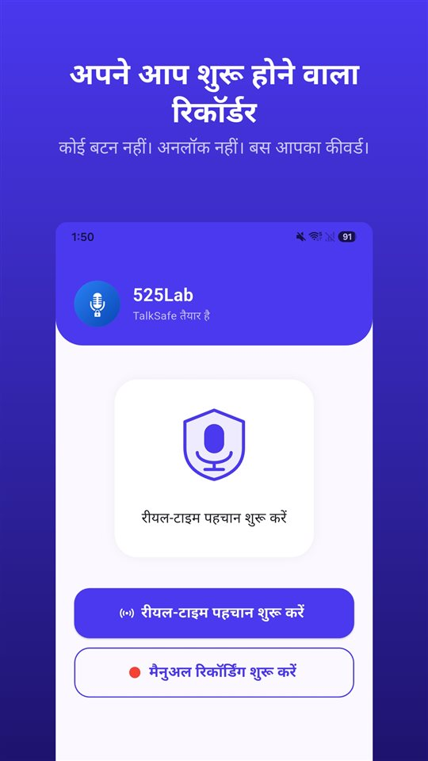

परीक्षा से पहले की रात आप नोट्स खोलते हैं, और ठीक वही हिस्सा खाली है। बस इतना याद है कि टीचर ने कहा था, "यह ज़रूर याद रखना।"

लिखते-लिखते वह छूट गया। एक वाक्य लिखने तक अगला बोला जा चुका होता है; बोर्ड की तरफ़ देखने तक समझाना ख़त्म हो जाता है। यह ध्यान की कमी नहीं है। सुनना और लिखना एक साथ करना ही मुश्किल है।

जो बात आप सबसे ज़्यादा दोबारा सुनना चाहते हैं, वह अक्सर वही होती है जो नोट्स लेते समय छूट गई।

## लेक्चर रिकॉर्डिंग: कब क्या इस्तेमाल करें

| स्थिति | कैसे | TalkSafe में |
|---|---|---|
| पूरी क्लास चाहिए | शुरू में रिकॉर्डिंग चालू, आख़िर में बंद | स्टार्ट स्क्रीन पर मैनुअल रिकॉर्डिंग |
| सिर्फ़ ज़रूरी हिस्से चाहिए | टीचर के शब्दों से रिकॉर्डिंग शुरू हो | कीवर्ड पहचान; बीत चुके 30 सेकंड भी सेव |
| क्लास के बाद | पहले देख लें कि क्या पढ़ाया गया | हर रिकॉर्डिंग का AI सारांश, लेक्चर की भाषा में |
| पढ़ाई करते समय | सिर्फ़ ज़रूरी व्याख्या रखें | ट्रिम (मूल फ़ाइल रहती है) |
| पूरा लेक्चर टेक्स्ट में | कोई ऐप 100% शब्दशः नहीं लिखता | ट्रांसक्रिप्ट नहीं, सिर्फ़ सारांश |

## पूरी क्लास के लिए मैनुअल रिकॉर्डिंग ही आम तरीका है

लेक्चर को शुरू से आख़िर तक रिकॉर्ड करने के लिए सबसे पक्का तरीका है क्लास शुरू होते ही रिकॉर्डिंग चालू करना और ख़त्म होने पर रोकना। फ़ोन को आगे की ओर, टीचर के पास रखें, और नीचे का किनारा जहाँ माइक्रोफ़ोन होता है, किताबों या पेंसिल बॉक्स से न ढकें। बड़े क्लासरूम में बोलने वाला दूर होता है, इसलिए जितना पास बैठेंगे, बाद में सुनना उतना आसान होगा।

[TalkSafe](/talksafe/hi/) Android और iPhone के लिए एक वॉइस रिकॉर्डर ऐप है, जो पहले से चुना हुआ शब्द पहचानते ही रिकॉर्डिंग शुरू कर देता है, लेकिन इसकी स्टार्ट स्क्रीन पर **मैनुअल रिकॉर्डिंग शुरू करने का बटन** भी है। पूरी क्लास के लिए यही एक बटन काफ़ी है।

<figure class="shot"><figcaption>TalkSafe की स्टार्ट स्क्रीन। पूरी क्लास मैनुअल रिकॉर्डिंग से, सिर्फ़ ज़रूरी हिस्से रियल-टाइम पहचान से।</figcaption></figure>

## जब सिर्फ़ ज़रूरी बातें रखनी हों

हर क्लास के नब्बे मिनट रिकॉर्ड कर लें, तब भी उन्हें शुरू से सुनने वाले दिन कम ही आते हैं। जो दोबारा सुनना है, वह अक्सर कुछ मिनट होते हैं: जब टीचर ने कहा "यह परीक्षा में आएगा" या "यह ज़रूरी है"।

क्योंकि **TalkSafe में कीवर्ड किसी एक व्यक्ति से बँधे नहीं होते**, आप सिर्फ़ अपने नहीं, **टीचर के संभावित शब्द** भी सेव कर सकते हैं। रियल-टाइम पहचान चालू हो तो वह वाक्य पहचाना जाते ही फ़ोन अनलॉक किए बिना रिकॉर्डिंग शुरू हो जाती है, और **बीत चुके 30 सेकंड** भी सेव होते हैं। अगर वह वाक्य किसी व्याख्या के आख़िर में आया, तो उससे पहले की व्याख्या भी रहती है।

**एक ही वाक्य में साथ आने वाले दो शब्द** पहचान को कहीं ज़्यादा भरोसेमंद बनाते हैं। "यह ज़रूरी है, यह परीक्षा में आएगा" सोचिए और "ज़रूरी" और "परीक्षा" दोनों सेव कीजिए। पहचान के बाद रिकॉर्डिंग 10 मिनट, 30 मिनट, 1 घंटा या आपके रोकने तक चलती है।

अगले हफ़्ते जैसे ही टीचर कहेंगे "यह हिस्सा ज़रूरी है", डेस्क पर रखा फ़ोन वैसे ही रिकॉर्डिंग शुरू कर देगा। परीक्षा से पहले की रात आप जो फ़ाइल सुनेंगे, वह नब्बे मिनट नहीं, वही कुछ मिनट होंगे।

## क्लास के बाद पहले सारांश पढ़िए

TalkSafe **हर रिकॉर्डिंग का AI सारांश** बनाता है और उसे रिकॉर्डिंग के विवरण वाली स्क्रीन पर प्लेयर के नीचे बिंदुओं की सूची के रूप में दिखाता है। हिंदी में हुए लेक्चर का सारांश हिंदी में बनता है। दोहराने का एक तरीका है कि पहले सारांश में क्लास का क्रम देख लें, फिर सिर्फ़ वे हिस्से सुनें जो समझ नहीं आए।

- **सारांश सर्वर पर बनते हैं।** कीवर्ड की पहचान फ़ोन के अंदर होती है, लेकिन सारांश के लिए रिकॉर्डिंग सर्वर पर भेजी जाती है।
- **ट्रिम किए गए हिस्सों** का भी सारांश बन सकता है। आप [मूल फ़ाइल रखते हुए सिर्फ़ ज़रूरी व्याख्या ट्रिम कर](/blog/hi/trim-recording/) सकते हैं और सिर्फ़ उसका सारांश बना सकते हैं।

Galaxy और Pixel फ़ोन के बिल्ट-इन रिकॉर्डर भी समर्थित मॉडलों पर सारांश देते हैं। ऐप्स के बीच के फ़र्क़ [Android पर AI से वॉइस रिकॉर्डिंग का सारांश कैसे बनाएँ](/blog/hi/summarize-recording/) में हैं।

## ट्रांसक्रिप्ट क्यों नहीं है

बहुत लोग ऐसा फ़ीचर ढूँढते हैं जो पूरा लेक्चर लिख दे। लेकिन कोई भी रिकॉर्डिंग ऐप बोली गई बात को 100% शब्दशः टेक्स्ट में नहीं बदल सकता। Samsung की अपनी सहायता में लिखा है कि सटीक ट्रांसक्रिप्शन के लिए बोलने वाले को साफ़ और माइक्रोफ़ोन के पास बोलना चाहिए। क्लासरूम में टीचर अक्सर माइक्रोफ़ोन से दूर होते हैं।

इसीलिए TalkSafe अभी **सिर्फ़ सारांश** देता है, और ट्रांसक्रिप्शन जोड़ने पर तभी विचार करेगा जब उसके 100% सटीक होने का भरोसा हो। जब ठीक-ठीक शब्द ज़रूरी हों, तो सारांश से जगह ढूँढकर रिकॉर्डिंग का वह हिस्सा सुनना सबसे पक्का तरीका है।

## भारत में लेक्चर रिकॉर्डिंग और कॉपीराइट

- **लेक्चर कॉपीराइट अधिनियम, 1957 में परिभाषित है।** धारा 2(n) के अनुसार "लेक्चर" में संबोधन, भाषण और प्रवचन शामिल हैं।
- **निजी उपयोग।** धारा 52(1)(a)(i) के तहत निजी या व्यक्तिगत उपयोग, जिसमें शोध भी शामिल है, के लिए किसी कृति का उचित उपयोग कॉपीराइट का उल्लंघन नहीं है।
- हमें ऐसा कोई अदालती फ़ैसला या आधिकारिक दिशानिर्देश नहीं मिला जो इसे ख़ास तौर पर क्लास में लेक्चर रिकॉर्ड करने पर लागू करता हो। कॉलेज के नियम और टीचर की अनुमति पहले आती है।
- भारत के बाहर के हिंदी भाषी देशों के नियम हमने नहीं जाँचे हैं।

सबसे आसान है कि पहली क्लास के बाद एक बार पूछ लें: "क्या मैं दोहराने के लिए रिकॉर्ड कर सकता हूँ?" बातचीत रिकॉर्ड करने के कानून के बारे में [भारत में बातचीत रिकॉर्ड करना: रिकॉर्डिंग आसान हिस्सा है, प्रमाणपत्र नहीं](/blog/hi/recording-law-india/) में है।

## नोट्स का वह खाली हिस्सा

अगली बार परीक्षा से पहले की रात नोट्स में कोई हिस्सा खाली हो, तो घबराने की ज़रूरत नहीं। सारांश खोलिए, वह क्लास ढूँढिए और वे कुछ मिनट दोबारा सुनिए जब टीचर ने कहा था, "यह ज़रूरी है।"

रिकॉर्डिंग नोट्स की जगह नहीं लेती। नोट्स लेते समय जो छूट गया, वह आपको लौटा देती है।

यह सामान्य जानकारी है, कानूनी सलाह नहीं। किसी ख़ास मामले के लिए अपने कॉलेज के नियम देखें या वकील से सलाह लें। दूसरे ऐप्स की सुविधाएँ लिखते समय की उनकी आधिकारिक सहायता के आधार पर बताई गई हैं और बदल सकती हैं। हम रिकॉर्डिंग ऐप TalkSafe बनाते हैं।

