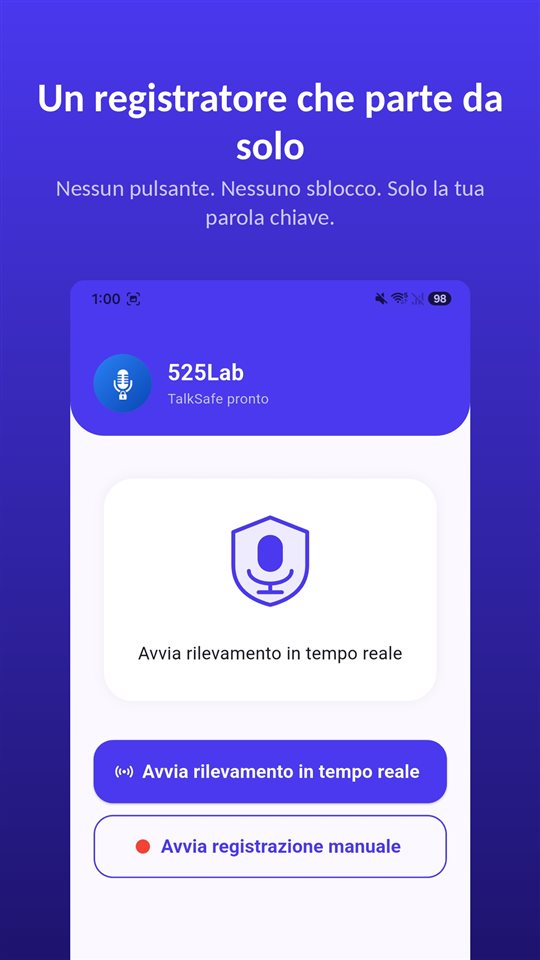

La sera prima dell'esame apri gli appunti e proprio quella parte è vuota. Ricordi solo che il docente aveva detto: «Questo dovete saperlo».

Ti è sfuggito mentre scrivevi. Quando finisci una frase, lui è già alla successiva; mentre guardi la lavagna, la spiegazione finisce. Non è mancanza di attenzione. Ascoltare e scrivere insieme è difficile di per sé.

Quello che più vorresti riascoltare è di solito proprio ciò che ti è sfuggito mentre prendevi appunti.

## Registrare una lezione: cosa usare quando

| Situazione | Come | In TalkSafe |
|---|---|---|
| Vuoi tutta la lezione | Avviare la registrazione all'inizio e fermarla alla fine | Avvio della registrazione manuale nella schermata iniziale |
| Vuoi solo le parti importanti | Far partire la registrazione dalle parole del docente | Rilevamento delle parole chiave; si salvano i 30 secondi già passati |
| Dopo la lezione | Ripassare prima cosa si è visto | Un riassunto con IA di ogni registrazione, nella lingua della lezione |
| Quando studi | Tenere solo la spiegazione che ti serve | Ritaglio (l'originale resta) |
| Tutta la lezione in testo | Nessuna app trascrive al 100% parola per parola | Nessuna trascrizione, solo riassunto |

## Per tutta la lezione, la registrazione manuale è la base

Per registrare una lezione dall'inizio alla fine, la cosa più sicura è avviare la registrazione quando inizia e fermarla quando finisce. Metti il telefono verso le prime file, più vicino al docente, e lascia libero il bordo inferiore, dove c'è il microfono, da libri e astucci. In un'aula grande chi parla è lontano, quindi più ti siedi vicino, più sarà facile riascoltarla.

[TalkSafe](/talksafe/it/) è un registratore vocale per Android e iPhone che inizia a registrare quando rileva una parola scelta in anticipo, ma nella sua schermata iniziale c'è anche un **pulsante per avviare una registrazione manuale**. Per tutta la lezione basta quel pulsante.

<figure class="shot"><figcaption>Schermata iniziale di TalkSafe. Tutta la lezione con la registrazione manuale; solo le parti importanti con il rilevamento in tempo reale.</figcaption></figure>

## Quando vuoi solo quello che conta

Anche se registri tutti i novanta minuti di ogni lezione, non saranno molti i giorni in cui li riascolti dall'inizio. Quello che vuoi risentire sono di solito pochi minuti: quando il docente ha detto «questo è da esame» o «questo è importante».

Dato che **in TalkSafe le parole chiave non sono legate a una persona**, puoi impostare **quello che probabilmente dirà il docente**, non solo le tue parole. Con il rilevamento in tempo reale attivo, la registrazione parte nel momento in cui quella frase viene rilevata, senza sbloccare il telefono, e vengono salvati anche **i 30 secondi già trascorsi**. Se quella frase arriva alla fine di una spiegazione, resta anche la spiegazione che la precede.

**Due parole che di solito compaiono nella stessa frase** rendono il rilevamento molto più affidabile. Pensa a «questo è importante, sarà all'esame» e registra «importante» ed «esame». Dopo il rilevamento, la registrazione dura 10 minuti, 30 minuti, 1 ora o finché non la fermi.

La settimana prossima, nel momento in cui il docente dice «questa parte è importante», il telefono sul banco inizia a registrare così com'è. Il file che ascolterai la sera prima dell'esame saranno quei pochi minuti, non novanta.

## Dopo la lezione, leggi prima il riassunto

TalkSafe crea **un riassunto con IA di ogni registrazione** e lo mostra come elenco di punti sotto il lettore, nella schermata di dettaglio. Una lezione in italiano viene riassunta in italiano. Un modo per ripassare è vedere prima nel riassunto come è andata la lezione e ascoltare solo le parti che non hai capito.

- **I riassunti si fanno su un server.** Il rilevamento delle parole chiave avviene sul telefono, ma per il riassunto la registrazione viene inviata a un server.
- **Anche i tratti ritagliati** si possono riassumere. Puoi [tenere solo la spiegazione che ti serve, lasciando l'originale](/blog/it/trim-recording/), e riassumere solo quella.

Anche i registratori integrati dei telefoni Galaxy e Pixel offrono riassunti sui modelli compatibili. Le differenze tra le app sono in [Come riassumere una registrazione vocale con l'IA su Android](/blog/it/summarize-recording/).

## Perché non c'è la trascrizione

Molti cercano una funzione che scriva tutta la lezione. Ma nessuna app di registrazione trascrive la voce al 100% parola per parola. La stessa guida di Samsung dice che, per una trascrizione accurata, chi parla deve farlo in modo chiaro e vicino al microfono. In aula, il docente di solito è lontano.

Per questo TalkSafe per ora offre **solo il riassunto**, e prevede di valutare la trascrizione quando potrà essere sicuro che sia accurata al 100%. Quando contano le parole esatte, la cosa più sicura è trovare il punto nel riassunto e ascoltare quella parte della registrazione.

## Si può registrare una lezione?

In Italia c'è un riferimento chiaro: le **FAQ del Garante per la protezione dei dati personali su scuola e privacy**.

- **Per studio personale è lecito.** Il Garante indica che «è lecito registrare la lezione per scopi personali, ad esempio per motivi di studio individuale», nel rispetto delle regole stabilite dalla scuola.
- **Diffondere è un'altra cosa.** Per ogni altro utilizzo o eventuale diffusione, anche su Internet, bisogna prima informare le persone coinvolte e ottenerne il consenso.
- **Studenti con DSA.** Gli studenti con disturbi specifici dell'apprendimento possono usare gli strumenti di registrazione previsti dal loro piano didattico personalizzato senza chiedere il consenso delle persone registrate.
- **La lezione è un'opera.** La legge sul diritto d'autore (L. 633/1941, art. 2 n. 1) protegge le opere didattiche «tanto se in forma scritta quanto se orale».

Le regole della scuola o dell'università vengono prima. La cosa più semplice è chiedere una volta, alla fine della prima lezione: «Posso registrare per ripassare?». Il quadro generale sulle registrazioni è in [È legale registrare una conversazione in Italia? Registrare sì, diffondere no](/blog/it/registrare-conversazione/).

## Il buco negli appunti

La prossima volta che negli appunti c'è un buco la sera prima di un esame, non serve agitarsi. Apri il riassunto, cerca quella lezione e riascolta i minuti in cui il docente ha detto «questo è importante».

Registrare non sostituisce gli appunti. Ti restituisce quello che ti è sfuggito mentre li prendevi.

Informazioni generali, non consulenza legale. Per un caso specifico, verifica il regolamento della tua scuola o università o rivolgiti a un avvocato. Le funzioni di altre app sono descritte in base alle loro guide ufficiali al momento della scrittura e possono cambiare. Realizziamo l'app di registrazione TalkSafe.

