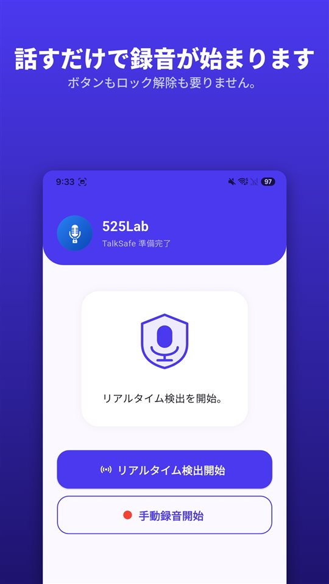

試験前日の夜、ノートを開くとそこだけ空白です。先生が「ここは必ず覚えてください」と言ったことだけは覚えています。

書いている間に聞き逃したのです。一文を書き終えるころには次の話が進み、黒板を見ている間に説明は終わっています。集中していなかったのではなく、聞くことと書くことを同時にするのがもともと難しいのです。

講義でいちばん聞き直したいのは、たいていノートを取っていて聞き逃したその言葉です。

## 講義の録音、場面に合った方法

| 場面 | 方法 | TalkSafeでは |
|---|---|---|
| 授業をまるごと残したい | 始まりで録音を始め、終わりで止める | スタート画面の手動録音 |
| 大事なところだけ残したい | 先生の言葉で録音を始める | キーワード検知、すでに過ぎた30秒まで保存 |
| 授業のあと | 何を習ったかを先にざっと見る | 録音で押して作るAI要約、講義の言語のまま |
| 復習するとき | 必要な説明だけを別に | 切り取り（原本は残る） |
| 全部を文字に | 100%そのまま文字にするアプリはない | 文字起こしなし、要約のみ |

## 授業まるごとなら手動録音が基本です

講義を最初から最後まで録音するなら、授業が始まったら録音を始め、終わったら止めるのがいちばん確実です。スマホは先生に近い前の席のほうに置き、マイクのある下の端が教科書や筆箱でふさがれないようにします。講義室では話す人との距離が遠いので、近い席ほど聞き直しやすくなります。

[TalkSafe](/talksafe/ja/)は、あらかじめ決めておいた言葉が検知されると録音を始めるAndroid・iPhone向けの録音アプリですが、スタート画面には**手動録音を始めるボタン**もあります。授業まるごとなら、このボタン一つで足ります。

<figure class="shot"><figcaption>TalkSafeの開始画面。授業まるごとは手動録音で、大事なところだけならリアルタイム検知で録音します。</figcaption></figure>

## 大事なところだけ残したいとき

毎回90分を全部録音しても、そのファイルを最初から聞き直す日はそう多くありません。聞き直したいのはたいてい数分です。先生が「ここ、試験に出ます」「ここは大事です」と言ったところです。

TalkSafeは**キーワードが話す人に結びついていない**ので、自分の言葉ではなく**先生が言いそうな言葉**を登録しておけます。リアルタイム検知をオンにしておくと、その言葉が検知された瞬間にロック画面を解除しなくてもすぐに録音が始まり、**すでに過ぎた30秒**まで一緒に保存されます。その言葉が説明の終わりに出てきたなら、その前の説明まで残るわけです。

**同じ文に一緒に出てきそうな2つの言葉**を登録すると、検知の精度がずっと上がります。「ここは大事なので試験に出します」という文を思い浮かべて、「大事」と「試験」を両方登録する、といった具合です。検知後の録音時間は10分、30分、1時間、手動停止から選べます。

来週の授業で先生が「この部分は大事です」と言った瞬間、机の上のスマホはそのまま録音を始めます。試験前日に聞き直すファイルは、90分ではなくその数分です。

## 授業のあとは、まず要約を見る

TalkSafeは録音で**AI要約**を押すと要約を作り、録音の詳細画面で再生バーの下に箇条書きで表示します。日本語の講義は日本語で要約されます。要約でその日の授業の流れを先にざっと見て、分からなかったところだけを探して聞く方法があります。

- **要約はサーバーで作られます。** キーワード検知はスマホの中で行われますが、要約のためには録音をサーバーへ送ります。
- **切り取ったファイルにも**要約を使えます。必要な説明だけを[原本を残したまま切り取って](/blog/ja/trim-recording/)、その部分だけを要約することもできます。

GalaxyやPixelの標準録音アプリにも、対応機種では要約機能があります。アプリごとの違いは[録音をAIで要約する方法、Androidで使えるアプリ](/blog/ja/summarize-recording/)にまとめました。

## 文字起こしを入れていない理由

講義を全部文字にしてくれる機能を探す人はたくさんいます。ただ、話した言葉を100%そのまま文字にする文字起こしは、どの録音アプリにもできません。Samsungも、正確な文字起こしには話す人がはっきり、マイクの近くで話す必要があると案内しています。講義室では、先生はたいていマイクから遠くにいます。

そのためTalkSafeは今は**要約だけ**を提供しており、文字起こしが100%正確だと確信できたときに追加を検討する予定です。正確な言い回しが必要なときは、要約で場所を見つけてその部分の録音を直接聞くのがいちばん確実です。

## 講義の録音は違法なのか

勉強のために講義を録音すること自体を罰する規定は見つかりませんでした。講義の録音で法律が関わるのは著作権です。

- **講義は著作物です。** 著作権法10条1項1号は、言語の著作物の例として「講演」を挙げています。
- **自分の勉強用は認められる範囲です。** 30条1項は、個人的に、または家庭内などの限られた範囲で使うこと（私的使用）を目的とする複製を認めています。ただ、この規定が講義の録音にそのまま当てはまると判断した判決や官庁の案内は見つかりませんでした。
- **広めるのは別の話です。** 録音した講義をグループトークやネットに上げるのは、私的使用を超えます。
- **学校のルールと先生の意向が先です。** 録音を禁止している授業なら、そのルールに従います。

いちばん簡単なのは、最初の授業のあとに「復習のために録音してもいいですか」と一度聞くことです。会話の録音に関する法律全体は[日本には「盗聴罪」がありません](/blog/ja/recording-consent-law/)にまとめています。

## 試験前日の、あの空白

次の試験前日にノートに空白があっても、今度は慌てなくて大丈夫です。要約を開いてその授業を探し、先生が「大事です」と言った数分を聞き直せばいいのです。

録音はノートの代わりではなく、ノートを取っていて聞き逃した言葉を取り戻す方法です。

この記事は一般的な情報提供を目的としたもので、法的助言ではありません。具体的な事案は学校の規則を確認するか、弁護士にご相談ください。ほかのアプリの機能は執筆時点の公式案内に基づいており、変わることがあります。私たちは録音アプリTalkSafeを作っています。

