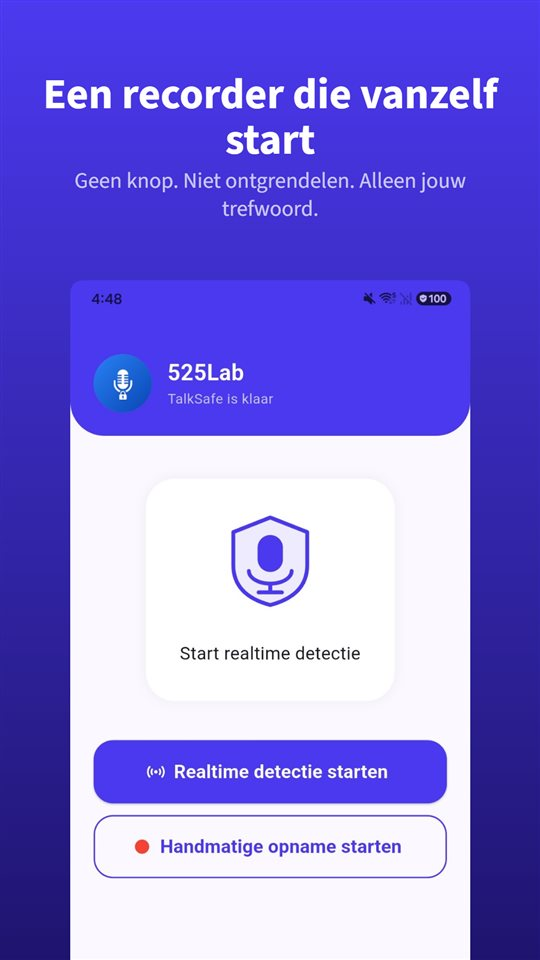

De avond voor het tentamen sla je je aantekeningen open en precies dat stuk is leeg. Je weet alleen nog dat de docent zei: "Dit moet je echt kennen."

Het ontging je terwijl je schreef. Tegen de tijd dat je één zin hebt genoteerd, is de volgende al gezegd; terwijl je naar het bord kijkt, is de uitleg voorbij. Dat is geen gebrek aan aandacht. Luisteren en schrijven tegelijk is gewoon moeilijk.

Wat je het liefst nog eens wilt horen, is meestal precies wat je miste terwijl je aantekeningen maakte.

## Een college opnemen: wat je wanneer gebruikt

| Situatie | Hoe | In TalkSafe |
|---|---|---|
| Je wilt het hele college | Aan het begin starten, aan het eind stoppen | Handmatige opname op het startscherm |
| Je wilt alleen het belangrijke | De woorden van de docent laten de opname starten | Trefwoordherkenning; de 30 seconden die al voorbij waren worden bewaard |
| Na het college | Eerst overzien wat er behandeld is | Een AI-samenvatting met één tik, in de taal van het college |
| Bij het leren | Alleen de uitleg bewaren die je nodig hebt | Inkorten (het origineel blijft) |
| Het hele college als tekst | Geen app zet 100% woord voor woord om | Geen transcriptie, alleen samenvatting |

## Voor het hele college is een handmatige opname de basis

Om een college van begin tot eind op te nemen, start je de opname het zekerst als het begint en stop je hem als het eindigt. Leg de telefoon meer naar voren, dichter bij de docent, en houd de onderrand, waar de microfoon zit, vrij van boeken en etuis. In een grote zaal staat de spreker ver weg; hoe dichterbij je zit, hoe makkelijker het terugluisteren.

[TalkSafe](/talksafe/nl/) is een opname-app voor Android en iPhone die begint met opnemen als hij een vooraf gekozen woord herkent, maar op het startscherm staat ook een **knop voor een handmatige opname**. Voor het hele college is die ene knop genoeg.

<figure class="shot"><figcaption>Startscherm van TalkSafe. Het hele college met een handmatige opname, alleen het belangrijke met realtime detectie.</figcaption></figure>

## Als je alleen wilt bewaren wat telt

Ook als je elk college van negentig minuten opneemt, luister je het zelden vanaf het begin terug. Wat je nog eens wilt horen, zijn meestal een paar minuten: het moment waarop de docent zei "dit komt op het tentamen" of "dit is belangrijk".

Omdat **trefwoorden in TalkSafe niet aan een persoon gekoppeld zijn**, kun je instellen **wat de docent waarschijnlijk zegt**, niet alleen je eigen woorden. Met realtime detectie aan start de opname op het moment dat die zin wordt herkend, zonder de telefoon te ontgrendelen, en **de 30 seconden die al voorbij waren** worden ook bewaard. Valt die zin aan het eind van een uitleg, dan blijft de uitleg ervoor ook bewaard.

**Twee woorden die meestal in dezelfde zin voorkomen**, maken de herkenning veel betrouwbaarder. Denk aan "dit is belangrijk, dit komt op het tentamen" en stel "belangrijk" en "tentamen" in. Na de herkenning loopt de opname 10 minuten, 30 minuten, 1 uur of tot je hem stopt.

Volgende week, op het moment dat de docent zegt "dit deel is belangrijk", begint de telefoon op je tafel gewoon met opnemen. Het bestand dat je de avond voor het tentamen beluistert, zijn die paar minuten, geen negentig.

## Na het college eerst de samenvatting lezen

TalkSafe maakt met één tik **een AI-samenvatting** van een opname en toont die als lijst met punten onder de speler in het detailscherm. Een Nederlandstalig college wordt in het Nederlands samengevat. Een manier om te herhalen: eerst in de samenvatting het verloop van het college overzien, en dan alleen de stukken beluisteren die je niet begreep.

- **Samenvattingen worden op een server gemaakt.** De trefwoordherkenning werkt op de telefoon, maar voor de samenvatting wordt de opname naar een server gestuurd.
- **Ingekorte fragmenten** kun je ook laten samenvatten. Je kunt [alleen de uitleg die je nodig hebt inkorten, het origineel blijft staan](/blog/nl/trim-recording/), en alleen die laten samenvatten.

De ingebouwde recorders op Galaxy- en Pixel-telefoons bieden op ondersteunde modellen ook samenvattingen. De verschillen tussen de apps staan in [Een spraakopname samenvatten met AI op Android](/blog/nl/summarize-recording/).

## Waarom er geen transcriptie is

Veel mensen zoeken een functie die het hele college uitschrijft. Maar geen enkele opname-app zet spraak voor 100% woord voor woord om in tekst. Samsung schrijft zelf dat voor een nauwkeurige transcriptie de spreker duidelijk en dicht bij de microfoon moet spreken. In een collegezaal staat de docent meestal ver van de microfoon.

Daarom biedt TalkSafe voorlopig **alleen de samenvatting** en wil het transcriptie pas overwegen als het zeker is dat die 100% nauwkeurig is. Als de precieze woorden ertoe doen, vind je het moment het zekerst via de samenvatting en luister je dat stuk van de opname.

## Wat de wet zegt in Nederland en België

**In Nederland** gaat het vooral om auteursrecht:
- De **Auteurswet** rekent "mondelinge voordrachten" tot de werken van letterkunde, wetenschap of kunst (art. 10).
- **Art. 16b en 16c** staan kopieën toe die beperkt blijven tot enkele exemplaren en uitsluitend dienen tot eigen oefening, studie of gebruik van de natuurlijke persoon, zonder direct of indirect commercieel oogmerk.
- Een uitspraak of officiële richtlijn die dit specifiek op het opnemen van colleges toepast, hebben we niet gevonden. De regels van je onderwijsinstelling en de toestemming van de docent gaan voor.

**In België, Suriname, Aruba, Curaçao en Sint Maarten** hebben we geen regels voor het opnemen van colleges onderzocht. Wel geldt in België dat het gebruik van een opname met bedrieglijk opzet of met het oogmerk te schaden strafbaar is (art. 314bis Sw.).

Het eenvoudigst is om na het eerste college één keer te vragen: "Mag ik opnemen om het terug te luisteren?" Meer over het opnemen van gesprekken staat in [Mag je een gesprek stiekem opnemen? In Nederland en België wel, als je zelf meepraat](/blog/nl/gesprek-opnemen/).

## Het gat in je aantekeningen

Als er de volgende keer de avond voor een tentamen een gat in je aantekeningen zit, hoef je niet in paniek te raken. Open de samenvatting, zoek dat college op en luister de paar minuten terug waarin de docent zei: "Dit is belangrijk."

Een opname vervangt je aantekeningen niet. Hij geeft je terug wat je miste terwijl je ze maakte.

Algemene informatie, geen juridisch advies. Kijk voor een concrete situatie naar de regels van je onderwijsinstelling of raadpleeg een advocaat. De functies van andere apps zijn beschreven op basis van hun officiële hulp op het moment van schrijven en kunnen veranderen. Wij maken de opname-app TalkSafe.

