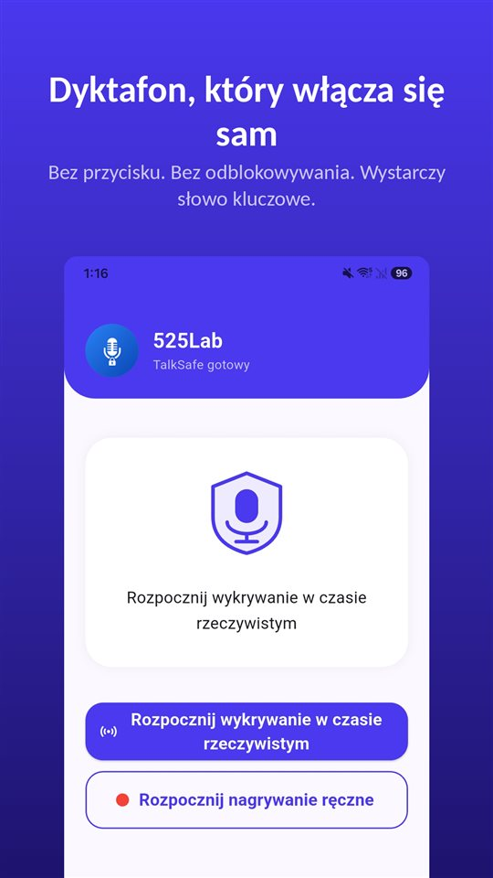

Wieczorem przed egzaminem otwierasz notatki i akurat ten fragment jest pusty. Pamiętasz tylko, że wykładowczyni powiedziała: „To trzeba umieć”.

Umknęło ci, kiedy pisałeś. Zanim zapiszesz jedno zdanie, następne już padło; zanim spojrzysz na tablicę, wyjaśnienie się kończy. To nie brak uwagi. Słuchanie i pisanie naraz po prostu jest trudne.

Najbardziej chcesz odsłuchać zwykle właśnie to, co umknęło ci przy notowaniu.

## Nagrywanie wykładu: co kiedy wybrać

| Sytuacja | Jak | W TalkSafe |
|---|---|---|
| Chcesz cały wykład | Włączyć nagrywanie na początku i zatrzymać na końcu | Ręczne nagrywanie na ekranie startowym |
| Chcesz tylko ważne fragmenty | Niech słowa wykładowcy uruchomią nagrywanie | Wykrywanie słów kluczowych; zapisuje się 30 sekund, które już minęły |
| Po wykładzie | Najpierw przejrzeć, co było omawiane | Podsumowanie AI jednym stuknięciem, w języku wykładu |
| Przy nauce | Zostawić tylko potrzebne wyjaśnienie | Wycinanie (oryginał zostaje) |
| Cały wykład jako tekst | Żadna aplikacja nie zapisuje 100% słowo w słowo | Brak transkrypcji, tylko podsumowanie |

## Na cały wykład podstawą jest ręczne nagrywanie

Żeby nagrać wykład od początku do końca, najpewniej jest włączyć nagrywanie, gdy się zaczyna, i zatrzymać, gdy się kończy. Połóż telefon bliżej przodu sali, bliżej wykładowcy, i nie zasłaniaj książkami ani piórnikiem dolnej krawędzi, przy której jest mikrofon. W dużej sali mówiący jest daleko, więc im bliżej siedzisz, tym łatwiej potem odsłuchać.

[TalkSafe](/talksafe/pl/) to aplikacja do nagrywania na Androida i iPhone'a, która zaczyna nagrywać, gdy wykryje wybrane wcześniej słowo, ale na ekranie startowym ma też **przycisk ręcznego nagrywania**. Na cały wykład wystarczy ten jeden przycisk.

<figure class="shot"><figcaption>Ekran startowy TalkSafe. Cały wykład nagrywasz ręcznie, tylko ważne fragmenty dzięki wykrywaniu na żywo.</figcaption></figure>

## Gdy chcesz zachować tylko to, co ważne

Nawet jeśli nagrasz dziewięćdziesiąt minut każdego wykładu, rzadko będziesz słuchać ich od początku. Odsłuchać chcesz zwykle kilka minut: moment, w którym wykładowca powiedział „to będzie na egzaminie” albo „to jest ważne”.

Ponieważ **słowa kluczowe w TalkSafe nie są przypisane do osoby**, możesz zapisać **to, co prawdopodobnie powie wykładowca**, a nie tylko własne słowa. Przy włączonym wykrywaniu na żywo nagrywanie zaczyna się w chwili, gdy to zdanie zostanie wykryte, bez odblokowywania telefonu, i zapisuje się też **30 sekund, które już minęły**. Jeśli to zdanie pada na końcu wyjaśnienia, zostaje też wyjaśnienie, które je poprzedza.

**Dwa słowa, które zwykle pojawiają się w tym samym zdaniu**, sprawiają, że wykrywanie jest znacznie pewniejsze. Pomyśl o zdaniu „to jest ważne, będzie na egzaminie” i zapisz „ważne” oraz „egzaminie”. Po wykryciu nagrywanie trwa 10 minut, 30 minut, 1 godzinę albo do ręcznego zatrzymania.

W przyszłym tygodniu, w chwili gdy wykładowczyni powie „ten fragment jest ważny”, telefon na stoliku zacznie nagrywać tak, jak leży. Plik, którego posłuchasz wieczorem przed egzaminem, to te kilka minut, a nie dziewięćdziesiąt.

## Po wykładzie najpierw przeczytaj podsumowanie

TalkSafe tworzy **podsumowanie AI** nagrania po jednym stuknięciu i pokazuje je jako listę punktów pod odtwarzaczem na ekranie szczegółów. Wykład po polsku jest streszczany po polsku. Jeden ze sposobów powtórki: najpierw przejrzeć w podsumowaniu przebieg zajęć, a potem odsłuchać tylko te fragmenty, których nie zrozumiałeś.

- **Podsumowania powstają na serwerze.** Wykrywanie słów kluczowych działa w telefonie, ale do podsumowania nagranie jest wysyłane na serwer.
- **Wycięte fragmenty** też można streścić. Możesz [wyciąć tylko potrzebne wyjaśnienie, zostawiając oryginał](/blog/pl/trim-recording/), i streścić tylko je.

Wbudowane dyktafony w telefonach Galaxy i Pixel też oferują podsumowania na obsługiwanych modelach. Różnice między aplikacjami opisujemy w [Jak streścić nagranie głosowe za pomocą AI na Androidzie](/blog/pl/summarize-recording/).

## Dlaczego nie ma transkrypcji

Wiele osób szuka funkcji, która spisze cały wykład. Ale żadna aplikacja do nagrywania nie zapisuje mowy w 100% słowo w słowo. Sama pomoc Samsunga podaje, że do dokładnej transkrypcji osoba mówiąca musi mówić wyraźnie i blisko mikrofonu. Na sali wykładowej wykładowca jest zwykle daleko.

Dlatego TalkSafe oferuje na razie **tylko podsumowanie** i planuje rozważyć transkrypcję, gdy będzie pewne, że jest w 100% dokładna. Gdy liczą się dokładne słowa, najpewniej jest znaleźć miejsce w podsumowaniu i odsłuchać ten fragment nagrania.

## Co mówi prawo w Polsce i tam, gdzie mieszka wielu Polaków

**W Polsce** sprawa dotyczy głównie prawa autorskiego:
- **Art. 23 ustawy o prawie autorskim** pozwala bez zezwolenia twórcy nieodpłatnie korzystać z już rozpowszechnionego utworu w zakresie własnego użytku osobistego. Ten zakres obejmuje krąg osób pozostających w związku osobistym, np. rodzinnym lub towarzyskim.
- Nie znaleźliśmy orzeczenia ani oficjalnych wytycznych, które przesądzałyby, czy wykład jest w tym rozumieniu utworem rozpowszechnionym.
- Najpierw obowiązują zasady uczelni i zgoda wykładowcy.

**W Niemczech** praktycznie zawsze potrzebna jest zgoda wykładowcy: nagranie publicznego wykładu jest dopuszczalne tylko za zgodą uprawnionego (§ 53 ust. 7 UrhG), a nagranie wypowiedzi niepublicznej obejmuje § 201 StGB. **W Holandii** ustawa o prawie autorskim zalicza wykłady ustne do utworów (art. 10), a art. 16b i 16c pozwalają na kopie służące wyłącznie własnym ćwiczeniom, nauce lub użytkowi. **W Wielkiej Brytanii** dozwolony użytek do celów prywatnej nauki nie narusza praw autorskich (CDPA 1988 s.29(1C)).

Najprościej zapytać raz, po pierwszych zajęciach: „Czy mogę nagrywać, żeby powtarzać materiał?”. Więcej o nagrywaniu rozmów jest w [Czy można nagrywać rozmowę bez zgody? W Polsce uczestnik może, rozpowszechnianie to inna sprawa](/blog/pl/nagrywanie-rozmowy/).

## Dziura w notatkach

Gdy następnym razem wieczorem przed egzaminem w notatkach będzie dziura, nie trzeba panikować. Otwórz podsumowanie, znajdź ten wykład i odsłuchaj kilka minut, w których wykładowca powiedział „to jest ważne”.

Nagranie nie zastępuje notatek. Oddaje ci to, co umknęło, kiedy je robiłeś.

Informacja ogólna, a nie porada prawna. W konkretnej sprawie sprawdź regulamin uczelni albo skonsultuj się z prawnikiem. Funkcje innych aplikacji opisano na podstawie ich oficjalnej pomocy z chwili pisania i mogą się zmienić. Tworzymy aplikację do nagrywania TalkSafe.

